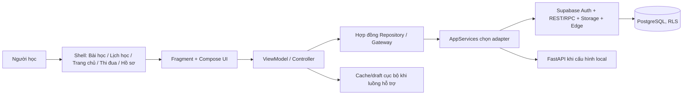

# Bản đồ luồng hoạt động AI Mentor

> Mốc mã nguồn: `origin/main` tại `7857061919aa23dc3e6d5069269cf7fffbd9985a` (25/11/2026). Số dòng dưới đây thuộc đúng commit này. Đây là bản đồ từ mã nguồn, không phải xác nhận đã thử mọi luồng trên thiết bị hay mọi dịch vụ cloud.

## Cách đọc

- Đường dẫn có dạng `tệp:Ldòng` và có thể bấm để mở mã nguồn trên GitHub tại commit cố định. Các dòng là điểm bắt đầu của hàm/lớp; đọc tiếp phần thân hàm để xem toàn bộ nhánh xử lý.
- `UI → ViewModel/controller → repository/gateway → RPC/API/bảng` là đường đi của thao tác. `AppServices` chọn adapter Supabase hoặc FastAPI theo cấu hình; đây là lựa chọn lúc khởi tạo, không phải tự động chuyển server khi mất mạng.
- Cột “Trạng thái” phân biệt code, dữ liệu local, dịch vụ online. Luồng online không tự trở thành offline chỉ vì có cache hoặc mock.

## Học code để trả lời ban giám khảo

**Câu trả lời khung:** “Người dùng thao tác ở màn UI; UI gọi ViewModel/Controller để giữ trạng thái và xử lý bất đồng bộ; ViewModel gọi Repository/Gateway theo hợp đồng; AppServices chọn adapter Supabase hoặc FastAPI; server kiểm tra quyền, lưu/chấm; kết quả quay lại ViewModel rồi UI vẽ lại.” Đi theo đúng thứ tự đó và chỉ mở 2–3 file tiêu biểu khi demo.

| Giám khảo hỏi | Câu trả lời ngắn và điểm mở code |
| --- | --- |
| App có những module gì? | 5 tab trong [ShellUi.kt:L30](../app/src/main/java/com/example/asm_final/ui/ShellUi.kt#L30); từng tab mở Fragment/Compose riêng. TeamOS là màn riêng, không phải một dịch vụ chạy độc lập trong app. |
| AI xử lý ở đâu? | App gửi yêu cầu qua [AppServices.java:L31](../app/src/main/java/com/example/asm_final/AppServices.java#L31) và [SupabaseTutorGateway.kt](../app/src/main/java/com/example/asm_final/supabase/SupabaseTutorGateway.kt); Edge [mentor-ai/index.ts:L20](../supabase/functions/mentor-ai/index.ts#L20) gọi mô hình và RPC. Chấm/lưu có phần server riêng; không nói toàn bộ AI chạy trên điện thoại. |
| Dữ liệu mỗi học sinh tách nhau thế nào? | Auth cung cấp UID; Repository dùng UID khi gọi API; SQL bật RLS/chính sách quyền. Ví dụ TeamOS RPC kiểm tra người gọi ở [teamos_member_invitations.sql:L4](../supabase/migrations/202611250003_teamos_member_invitations.sql#L4). |
| Làm bài dở rồi trở lại? | UI lịch sử [LibraryUi.kt:L928](../app/src/main/java/com/example/asm_final/ui/LibraryUi.kt#L928) hoặc ôn thi [ExamPrepViewModel.kt:L250](../app/src/main/java/com/example/asm_final/learning/ExamPrepViewModel.kt#L250) lấy phiên có trạng thái dở; mở lại cùng session ID. |
| Kiểm tra đầu vào bỏ bài đã biết thế nào? | [LessonViewModel.java:L750](../app/src/main/java/com/example/asm_final/learning/LessonViewModel.java#L750) giữ lựa chọn theo câu, [L787](../app/src/main/java/com/example/asm_final/learning/LessonViewModel.java#L787) nộp; server [adaptive_placement.sql](../supabase/migrations/202610300002_adaptive_placement.sql) quyết định tiến độ/bài cần học theo môn và lớp. |
| Vì sao TeamOS cần lời mời? | UI tìm tên [TeamOsUi.kt:L1264](../app/src/main/java/com/example/asm_final/ui/TeamOsUi.kt#L1264), ViewModel gửi [L294](../app/src/main/java/com/example/asm_final/learning/TeamOsViewModel.kt#L294), RPC đặt INVITED [teamos_member_invitations.sql:L4](../supabase/migrations/202611250003_teamos_member_invitations.sql#L4); người nhận chấp nhận mới ACTIVE [L15](../supabase/migrations/202611250003_teamos_member_invitations.sql#L15). |
| Mất mạng có dùng hết app không? | Không. Có các cache/nháp được thiết kế riêng, nhưng Auth, AI, chấm bài, bạn bè và TeamOS cần online. Mở [AppServices.java:L29](../app/src/main/java/com/example/asm_final/AppServices.java#L29) để giải thích adapter. |
| Tại sao có Android, FastAPI và Supabase? | Android là giao diện và trạng thái người dùng; FastAPI là backend thay thế trong cấu hình local; Supabase cung cấp Auth, PostgreSQL/RLS, Storage và Edge cho cấu hình online. App chọn triển khai qua [AppServices.java](../app/src/main/java/com/example/asm_final/AppServices.java). |

**Cách luyện 15 phút:** (1) mở ShellUi và AppServices; (2) chọn một luồng học bài, tự lần UI → VM → repository → SQL; (3) chọn một luồng AI; (4) chọn một luồng có quyền như TeamOS; (5) tự trả lời 8 câu trên mà không nhìn tài liệu. Khi chưa thử một luồng thực tế, nói rõ “đây là luồng theo code” thay vì khẳng định đã kiểm thử trên máy thật.

## Từ vựng để đọc code

- **Activity/Fragment:** màn hình và vòng đời Android.
- **Composable/UI:** vẽ nội dung, nhận thao tác, hiện trạng thái; không nên giữ quy tắc quyền hay gọi DB trực tiếp.
- **ViewModel/Controller:** giữ trạng thái màn, chống kết quả mạng cũ, gọi tác vụ bất đồng bộ.
- **Repository/Gateway:** hợp đồng đọc/ghi hoặc gửi yêu cầu AI; adapter online/local triển khai hợp đồng.
- **RPC:** hàm PostgreSQL gọi qua Supabase REST; nơi server kiểm tra quyền và tính kết quả.
- **RLS:** chính sách giới hạn các hàng người dùng được nhìn/thao tác.
- **Session/attempt:** một lần làm bài. Câu hỏi gốc và câu trả lời trong phiên là hai đối tượng khác nhau.
- **Migration:** file thay đổi cấu trúc/quy tắc DB. Có file trong Git không tự chứng minh đã chạy trên cloud.
## 1. Sơ đồ kiến trúc



**Điểm nối:** [AppServices.java:L9](../app/src/main/java/com/example/asm_final/AppServices.java#L9) là composition root; [L29](../app/src/main/java/com/example/asm_final/AppServices.java#L29) chọn tutor, account, chat, hồ sơ, bạn bè và TeamOS; [L174](../app/src/main/java/com/example/asm_final/AppServices.java#L174) chọn thư viện, AI practice, ôn thi và lịch. [ShellUi.kt:L30](../app/src/main/java/com/example/asm_final/ui/ShellUi.kt#L30) điều hướng 5 tab. [HomeActivity.java:L9](../app/src/main/java/com/example/asm_final/activities/HomeActivity.java#L9) là Activity chứa shell.

## 2. Tài khoản, hồ sơ học sinh và cài đặt

| Chức năng | Luồng và quan hệ | Mã nguồn chính |
| --- | --- | --- |
| Đăng ký/đăng nhập | Form → account access/authenticator → Supabase Auth khi bật Supabase; hồ sơ học tập gắn với định danh đăng nhập. | [RegisterActivity.java](../app/src/main/java/com/example/asm_final/activities/RegisterActivity.java), [AccountAccess.java](../app/src/main/java/com/example/asm_final/accounts/AccountAccess.java), [SupabaseAccounts.kt](../app/src/main/java/com/example/asm_final/supabase/SupabaseAccounts.kt), [AppServices.java:L44](../app/src/main/java/com/example/asm_final/AppServices.java#L44) |
| Xác thực email/quên mật khẩu | Callback hoặc liên kết khôi phục → dịch vụ recovery; callback phải khớp cấu hình Auth của project. | [AuthCallback.java](../app/src/main/java/com/example/asm_final/accounts/AuthCallback.java), [AuthRecoveryActivity.java](../app/src/main/java/com/example/asm_final/activities/AuthRecoveryActivity.java), [SupabaseRecoveryService.java](../app/src/main/java/com/example/asm_final/supabase/SupabaseRecoveryService.java) |
| Hồ sơ và ảnh | Tab Hồ sơ → ProfileHubFragment → ProfileUi → UserProfileRepository; bản online dùng SupabaseUserProfiles. Trạng thái bạn bè được tải riêng. | [ProfileHubFragment.java:L20](../app/src/main/java/com/example/asm_final/activities/fragments/ProfileHubFragment.java#L20), [ProfileUi.kt:L147](../app/src/main/java/com/example/asm_final/ui/ProfileUi.kt#L147), [SupabaseUserProfiles.kt](../app/src/main/java/com/example/asm_final/supabase/SupabaseUserProfiles.kt) |
| Thiết lập lớp/môn | Learner setup → LearnerProfileRepository; lựa chọn môn đi vào lộ trình và thống kê. | [LearnerSetupModel.java](../app/src/main/java/com/example/asm_final/onboarding/LearnerSetupModel.java), [SupabaseLearnerProfiles.kt](../app/src/main/java/com/example/asm_final/supabase/SupabaseLearnerProfiles.kt), [EnrollmentSelection.java](../app/src/main/java/com/example/asm_final/learning/EnrollmentSelection.java) |

**Dữ liệu:** `mentor_profiles`, `mentor_preferences` ở [foundation.sql:L4](../supabase/migrations/202610290001_foundation.sql#L4); hồ sơ riêng qua `mentor_update_profile` ở [editable_profile_bio.sql:L2](../supabase/migrations/202610300004_editable_profile_bio.sql#L2). Không đưa mật khẩu hay service-role key vào tài liệu.

## 3. Trang chủ, thống kê, streak và huy hiệu

Tab Trang chủ → [HomeFragment.java:L18](../app/src/main/java/com/example/asm_final/activities/fragments/HomeFragment.java#L18) → [OverviewUi.kt:L65](../app/src/main/java/com/example/asm_final/ui/OverviewUi.kt#L65) → [LearningOverviewRepository.java](../app/src/main/java/com/example/asm_final/dashboard/LearningOverviewRepository.java). Realtime đi qua [OverviewLiveBinding.java](../app/src/main/java/com/example/asm_final/dashboard/OverviewLiveBinding.java) và [SupabaseEventStream.kt](../app/src/main/java/com/example/asm_final/supabase/SupabaseEventStream.kt). Tổng quan lấy từ `mentor_overview` ở [selected_progress_and_rank.sql:L1](../supabase/migrations/202610290013_selected_progress_and_rank.sql#L1); thời gian học và huy hiệu dựa vào ledger ở [study_ledger_badges.sql:L3](../supabase/migrations/202610290015_study_ledger_badges.sql#L3). Quan hệ quan trọng: hoàn thành bài/đề tạo bằng chứng học → tổng quan/thi đua đọc lại; hiển thị không phải nguồn chấm điểm.

## 4. Bài học, chín môn và kiểm tra đầu vào

Chọn tab Bài học → [LessonHubFragment.java:L14](../app/src/main/java/com/example/asm_final/activities/fragments/LessonHubFragment.java#L14) → [SubjectHubUi.kt:L163](../app/src/main/java/com/example/asm_final/ui/SubjectHubUi.kt#L163) → danh mục môn [SubjectModules.java](../app/src/main/java/com/example/asm_final/learning/SubjectModules.java). Chọn môn/lớp tạo scope theo người, môn, lớp ở [LessonViewModel.java:L167](../app/src/main/java/com/example/asm_final/learning/LessonViewModel.java#L167); [L313](../app/src/main/java/com/example/asm_final/learning/LessonViewModel.java#L313) bind tài khoản. Giao diện bài tại [LearningUi.kt:L216](../app/src/main/java/com/example/asm_final/ui/LearningUi.kt#L216).

- **Bắt đầu:** [LessonViewModel.java:L608](../app/src/main/java/com/example/asm_final/learning/LessonViewModel.java#L608) mở bài/placement; [L638](../app/src/main/java/com/example/asm_final/learning/LessonViewModel.java#L638) chọn học từ đầu. RPC `mentor_choose_learning_start` ở [start_course_from_beginning.sql:L5](../supabase/migrations/202611160005_start_course_from_beginning.sql#L5).
- **Kiểm tra đầu vào:** [L708](../app/src/main/java/com/example/asm_final/learning/LessonViewModel.java#L708) và [L720](../app/src/main/java/com/example/asm_final/learning/LessonViewModel.java#L720) điều hướng câu; [L750](../app/src/main/java/com/example/asm_final/learning/LessonViewModel.java#L750) ghi lựa chọn; [L787](../app/src/main/java/com/example/asm_final/learning/LessonViewModel.java#L787) nộp. Chính sách/SQL ở [adaptive_placement.sql](../supabase/migrations/202610300002_adaptive_placement.sql).
- **Làm bài học:** [LearningUi.kt:L442](../app/src/main/java/com/example/asm_final/ui/LearningUi.kt#L442) hiện câu; [LessonViewModel.java:L816](../app/src/main/java/com/example/asm_final/learning/LessonViewModel.java#L816) lưu; [L840](../app/src/main/java/com/example/asm_final/learning/LessonViewModel.java#L840) hoàn thành; [L654](../app/src/main/java/com/example/asm_final/learning/LessonViewModel.java#L654) tiếp tục. Backend online gọi [SupabaseLessonApiClient.kt](../app/src/main/java/com/example/asm_final/supabase/SupabaseLessonApiClient.kt) → `mentor_learning_api` tại [lesson_answer_explanations.sql:L46](../supabase/migrations/202611150003_lesson_answer_explanations.sql#L46).
- **Dữ liệu môn:** [core/learning-core/SubjectCatalog.java](../core/learning-core/src/main/java/com/example/mentor/learning/SubjectCatalog.java) là hợp đồng danh mục; 9 module trong `subjects/` cung cấp định danh/màu/công cụ. Nội dung học ở `mentor_course_units` [learning.sql:L2](../supabase/migrations/202610290003_learning.sql#L2); tiến độ qua `mentor_enrollments`, `mentor_attempts`, `mentor_completions` cùng file.
- **Công cụ môn:** Toán dùng [CalculatorEngine.java](../subjects/math/src/main/java/com/example/mathmodule/calculator/CalculatorEngine.java), [MatrixEngine.java](../subjects/math/src/main/java/com/example/mathmodule/calculator/MatrixEngine.java), [StatisticsEngine.java](../subjects/math/src/main/java/com/example/mathmodule/calculator/StatisticsEngine.java); Hóa dùng [PeriodicTableActivity.java](../subjects/chemistry/src/main/java/com/example/mentor/chemistry/presentation/PeriodicTableActivity.java); Lý dùng [CircuitDiagramActivity.java](../subjects/physics/src/main/java/com/example/mentor/physics/presentation/CircuitDiagramActivity.java). Các công cụ này thuộc môn, không chấm thay luồng bài học.

## 5. Thư viện bài tập, kho câu hỏi và sổ lỗi sai

[LibraryUi.kt:L258](../app/src/main/java/com/example/asm_final/ui/LibraryUi.kt#L258) chọn môn; [L402](../app/src/main/java/com/example/asm_final/ui/LibraryUi.kt#L402) mở kho/bộ đề; [L928](../app/src/main/java/com/example/asm_final/ui/LibraryUi.kt#L928) xem lịch sử và tiếp tục bài dở; [L1006](../app/src/main/java/com/example/asm_final/ui/LibraryUi.kt#L1006) làm bài; [L1400](../app/src/main/java/com/example/asm_final/ui/LibraryUi.kt#L1400) mở sổ lỗi sai. Logic phiên ở [LibraryPracticeController.kt](../app/src/main/java/com/example/asm_final/learning/LibraryPracticeController.kt), hợp đồng ở [LibraryRepository.kt](../app/src/main/java/com/example/asm_final/learning/LibraryRepository.kt), bản online ở [SupabaseLibraryRepository.kt](../app/src/main/java/com/example/asm_final/learning/SupabaseLibraryRepository.kt). RPC `mentor_library_api` ở [allow_standalone_practice.sql:L3](../supabase/migrations/202611160008_allow_standalone_practice.sql#L3); bảng `mentor_library_quizzes`, `mentor_practice_sessions`, `mentor_wrong_questions` ở [practice_library.sql:L3](../supabase/migrations/202610290016_practice_library.sql#L3). Kho câu hỏi là nguồn câu; bộ đề là nhóm/phiên dùng câu; sổ lỗi sai là lịch sử cá nhân phát sinh sau khi trả lời.

## 6. Ôn thi tập trung, đề có giờ và tự luận

[ExamPrepUi.kt:L41](../app/src/main/java/com/example/asm_final/ui/ExamPrepUi.kt#L41) → [ExamPrepViewModel.kt:L94](../app/src/main/java/com/example/asm_final/learning/ExamPrepViewModel.kt#L94): [L184](../app/src/main/java/com/example/asm_final/learning/ExamPrepViewModel.kt#L184) tải đề, [L250](../app/src/main/java/com/example/asm_final/learning/ExamPrepViewModel.kt#L250) lịch sử, [L308](../app/src/main/java/com/example/asm_final/learning/ExamPrepViewModel.kt#L308) bắt đầu/tiếp tục, [L454](../app/src/main/java/com/example/asm_final/learning/ExamPrepViewModel.kt#L454) đồng hồ, [L539](../app/src/main/java/com/example/asm_final/learning/ExamPrepViewModel.kt#L539) và [L551](../app/src/main/java/com/example/asm_final/learning/ExamPrepViewModel.kt#L551) chọn đáp án/tự luận, [L695](../app/src/main/java/com/example/asm_final/learning/ExamPrepViewModel.kt#L695) xác nhận, [L703](../app/src/main/java/com/example/asm_final/learning/ExamPrepViewModel.kt#L703) nộp, [L832](../app/src/main/java/com/example/asm_final/learning/ExamPrepViewModel.kt#L832) giải thích thêm khi xem lại. Repository [ExamRepository.kt](../app/src/main/java/com/example/asm_final/learning/ExamRepository.kt) → [SupabaseExamRepository.kt](../app/src/main/java/com/example/asm_final/learning/SupabaseExamRepository.kt) → `mentor_exam_api` [grade12_exam_ai_essay.sql:L139](../supabase/migrations/202611170003_grade12_exam_ai_essay.sql#L139). `mentor_exams` và `mentor_exam_sessions` ở [exams_and_durable_schema.sql:L13](../supabase/migrations/202611010002_exams_and_durable_schema.sql#L13). Tự luận dùng bước chấm AI riêng, nên có trạng thái chờ/thử lại [ExamPrepViewModel.kt:L799](../app/src/main/java/com/example/asm_final/learning/ExamPrepViewModel.kt#L799).

## 7. Luyện cùng AI, báo lỗi câu và Xưởng phá mệnh đề

[AiPracticeUi.kt:L35](../app/src/main/java/com/example/asm_final/ui/AiPracticeUi.kt#L35) → [AiPracticeViewModel.kt:L158](../app/src/main/java/com/example/asm_final/learning/AiPracticeViewModel.kt#L158) tạo phiên; [L329](../app/src/main/java/com/example/asm_final/learning/AiPracticeViewModel.kt#L329) trả lời, [L368](../app/src/main/java/com/example/asm_final/learning/AiPracticeViewModel.kt#L368) bỏ qua, [L427](../app/src/main/java/com/example/asm_final/learning/AiPracticeViewModel.kt#L427) hoàn tất, [L507](../app/src/main/java/com/example/asm_final/learning/AiPracticeViewModel.kt#L507) phản hồi câu, [L533](../app/src/main/java/com/example/asm_final/learning/AiPracticeViewModel.kt#L533) hỏi thêm AI. Lịch sử [L236](../app/src/main/java/com/example/asm_final/learning/AiPracticeViewModel.kt#L236) và [L274](../app/src/main/java/com/example/asm_final/learning/AiPracticeViewModel.kt#L274). Repository [AiPracticeRepository.kt](../app/src/main/java/com/example/asm_final/learning/AiPracticeRepository.kt) → [SupabaseAiPracticeRepository.kt](../app/src/main/java/com/example/asm_final/learning/SupabaseAiPracticeRepository.kt) → Edge [mentor-ai/index.ts:L20](../supabase/functions/mentor-ai/index.ts#L20) và RPC [server_ai_practice_api.sql:L49](../supabase/migrations/202611160003_server_ai_practice_api.sql#L49).

**Xưởng phá mệnh đề:** từ câu Toán trả lời sai → [MisconceptionBusterUi.kt:L23](../app/src/main/java/com/example/asm_final/ui/MisconceptionBusterUi.kt#L23), 4 bước tại L107/L233/L309/L412 → [MisconceptionViewModel.kt:L29](../app/src/main/java/com/example/asm_final/learning/MisconceptionViewModel.kt#L29), chọn lý do [L180](../app/src/main/java/com/example/asm_final/learning/MisconceptionViewModel.kt#L180), kiểm chứng [L231](../app/src/main/java/com/example/asm_final/learning/MisconceptionViewModel.kt#L231), đồng bộ bản nháp [L122](../app/src/main/java/com/example/asm_final/learning/MisconceptionViewModel.kt#L122) → [MisconceptionRepository.kt](../app/src/main/java/com/example/asm_final/learning/MisconceptionRepository.kt) → `mentor_misconception_api` [misconception_buster_api.sql:L87](../supabase/migrations/202611210002_misconception_buster_api.sql#L87). Server giữ catalog và đáp án kiểm chứng; trạng thái RESOLVED không tự cộng EXP.

## 8. Chat học tập và hiển thị công thức

[GeneralChatFragment.java](../app/src/main/java/com/example/asm_final/activities/fragments/GeneralChatFragment.java) và [ChatUi.kt](../app/src/main/java/com/example/asm_final/ui/ChatUi.kt) → [ChatViewModel.java:L173](../app/src/main/java/com/example/asm_final/chat/ChatViewModel.java#L173) gắn tài khoản; [L270](../app/src/main/java/com/example/asm_final/chat/ChatViewModel.java#L270) chọn hội thoại; [L431](../app/src/main/java/com/example/asm_final/chat/ChatViewModel.java#L431) đính kèm; [L539](../app/src/main/java/com/example/asm_final/chat/ChatViewModel.java#L539) hủy tải; [L552](../app/src/main/java/com/example/asm_final/chat/ChatViewModel.java#L552) gửi; [L556](../app/src/main/java/com/example/asm_final/chat/ChatViewModel.java#L556) thử lại. ChatStore [ChatStore.java](../app/src/main/java/com/example/asm_final/chat/ChatStore.java) → [SupabaseChatStore.kt](../app/src/main/java/com/example/asm_final/supabase/SupabaseChatStore.kt); TutorGateway qua [AppServices.java:L31](../app/src/main/java/com/example/asm_final/AppServices.java#L31) → [SupabaseTutorGateway.kt](../app/src/main/java/com/example/asm_final/supabase/SupabaseTutorGateway.kt) → Edge mentor-ai. Công thức qua [ChatAnswerView.kt](../app/src/main/java/com/example/asm_final/ui/ChatAnswerView.kt), [ChatAnswerMarkup.kt](../app/src/main/java/com/example/asm_final/chat/ChatAnswerMarkup.kt) và KaTeX trong `core/ui-core/src/main/assets/katex/`. Bảng lưu luồng chat ở [chat_storage.sql:L2](../supabase/migrations/202610290007_chat_storage.sql#L2).

## 9. Lịch học 7 ngày, việc cần làm và gợi ý ôn thi

[ScheduleFragment.kt](../schedule/src/main/java/com/example/mentor/schedule/ui/ScheduleFragment.kt) → [ScheduleScreen.kt](../schedule/src/main/java/com/example/mentor/schedule/ui/ScheduleScreen.kt) → [ScheduleViewModel.kt](../schedule/src/main/java/com/example/mentor/schedule/ui/ScheduleViewModel.kt) → [ScheduleRepository.kt](../schedule/src/main/java/com/example/mentor/schedule/domain/ScheduleRepository.kt). Bản online [SupabaseScheduleRepository.kt:L11](../app/src/main/java/com/example/asm_final/supabase/SupabaseScheduleRepository.kt#L11) gọi `mentor_schedule_action` [L22](../app/src/main/java/com/example/asm_final/supabase/SupabaseScheduleRepository.kt#L22); bản cục bộ [ScheduleRepositoryImpl.kt](../schedule/src/main/java/com/example/mentor/schedule/data/ScheduleRepositoryImpl.kt). UI việc cần làm [DailyTodoList.kt](../schedule/src/main/java/com/example/mentor/schedule/ui/DailyTodoList.kt); dữ liệu `mentor_todos` [schedule.sql:L3](../supabase/migrations/202610290002_schedule.sql#L3). Gợi ý AI/lộ trình thi dùng [ScheduleAiHost.kt](../schedule/src/main/java/com/example/mentor/schedule/ui/ScheduleAiHost.kt), [ExamPlanImportUi.kt](../app/src/main/java/com/example/asm_final/ui/ExamPlanImportUi.kt), [ExamPlanProposal.kt](../app/src/main/java/com/example/asm_final/chat/ExamPlanProposal.kt). `ScheduleReadCache.kt` lưu bản đọc; thao tác ghi vẫn cần xác nhận từ server để tránh giả thành công.

## 10. Thi đua, bạn bè và hồ sơ công khai

[CompetitionFragment.java:L18](../app/src/main/java/com/example/asm_final/activities/fragments/CompetitionFragment.java#L18) → [CompetitionUi.kt](../app/src/main/java/com/example/asm_final/ui/CompetitionUi.kt) → [CompetitionViewModel.java](../app/src/main/java/com/example/asm_final/competition/CompetitionViewModel.java) → [CompetitionRepository.java](../app/src/main/java/com/example/asm_final/competition/CompetitionRepository.java) → Supabase/Backend adapter trong AppServices. Bạn bè mở từ Hồ sơ: [FriendsUi.kt](../app/src/main/java/com/example/asm_final/ui/FriendsUi.kt) → [FriendsViewModel.java:L108](../app/src/main/java/com/example/asm_final/competition/FriendsViewModel.java#L108) tìm; [L181](../app/src/main/java/com/example/asm_final/competition/FriendsViewModel.java#L181) gửi lời mời; [L185](../app/src/main/java/com/example/asm_final/competition/FriendsViewModel.java#L185) phản hồi; [L190](../app/src/main/java/com/example/asm_final/competition/FriendsViewModel.java#L190) xóa. [SupabaseLearnerSearch.java:L25](../app/src/main/java/com/example/asm_final/competition/SupabaseLearnerSearch.java#L25) gọi `mentor_search_learners` [learner_name_search.sql:L4](../supabase/migrations/202611250004_learner_name_search.sql#L4). `mentor_friendships` ở [overview_social.sql:L20](../supabase/migrations/202610290005_overview_social.sql#L20); streak chung ở [friend_shared_streaks.sql:L12](../supabase/migrations/202611160004_friend_shared_streaks.sql#L12).

## 11. TeamOS: nhóm, lời mời, tệp, nhiệm vụ và cảnh báo

[TeamOsFragment.kt:L26](../app/src/main/java/com/example/asm_final/activities/fragments/TeamOsFragment.kt#L26) → [TeamOsUi.kt:L47](../app/src/main/java/com/example/asm_final/ui/TeamOsUi.kt#L47) → [TeamOsViewModel.kt:L39](../app/src/main/java/com/example/asm_final/learning/TeamOsViewModel.kt#L39) → [TeamOsRepository.kt](../app/src/main/java/com/example/asm_final/learning/TeamOsRepository.kt) → [SupabaseTeamOsRepository.kt:L16](../app/src/main/java/com/example/asm_final/supabase/SupabaseTeamOsRepository.kt#L16).

| Chức năng | Luồng chi tiết và quan hệ |
| --- | --- |
| Dự án | Danh sách [UI L192](../app/src/main/java/com/example/asm_final/ui/TeamOsUi.kt#L192) → [VM L159](../app/src/main/java/com/example/asm_final/learning/TeamOsViewModel.kt#L159) tải; tạo ở [VM L266](../app/src/main/java/com/example/asm_final/learning/TeamOsViewModel.kt#L266) → [remote L46](../app/src/main/java/com/example/asm_final/supabase/SupabaseTeamOsRepository.kt#L46). |
| Mời người | [AddMemberDialog L1264](../app/src/main/java/com/example/asm_final/ui/TeamOsUi.kt#L1264) nhập tên → [VM L102](../app/src/main/java/com/example/asm_final/learning/TeamOsViewModel.kt#L102) tìm → learner directory/RPC tên → [VM L294](../app/src/main/java/com/example/asm_final/learning/TeamOsViewModel.kt#L294) gửi → [remote L267](../app/src/main/java/com/example/asm_final/supabase/SupabaseTeamOsRepository.kt#L267) → [RPC invite L4](../supabase/migrations/202611250003_teamos_member_invitations.sql#L4). Người nhận ở trạng thái INVITED, chưa có quyền dự án. |
| Nhận lời mời | [VM L199](../app/src/main/java/com/example/asm_final/learning/TeamOsViewModel.kt#L199) → [remote L155](../app/src/main/java/com/example/asm_final/supabase/SupabaseTeamOsRepository.kt#L155) → [RPC respond L15](../supabase/migrations/202611250003_teamos_member_invitations.sql#L15). Chấp nhận mới ACTIVE; từ chối REMOVED. |
| Đổi quyền/xóa người | [Members tab L561](../app/src/main/java/com/example/asm_final/ui/TeamOsUi.kt#L561) xác nhận → [VM L350](../app/src/main/java/com/example/asm_final/learning/TeamOsViewModel.kt#L350)/[L324](../app/src/main/java/com/example/asm_final/learning/TeamOsViewModel.kt#L324) → [RPC role L25](../supabase/migrations/202611250003_teamos_member_invitations.sql#L25)/[remove L35](../supabase/migrations/202611250003_teamos_member_invitations.sql#L35). Owner không bị đổi/xóa qua luồng này. |
| Tệp thật | [Documents tab L792](../app/src/main/java/com/example/asm_final/ui/TeamOsUi.kt#L792) → [Upload dialog L1450](../app/src/main/java/com/example/asm_final/ui/TeamOsUi.kt#L1450) → [VM L427](../app/src/main/java/com/example/asm_final/learning/TeamOsViewModel.kt#L427) → [remote L340](../app/src/main/java/com/example/asm_final/supabase/SupabaseTeamOsRepository.kt#L340) → [SupabaseStorage.kt](../app/src/main/java/com/example/asm_final/supabase/SupabaseStorage.kt), metadata `mentor_team_documents`. |
| Nhiệm vụ/phụ thuộc | [Tasks tab L934](../app/src/main/java/com/example/asm_final/ui/TeamOsUi.kt#L934) → [VM L526](../app/src/main/java/com/example/asm_final/learning/TeamOsViewModel.kt#L526) tạo, [L583](../app/src/main/java/com/example/asm_final/learning/TeamOsViewModel.kt#L583) phụ thuộc, [L618](../app/src/main/java/com/example/asm_final/learning/TeamOsViewModel.kt#L618) trạng thái → các bảng team task/dependency. Trên main, tạo yêu cầu và nhiệm vụ còn nhận tệp tùy chọn: [VM yêu cầu L366](../app/src/main/java/com/example/asm_final/learning/TeamOsViewModel.kt#L366), [VM nhiệm vụ L526](../app/src/main/java/com/example/asm_final/learning/TeamOsViewModel.kt#L526), [dialog yêu cầu L1334](../app/src/main/java/com/example/asm_final/ui/TeamOsUi.kt#L1334), [dialog nhiệm vụ L1608](../app/src/main/java/com/example/asm_final/ui/TeamOsUi.kt#L1608). |
| Phân tích thiếu sót | [Warnings tab L1087](../app/src/main/java/com/example/asm_final/ui/TeamOsUi.kt#L1087) → [VM L647](../app/src/main/java/com/example/asm_final/learning/TeamOsViewModel.kt#L647) phân tích → [L667](../app/src/main/java/com/example/asm_final/learning/TeamOsViewModel.kt#L667) người dùng duyệt cảnh báo. |
| Xóa dự án | UI xác nhận tên/mật khẩu → [VM L462](../app/src/main/java/com/example/asm_final/learning/TeamOsViewModel.kt#L462) → [remote L373](../app/src/main/java/com/example/asm_final/supabase/SupabaseTeamOsRepository.kt#L373); dọn tệp sau xóa DB [L403](../app/src/main/java/com/example/asm_final/supabase/SupabaseTeamOsRepository.kt#L403), job [mentor-team-cleanup/index.ts](../supabase/functions/mentor-team-cleanup/index.ts). |

Schema TeamOS tại [teamos_complete_schema.sql:L12](../supabase/migrations/202611220002_teamos_complete_schema.sql#L12); Storage/quyền tại [teamos_file_storage.sql](../supabase/migrations/202611250001_teamos_file_storage.sql); hàng đợi dọn tệp tại [team_file_cleanup.sql:L2](../supabase/migrations/202611250002_team_file_cleanup.sql#L2). Những quan hệ này cho thấy tên người dùng lấy từ hồ sơ công khai, còn vai trò thành viên nằm riêng trong bảng thành viên dự án.

## 12. Online, offline, đồng bộ và lỗi

- `SupabaseHttp.enabled` và [AppServices.java:L29](../app/src/main/java/com/example/asm_final/AppServices.java#L29) quyết định adapter theo cấu hình. Khi online lỗi, không tự chuyển tất cả dữ liệu sang FastAPI/local.
- [ScheduleReadCache.kt](../app/src/main/java/com/example/asm_final/supabase/ScheduleReadCache.kt) và [OfflineLessonUi.kt](../app/src/main/java/com/example/asm_final/ui/OfflineLessonUi.kt) phục vụ các luồng đọc/offline được viết riêng. Các hành động chấm bài, Auth, TeamOS, bạn bè và AI vẫn phụ thuộc dịch vụ trực tuyến.
- [MisconceptionViewModel.kt:L80](../app/src/main/java/com/example/asm_final/learning/MisconceptionViewModel.kt#L80) theo dõi mạng để đồng bộ nháp xưởng phá mệnh đề; chỉ server mới xác nhận RESOLVED.
- [SupabaseEventStream.kt](../app/src/main/java/com/example/asm_final/supabase/SupabaseEventStream.kt) phát sự kiện cập nhật cho tổng quan, bạn bè, thi đua; màn đang mở cần refresh từ repository sau sự kiện.

## 13. Ranh giới dữ liệu và các luồng liên thông

| Nguồn | Được dùng bởi | Điều cần giữ đúng |
| --- | --- | --- |
| Auth UID / profile ID | Hồ sơ, bạn bè, TeamOS, học tập | Không lấy dữ liệu tài khoản cũ sau khi đổi người dùng; local owner ID và UUID Supabase phải được ánh xạ. |
| Môn + lớp + enrollment | Lộ trình, bài học, thư viện, đề, AI | Scope theo cả người, môn và lớp; chọn học từ đầu ở một môn không đổi môn khác. |
| Câu hỏi/đề | Thư viện, ôn thi, AI practice, sổ lỗi sai | Câu hỏi gốc khác phiên trả lời và khác mục lỗi sai của riêng người học. |
| Study ledger | Tổng quan, streak, huy hiệu, thi đua | Chỉ sự kiện hợp lệ trên server thay đổi thành tích; UI không tự cộng. |
| Team project/member/document/task | TeamOS | Chỉ thành viên ACTIVE được truy cập; tệp Storage và metadata DB là hai phần cần dọn nhất quán. |
| Edge mentor-ai | Chat, AI practice, lịch ôn, giải thích | Phụ thuộc đăng nhập, quota, secret và chất lượng phản hồi; code client không chứng minh cloud đã triển khai cùng phiên bản. |

## 14. Tình trạng xác minh của tài liệu

- **Đã đối chiếu mã nguồn:** các đường dẫn và dòng của commit trên; chỉ mục dưới đây được sinh trực tiếp từ source của cùng commit.
- **Chưa thử trong lần lập tài liệu này:** APK, máy thật, hai tài khoản TeamOS, AI trả lời, email và các luồng mất mạng. Không diễn giải bản đồ mã nguồn là kết quả test.
- **Cloud:** migration history và Edge version cần đối chiếu riêng trước khi kết luận đã deploy; README cũng phân biệt rõ code/local/cloud/deploy.

## 15. Ba ví dụ lần theo code trước khi thuyết trình

### A. Học từ đầu một môn

1. Mở [LessonHubFragment.java:L14](../app/src/main/java/com/example/asm_final/activities/fragments/LessonHubFragment.java#L14) để thấy tab Bài học gắn UI, rồi [SubjectHubUi.kt:L163](../app/src/main/java/com/example/asm_final/ui/SubjectHubUi.kt#L163) để thấy lựa chọn môn.
2. [LessonViewModel.java:L313](../app/src/main/java/com/example/asm_final/learning/LessonViewModel.java#L313) ràng buộc người, môn và lớp; [L638](../app/src/main/java/com/example/asm_final/learning/LessonViewModel.java#L638) xử lý học từ đầu.
3. [SupabaseLessonApiClient.kt](../app/src/main/java/com/example/asm_final/supabase/SupabaseLessonApiClient.kt) gửi yêu cầu; [RPC mentor_choose_learning_start](../supabase/migrations/202611160005_start_course_from_beginning.sql#L5) quyết định enrollment trên server.
4. [LearningUi.kt:L442](../app/src/main/java/com/example/asm_final/ui/LearningUi.kt#L442) vẽ câu, [LessonViewModel.java:L816](../app/src/main/java/com/example/asm_final/learning/LessonViewModel.java#L816) lưu, [L840](../app/src/main/java/com/example/asm_final/learning/LessonViewModel.java#L840) hoàn thành. Dữ liệu nguồn và tiến độ ở [learning.sql](../supabase/migrations/202610290003_learning.sql).

**Trả lời ngắn:** Chọn học từ đầu chỉ tác động enrollment của môn/lớp đang chọn. Server quyết định lộ trình; UI tải lại và hiển thị.

### B. Tạo quiz AI và hỏi giải thích

1. [AiPracticeUi.kt:L35](../app/src/main/java/com/example/asm_final/ui/AiPracticeUi.kt#L35) nhận môn, lớp, chủ đề, số câu; [AiPracticeViewModel.kt:L158](../app/src/main/java/com/example/asm_final/learning/AiPracticeViewModel.kt#L158) tạo phiên.
2. Repository ở [AiPracticeRepository.kt](../app/src/main/java/com/example/asm_final/learning/AiPracticeRepository.kt) nối tới [Edge mentor-ai/index.ts:L20](../supabase/functions/mentor-ai/index.ts#L20); server dùng [mentor_ai_practice_api](../supabase/migrations/202611160003_server_ai_practice_api.sql#L49) để giữ phiên.
3. [AiPracticeViewModel.kt:L329](../app/src/main/java/com/example/asm_final/learning/AiPracticeViewModel.kt#L329) nộp câu; [L533](../app/src/main/java/com/example/asm_final/learning/AiPracticeViewModel.kt#L533) xin giải thích; [L507](../app/src/main/java/com/example/asm_final/learning/AiPracticeViewModel.kt#L507) báo lỗi câu. [ChatAnswerView.kt](../app/src/main/java/com/example/asm_final/ui/ChatAnswerView.kt) vẽ công thức.

**Trả lời ngắn:** AI tạo nội dung; phiên, đáp án và phản hồi được lưu riêng để có lịch sử và kiểm tra lại.

### C. Tìm tên và mời người vào TeamOS

1. [AddMemberDialog:L1264](../app/src/main/java/com/example/asm_final/ui/TeamOsUi.kt#L1264) nhận tên; [TeamOsViewModel.kt:L102](../app/src/main/java/com/example/asm_final/learning/TeamOsViewModel.kt#L102) chống kết quả tìm kiếm cũ về muộn.
2. [SupabaseLearnerSearch.java:L25](../app/src/main/java/com/example/asm_final/competition/SupabaseLearnerSearch.java#L25) gọi [mentor_search_learners](../supabase/migrations/202611250004_learner_name_search.sql#L4), trả ID và tên, hỗ trợ tên không dấu.
3. [TeamOsViewModel.kt:L294](../app/src/main/java/com/example/asm_final/learning/TeamOsViewModel.kt#L294) gửi lời mời; [SupabaseTeamOsRepository.kt:L267](../app/src/main/java/com/example/asm_final/supabase/SupabaseTeamOsRepository.kt#L267) gọi [mentor_team_invite](../supabase/migrations/202611250003_teamos_member_invitations.sql#L4). Người được mời còn ở trạng thái INVITED.
4. Người nhận chấp nhận qua [TeamOsViewModel.kt:L199](../app/src/main/java/com/example/asm_final/learning/TeamOsViewModel.kt#L199) và [mentor_team_respond_invite](../supabase/migrations/202611250003_teamos_member_invitations.sql#L15); [mentor_is_team_active_member](../supabase/migrations/202611220002_teamos_complete_schema.sql#L192) bảo vệ dữ liệu nhóm.

**Trả lời ngắn:** Tên chỉ giúp tìm; UUID xác định đúng người; quyền thật được cấp sau khi người nhận chấp nhận và được kiểm tra ở database.
## Phụ lục A — chỉ mục điểm vào mã nguồn

Chỉ mục bên dưới liệt kê các lớp/hàm có khả năng là điểm vào của chức năng. Nó giúp tìm dòng hiện hành; các hàm nội bộ không được liệt kê đều có thể xem từ đường dẫn tương ứng.


| Thành phần | Điểm vào/hàm và dòng trong main |
| --- | --- |
| app/src/main/java/com/example/asm_final/accounts/AccountAccess.java | [AccountAccess](../app/src/main/java/com/example/asm_final/accounts/AccountAccess.java#L10), [IMPORT_LOCK](../app/src/main/java/com/example/asm_final/accounts/AccountAccess.java#L14), [signIn](../app/src/main/java/com/example/asm_final/accounts/AccountAccess.java#L23), [register](../app/src/main/java/com/example/asm_final/accounts/AccountAccess.java#L33), [ticket](../app/src/main/java/com/example/asm_final/accounts/AccountAccess.java#L42), [restore](../app/src/main/java/com/example/asm_final/accounts/AccountAccess.java#L47), [importIdentity](../app/src/main/java/com/example/asm_final/accounts/AccountAccess.java#L69) |
| app/src/main/java/com/example/asm_final/accounts/AccountLookup.java | [AccountLookup](../app/src/main/java/com/example/asm_final/accounts/AccountLookup.java#L3) |
| app/src/main/java/com/example/asm_final/accounts/AccountRepository.java | [AccountRepository](../app/src/main/java/com/example/asm_final/accounts/AccountRepository.java#L4) |
| app/src/main/java/com/example/asm_final/accounts/AuthCallback.java | [AuthCallback](../app/src/main/java/com/example/asm_final/accounts/AuthCallback.java#L10), [parse](../app/src/main/java/com/example/asm_final/accounts/AuthCallback.java#L15), [read](../app/src/main/java/com/example/asm_final/accounts/AuthCallback.java#L35) |
| app/src/main/java/com/example/asm_final/accounts/AuthFormModel.java | [AuthFormModel](../app/src/main/java/com/example/asm_final/accounts/AuthFormModel.java#L8), [State](../app/src/main/java/com/example/asm_final/accounts/AuthFormModel.java#L12), [submit](../app/src/main/java/com/example/asm_final/accounts/AuthFormModel.java#L26), [consumed](../app/src/main/java/com/example/asm_final/accounts/AuthFormModel.java#L60), [onCleared](../app/src/main/java/com/example/asm_final/accounts/AuthFormModel.java#L67) |
| app/src/main/java/com/example/asm_final/accounts/AuthRoutes.java | [AuthRoutes](../app/src/main/java/com/example/asm_final/accounts/AuthRoutes.java#L8), [open](../app/src/main/java/com/example/asm_final/accounts/AuthRoutes.java#L11), [login](../app/src/main/java/com/example/asm_final/accounts/AuthRoutes.java#L26) |
| app/src/main/java/com/example/asm_final/accounts/AuthSession.java | [AuthSession](../app/src/main/java/com/example/asm_final/accounts/AuthSession.java#L7), [open](../app/src/main/java/com/example/asm_final/accounts/AuthSession.java#L10), [remembered](../app/src/main/java/com/example/asm_final/accounts/AuthSession.java#L20), [currentUsername](../app/src/main/java/com/example/asm_final/accounts/AuthSession.java#L29), [clear](../app/src/main/java/com/example/asm_final/accounts/AuthSession.java#L35) |
| app/src/main/java/com/example/asm_final/accounts/AuthTicket.java | [AuthTicket](../app/src/main/java/com/example/asm_final/accounts/AuthTicket.java#L5) |
| app/src/main/java/com/example/asm_final/accounts/FreshSchoolInstall.java | [FreshSchoolInstall](../app/src/main/java/com/example/asm_final/accounts/FreshSchoolInstall.java#L9), [prepare](../app/src/main/java/com/example/asm_final/accounts/FreshSchoolInstall.java#L14), [clearContents](../app/src/main/java/com/example/asm_final/accounts/FreshSchoolInstall.java#L41) |
| app/src/main/java/com/example/asm_final/accounts/LearnerRegistration.java | [LearnerRegistration](../app/src/main/java/com/example/asm_final/accounts/LearnerRegistration.java#L4) |
| app/src/main/java/com/example/asm_final/accounts/LocalAccountRepository.java | [LocalAccountRepository](../app/src/main/java/com/example/asm_final/accounts/LocalAccountRepository.java#L6), [authenticate](../app/src/main/java/com/example/asm_final/accounts/LocalAccountRepository.java#L13), [register](../app/src/main/java/com/example/asm_final/accounts/LocalAccountRepository.java#L19), [userId](../app/src/main/java/com/example/asm_final/accounts/LocalAccountRepository.java#L25), [canonicalUsername](../app/src/main/java/com/example/asm_final/accounts/LocalAccountRepository.java#L31), [registerLearner](../app/src/main/java/com/example/asm_final/accounts/LocalAccountRepository.java#L37) |
| app/src/main/java/com/example/asm_final/accounts/LocalRecoveryService.java | [LocalRecoveryService](../app/src/main/java/com/example/asm_final/accounts/LocalRecoveryService.java#L11), [available](../app/src/main/java/com/example/asm_final/accounts/LocalRecoveryService.java#L29), [requestReset](../app/src/main/java/com/example/asm_final/accounts/LocalRecoveryService.java#L34), [resendVerification](../app/src/main/java/com/example/asm_final/accounts/LocalRecoveryService.java#L39), [generateAndSendOTP](../app/src/main/java/com/example/asm_final/accounts/LocalRecoveryService.java#L43), [verify](../app/src/main/java/com/example/asm_final/accounts/LocalRecoveryService.java#L62), [reset](../app/src/main/java/com/example/asm_final/accounts/LocalRecoveryService.java#L82) |
| app/src/main/java/com/example/asm_final/accounts/LocalResetMigration.java | [LocalResetMigration](../app/src/main/java/com/example/asm_final/accounts/LocalResetMigration.java#L7), [Journal](../app/src/main/java/com/example/asm_final/accounts/LocalResetMigration.java#L9), [Observer](../app/src/main/java/com/example/asm_final/accounts/LocalResetMigration.java#L14), [transition](../app/src/main/java/com/example/asm_final/accounts/LocalResetMigration.java#L27), [run](../app/src/main/java/com/example/asm_final/accounts/LocalResetMigration.java#L30), [deleteQuarantined](../app/src/main/java/com/example/asm_final/accounts/LocalResetMigration.java#L75) |
| app/src/main/java/com/example/asm_final/accounts/LocalUserProfileRepository.java | [LocalUserProfileRepository](../app/src/main/java/com/example/asm_final/accounts/LocalUserProfileRepository.java#L7), [load](../app/src/main/java/com/example/asm_final/accounts/LocalUserProfileRepository.java#L14), [update](../app/src/main/java/com/example/asm_final/accounts/LocalUserProfileRepository.java#L28) |
| app/src/main/java/com/example/asm_final/accounts/PasswordPolicy.java | [PasswordPolicy](../app/src/main/java/com/example/asm_final/accounts/PasswordPolicy.java#L3), [isValid](../app/src/main/java/com/example/asm_final/accounts/PasswordPolicy.java#L6) |
| app/src/main/java/com/example/asm_final/accounts/RecoveryLinkModel.java | [RecoveryLinkModel](../app/src/main/java/com/example/asm_final/accounts/RecoveryLinkModel.java#L6), [clear](../app/src/main/java/com/example/asm_final/accounts/RecoveryLinkModel.java#L8) |
| app/src/main/java/com/example/asm_final/accounts/RecoveryService.java | [RecoveryService](../app/src/main/java/com/example/asm_final/accounts/RecoveryService.java#L6) |
| app/src/main/java/com/example/asm_final/accounts/RemoteAccountLinks.java | [RemoteAccountLinks](../app/src/main/java/com/example/asm_final/accounts/RemoteAccountLinks.java#L12), [onCreate](../app/src/main/java/com/example/asm_final/accounts/RemoteAccountLinks.java#L18), [owner](../app/src/main/java/com/example/asm_final/accounts/RemoteAccountLinks.java#L25), [bound](../app/src/main/java/com/example/asm_final/accounts/RemoteAccountLinks.java#L35), [remoteId](../app/src/main/java/com/example/asm_final/accounts/RemoteAccountLinks.java#L39), [bind](../app/src/main/java/com/example/asm_final/accounts/RemoteAccountLinks.java#L49), [onUpgrade](../app/src/main/java/com/example/asm_final/accounts/RemoteAccountLinks.java#L57) |
| app/src/main/java/com/example/asm_final/accounts/UnavailableRecoveryService.java | [UnavailableRecoveryService](../app/src/main/java/com/example/asm_final/accounts/UnavailableRecoveryService.java#L4), [available](../app/src/main/java/com/example/asm_final/accounts/UnavailableRecoveryService.java#L5), [requestReset](../app/src/main/java/com/example/asm_final/accounts/UnavailableRecoveryService.java#L9), [resendVerification](../app/src/main/java/com/example/asm_final/accounts/UnavailableRecoveryService.java#L13), [verify](../app/src/main/java/com/example/asm_final/accounts/UnavailableRecoveryService.java#L17), [reset](../app/src/main/java/com/example/asm_final/accounts/UnavailableRecoveryService.java#L21) |
| app/src/main/java/com/example/asm_final/accounts/UserAuthenticator.java | [UserAuthenticator](../app/src/main/java/com/example/asm_final/accounts/UserAuthenticator.java#L3) |
| app/src/main/java/com/example/asm_final/accounts/UserProfile.java | [UserProfile](../app/src/main/java/com/example/asm_final/accounts/UserProfile.java#L3) |
| app/src/main/java/com/example/asm_final/accounts/UserProfileRepository.java | [UserProfileRepository](../app/src/main/java/com/example/asm_final/accounts/UserProfileRepository.java#L3) |
| app/src/main/java/com/example/asm_final/accounts/UserRegistration.java | [UserRegistration](../app/src/main/java/com/example/asm_final/accounts/UserRegistration.java#L3) |
| app/src/main/java/com/example/asm_final/activities/AuthRecoveryActivity.java | [AuthRecoveryActivity](../app/src/main/java/com/example/asm_final/activities/AuthRecoveryActivity.java#L14), [onCreate](../app/src/main/java/com/example/asm_final/activities/AuthRecoveryActivity.java#L28), [render](../app/src/main/java/com/example/asm_final/activities/AuthRecoveryActivity.java#L102), [updateResendButton](../app/src/main/java/com/example/asm_final/activities/AuthRecoveryActivity.java#L128), [startResendTimer](../app/src/main/java/com/example/asm_final/activities/AuthRecoveryActivity.java#L143), [onTick](../app/src/main/java/com/example/asm_final/activities/AuthRecoveryActivity.java#L147), [onFinish](../app/src/main/java/com/example/asm_final/activities/AuthRecoveryActivity.java#L151), [request](../app/src/main/java/com/example/asm_final/activities/AuthRecoveryActivity.java#L158) |
| app/src/main/java/com/example/asm_final/activities/database/DatabaseHelper.java | [DatabaseHelper](../app/src/main/java/com/example/asm_final/activities/database/DatabaseHelper.java#L10), [onCreate](../app/src/main/java/com/example/asm_final/activities/database/DatabaseHelper.java#L33), [onUpgrade](../app/src/main/java/com/example/asm_final/activities/database/DatabaseHelper.java#L61), [createLearnerProfiles](../app/src/main/java/com/example/asm_final/activities/database/DatabaseHelper.java#L67), [insertAccount](../app/src/main/java/com/example/asm_final/activities/database/DatabaseHelper.java#L77), [addLearner](../app/src/main/java/com/example/asm_final/activities/database/DatabaseHelper.java#L105), [canonicalUsername](../app/src/main/java/com/example/asm_final/activities/database/DatabaseHelper.java#L132), [addUser](../app/src/main/java/com/example/asm_final/activities/database/DatabaseHelper.java#L153) |
| app/src/main/java/com/example/asm_final/activities/ExamPackActivity.kt | [ExamPackActivity](../app/src/main/java/com/example/asm_final/activities/ExamPackActivity.kt#L32), [onCreate](../app/src/main/java/com/example/asm_final/activities/ExamPackActivity.kt#L38), [onSaveInstanceState](../app/src/main/java/com/example/asm_final/activities/ExamPackActivity.kt#L51), [ExamPackPage](../app/src/main/java/com/example/asm_final/activities/ExamPackActivity.kt#L58), [label](../app/src/main/java/com/example/asm_final/activities/ExamPackActivity.kt#L73), [run](../app/src/main/java/com/example/asm_final/activities/ExamPackActivity.kt#L76), [ExamPackReview](../app/src/main/java/com/example/asm_final/activities/ExamPackActivity.kt#L210), [label](../app/src/main/java/com/example/asm_final/activities/ExamPackActivity.kt#L213) |
| app/src/main/java/com/example/asm_final/activities/fragments/CompetitionFragment.java | [CompetitionFragment](../app/src/main/java/com/example/asm_final/activities/fragments/CompetitionFragment.java#L18), [onCreateView](../app/src/main/java/com/example/asm_final/activities/fragments/CompetitionFragment.java#L31), [onResume](../app/src/main/java/com/example/asm_final/activities/fragments/CompetitionFragment.java#L52), [onPause](../app/src/main/java/com/example/asm_final/activities/fragments/CompetitionFragment.java#L69) |
| app/src/main/java/com/example/asm_final/activities/fragments/GeneralChatFragment.java | [GeneralChatFragment](../app/src/main/java/com/example/asm_final/activities/fragments/GeneralChatFragment.java#L25), [onCreate](../app/src/main/java/com/example/asm_final/activities/fragments/GeneralChatFragment.java#L65), [onCreateView](../app/src/main/java/com/example/asm_final/activities/fragments/GeneralChatFragment.java#L79), [history](../app/src/main/java/com/example/asm_final/activities/fragments/GeneralChatFragment.java#L86), [options](../app/src/main/java/com/example/asm_final/activities/fragments/GeneralChatFragment.java#L93), [grade](../app/src/main/java/com/example/asm_final/activities/fragments/GeneralChatFragment.java#L98), [attach](../app/src/main/java/com/example/asm_final/activities/fragments/GeneralChatFragment.java#L102), [file](../app/src/main/java/com/example/asm_final/activities/fragments/GeneralChatFragment.java#L106) |
| app/src/main/java/com/example/asm_final/activities/fragments/HomeFragment.java | [HomeFragment](../app/src/main/java/com/example/asm_final/activities/fragments/HomeFragment.java#L18), [overviewAction](../app/src/main/java/com/example/asm_final/activities/fragments/HomeFragment.java#L27), [openSchedule](../app/src/main/java/com/example/asm_final/activities/fragments/HomeFragment.java#L33), [onCreateView](../app/src/main/java/com/example/asm_final/activities/fragments/HomeFragment.java#L40), [onResume](../app/src/main/java/com/example/asm_final/activities/fragments/HomeFragment.java#L56), [onPause](../app/src/main/java/com/example/asm_final/activities/fragments/HomeFragment.java#L63), [onDestroyView](../app/src/main/java/com/example/asm_final/activities/fragments/HomeFragment.java#L72), [openLessons](../app/src/main/java/com/example/asm_final/activities/fragments/HomeFragment.java#L79) |
| app/src/main/java/com/example/asm_final/activities/fragments/LessonHubFragment.java | [LessonHubFragment](../app/src/main/java/com/example/asm_final/activities/fragments/LessonHubFragment.java#L14), [services](../app/src/main/java/com/example/asm_final/activities/fragments/LessonHubFragment.java#L19), [onCreate](../app/src/main/java/com/example/asm_final/activities/fragments/LessonHubFragment.java#L24), [onCreateView](../app/src/main/java/com/example/asm_final/activities/fragments/LessonHubFragment.java#L33), [onSaveInstanceState](../app/src/main/java/com/example/asm_final/activities/fragments/LessonHubFragment.java#L51), [openSubject](../app/src/main/java/com/example/asm_final/activities/fragments/LessonHubFragment.java#L56), [openPlan](../app/src/main/java/com/example/asm_final/activities/fragments/LessonHubFragment.java#L67), [openAiChat](../app/src/main/java/com/example/asm_final/activities/fragments/LessonHubFragment.java#L76) |
| app/src/main/java/com/example/asm_final/activities/fragments/ProfileFragment.java | [ProfileFragment](../app/src/main/java/com/example/asm_final/activities/fragments/ProfileFragment.java#L20), [OnProfileUpdatedListener](../app/src/main/java/com/example/asm_final/activities/fragments/ProfileFragment.java#L33), [onCreate](../app/src/main/java/com/example/asm_final/activities/fragments/ProfileFragment.java#L40), [onCreateView](../app/src/main/java/com/example/asm_final/activities/fragments/ProfileFragment.java#L65), [loadUserData](../app/src/main/java/com/example/asm_final/activities/fragments/ProfileFragment.java#L161), [onDestroyView](../app/src/main/java/com/example/asm_final/activities/fragments/ProfileFragment.java#L197), [isValidPassword](../app/src/main/java/com/example/asm_final/activities/fragments/ProfileFragment.java#L202) |
| app/src/main/java/com/example/asm_final/activities/fragments/ProfileHubFragment.java | [ProfileHubFragment](../app/src/main/java/com/example/asm_final/activities/fragments/ProfileHubFragment.java#L20), [onCreateView](../app/src/main/java/com/example/asm_final/activities/fragments/ProfileHubFragment.java#L29), [shell](../app/src/main/java/com/example/asm_final/activities/fragments/ProfileHubFragment.java#L50), [onResume](../app/src/main/java/com/example/asm_final/activities/fragments/ProfileHubFragment.java#L55), [onPause](../app/src/main/java/com/example/asm_final/activities/fragments/ProfileHubFragment.java#L65), [load](../app/src/main/java/com/example/asm_final/activities/fragments/ProfileHubFragment.java#L77), [userVisibleName](../app/src/main/java/com/example/asm_final/activities/fragments/ProfileHubFragment.java#L144), [onDestroyView](../app/src/main/java/com/example/asm_final/activities/fragments/ProfileHubFragment.java#L154) |
| app/src/main/java/com/example/asm_final/activities/fragments/SettingsFragment.java | [SettingsFragment](../app/src/main/java/com/example/asm_final/activities/fragments/SettingsFragment.java#L26), [onCreateView](../app/src/main/java/com/example/asm_final/activities/fragments/SettingsFragment.java#L45), [setupEditProfile](../app/src/main/java/com/example/asm_final/activities/fragments/SettingsFragment.java#L97), [setupReminders](../app/src/main/java/com/example/asm_final/activities/fragments/SettingsFragment.java#L106), [applyReminderChoice](../app/src/main/java/com/example/asm_final/activities/fragments/SettingsFragment.java#L127), [onResume](../app/src/main/java/com/example/asm_final/activities/fragments/SettingsFragment.java#L146), [updateEmailVerificationButton](../app/src/main/java/com/example/asm_final/activities/fragments/SettingsFragment.java#L156), [onDestroyView](../app/src/main/java/com/example/asm_final/activities/fragments/SettingsFragment.java#L180) |
| app/src/main/java/com/example/asm_final/activities/fragments/TeamOsFragment.kt | [TeamOsFragment](../app/src/main/java/com/example/asm_final/activities/fragments/TeamOsFragment.kt#L26), [onCreateView](../app/src/main/java/com/example/asm_final/activities/fragments/TeamOsFragment.kt#L27), [TeamOsUnavailable](../app/src/main/java/com/example/asm_final/activities/fragments/TeamOsFragment.kt#L40) |
| app/src/main/java/com/example/asm_final/activities/HomeActivity.java | [HomeActivity](../app/src/main/java/com/example/asm_final/activities/HomeActivity.java#L9), [onCreate](../app/src/main/java/com/example/asm_final/activities/HomeActivity.java#L16), [navigateTo](../app/src/main/java/com/example/asm_final/activities/HomeActivity.java#L58), [openScheduleAi](../app/src/main/java/com/example/asm_final/activities/HomeActivity.java#L63), [onResume](../app/src/main/java/com/example/asm_final/activities/HomeActivity.java#L74), [onPause](../app/src/main/java/com/example/asm_final/activities/HomeActivity.java#L81), [logout](../app/src/main/java/com/example/asm_final/activities/HomeActivity.java#L85), [onProfileUpdated](../app/src/main/java/com/example/asm_final/activities/HomeActivity.java#L102) |
| app/src/main/java/com/example/asm_final/activities/LessonActivity.java | [LessonActivity](../app/src/main/java/com/example/asm_final/activities/LessonActivity.java#L17), [onCreate](../app/src/main/java/com/example/asm_final/activities/LessonActivity.java#L24), [handleOnBackPressed](../app/src/main/java/com/example/asm_final/activities/LessonActivity.java#L55), [getToolRunnable](../app/src/main/java/com/example/asm_final/activities/LessonActivity.java#L61), [onResume](../app/src/main/java/com/example/asm_final/activities/LessonActivity.java#L68), [onDestroy](../app/src/main/java/com/example/asm_final/activities/LessonActivity.java#L81), [leave](../app/src/main/java/com/example/asm_final/activities/LessonActivity.java#L87), [askAi](../app/src/main/java/com/example/asm_final/activities/LessonActivity.java#L98) |
| app/src/main/java/com/example/asm_final/activities/MainActivity.java | [MainActivity](../app/src/main/java/com/example/asm_final/activities/MainActivity.java#L13), [onCreate](../app/src/main/java/com/example/asm_final/activities/MainActivity.java#L22) |
| app/src/main/java/com/example/asm_final/activities/OnboardingActivity.java | [OnboardingActivity](../app/src/main/java/com/example/asm_final/activities/OnboardingActivity.java#L14), [onCreate](../app/src/main/java/com/example/asm_final/activities/OnboardingActivity.java#L40), [handleOnBackPressed](../app/src/main/java/com/example/asm_final/activities/OnboardingActivity.java#L59), [render](../app/src/main/java/com/example/asm_final/activities/OnboardingActivity.java#L98), [back](../app/src/main/java/com/example/asm_final/activities/OnboardingActivity.java#L125), [next](../app/src/main/java/com/example/asm_final/activities/OnboardingActivity.java#L133), [onSaveInstanceState](../app/src/main/java/com/example/asm_final/activities/OnboardingActivity.java#L174), [onDestroy](../app/src/main/java/com/example/asm_final/activities/OnboardingActivity.java#L180) |
| app/src/main/java/com/example/asm_final/activities/ProfileSetupActivity.java | [ProfileSetupActivity](../app/src/main/java/com/example/asm_final/activities/ProfileSetupActivity.java#L16), [onCreate](../app/src/main/java/com/example/asm_final/activities/ProfileSetupActivity.java#L52), [handleOnBackPressed](../app/src/main/java/com/example/asm_final/activities/ProfileSetupActivity.java#L149), [chip](../app/src/main/java/com/example/asm_final/activities/ProfileSetupActivity.java#L155), [bind](../app/src/main/java/com/example/asm_final/activities/ProfileSetupActivity.java#L164), [collect](../app/src/main/java/com/example/asm_final/activities/ProfileSetupActivity.java#L176), [back](../app/src/main/java/com/example/asm_final/activities/ProfileSetupActivity.java#L200), [onPause](../app/src/main/java/com/example/asm_final/activities/ProfileSetupActivity.java#L214) |
| app/src/main/java/com/example/asm_final/activities/RegisterActivity.java | [RegisterActivity](../app/src/main/java/com/example/asm_final/activities/RegisterActivity.java#L12), [onCreate](../app/src/main/java/com/example/asm_final/activities/RegisterActivity.java#L18) |
| app/src/main/java/com/example/asm_final/activities/ScheduleAiActivity.kt | [ScheduleAiActivity](../app/src/main/java/com/example/asm_final/activities/ScheduleAiActivity.kt#L48), [onCreate](../app/src/main/java/com/example/asm_final/activities/ScheduleAiActivity.kt#L72), [takePhoto](../app/src/main/java/com/example/asm_final/activities/ScheduleAiActivity.kt#L91), [launchCamera](../app/src/main/java/com/example/asm_final/activities/ScheduleAiActivity.kt#L99), [discardCamera](../app/src/main/java/com/example/asm_final/activities/ScheduleAiActivity.kt#L115), [onSaveInstanceState](../app/src/main/java/com/example/asm_final/activities/ScheduleAiActivity.kt#L121), [onDestroy](../app/src/main/java/com/example/asm_final/activities/ScheduleAiActivity.kt#L128), [PlannerScreen](../app/src/main/java/com/example/asm_final/activities/ScheduleAiActivity.kt#L135) |
| app/src/main/java/com/example/asm_final/AiMentorApplication.java | [AiMentorApplication](../app/src/main/java/com/example/asm_final/AiMentorApplication.java#L8), [services](../app/src/main/java/com/example/asm_final/AiMentorApplication.java#L11), [onCreate](../app/src/main/java/com/example/asm_final/AiMentorApplication.java#L23) |
| app/src/main/java/com/example/asm_final/AppServices.java | [AppServices](../app/src/main/java/com/example/asm_final/AppServices.java#L9), [accountAccess](../app/src/main/java/com/example/asm_final/AppServices.java#L86), [overview](../app/src/main/java/com/example/asm_final/AppServices.java#L90), [overviewUpdates](../app/src/main/java/com/example/asm_final/AppServices.java#L94), [chatUpdates](../app/src/main/java/com/example/asm_final/AppServices.java#L98), [friendUpdates](../app/src/main/java/com/example/asm_final/AppServices.java#L123), [rankingUpdates](../app/src/main/java/com/example/asm_final/AppServices.java#L132), [publicProfileUpdates](../app/src/main/java/com/example/asm_final/AppServices.java#L136) |
| app/src/main/java/com/example/asm_final/backend/BackendAvatar.java | [BackendAvatar](../app/src/main/java/com/example/asm_final/backend/BackendAvatar.java#L7), [load](../app/src/main/java/com/example/asm_final/backend/BackendAvatar.java#L10) |
| app/src/main/java/com/example/asm_final/backend/BackendClient.java | [BackendClient](../app/src/main/java/com/example/asm_final/backend/BackendClient.java#L16), [sessionLock](../app/src/main/java/com/example/asm_final/backend/BackendClient.java#L19), [endpoint](../app/src/main/java/com/example/asm_final/backend/BackendClient.java#L21), [detach](../app/src/main/java/com/example/asm_final/backend/BackendClient.java#L32), [Identity](../app/src/main/java/com/example/asm_final/backend/BackendClient.java#L57), [remoteId](../app/src/main/java/com/example/asm_final/backend/BackendClient.java#L69), [authenticate](../app/src/main/java/com/example/asm_final/backend/BackendClient.java#L74), [register](../app/src/main/java/com/example/asm_final/backend/BackendClient.java#L89) |
| app/src/main/java/com/example/asm_final/backend/BackendEndpointPolicy.java | [BackendEndpointPolicy](../app/src/main/java/com/example/asm_final/backend/BackendEndpointPolicy.java#L6), [allowed](../app/src/main/java/com/example/asm_final/backend/BackendEndpointPolicy.java#L9), [isPrivateIpv4](../app/src/main/java/com/example/asm_final/backend/BackendEndpointPolicy.java#L29) |
| app/src/main/java/com/example/asm_final/backend/BackendEventStream.java | [BackendEventStream](../app/src/main/java/com/example/asm_final/backend/BackendEventStream.java#L11), [check](../app/src/main/java/com/example/asm_final/backend/BackendEventStream.java#L25), [run](../app/src/main/java/com/example/asm_final/backend/BackendEventStream.java#L30), [close](../app/src/main/java/com/example/asm_final/backend/BackendEventStream.java#L73) |
| app/src/main/java/com/example/asm_final/backend/BackendSession.java | [BackendSession](../app/src/main/java/com/example/asm_final/backend/BackendSession.java#L15), [key](../app/src/main/java/com/example/asm_final/backend/BackendSession.java#L33), [load](../app/src/main/java/com/example/asm_final/backend/BackendSession.java#L50), [decode](../app/src/main/java/com/example/asm_final/backend/BackendSession.java#L62), [save](../app/src/main/java/com/example/asm_final/backend/BackendSession.java#L83), [clear](../app/src/main/java/com/example/asm_final/backend/BackendSession.java#L103), [take](../app/src/main/java/com/example/asm_final/backend/BackendSession.java#L108) |
| app/src/main/java/com/example/asm_final/backend/EventStream.java | [EventStream](../app/src/main/java/com/example/asm_final/backend/EventStream.java#L4), [Listener](../app/src/main/java/com/example/asm_final/backend/EventStream.java#L5) |
| app/src/main/java/com/example/asm_final/backend/SseReader.java | [SseReader](../app/src/main/java/com/example/asm_final/backend/SseReader.java#L6), [Receiver](../app/src/main/java/com/example/asm_final/backend/SseReader.java#L7), [read](../app/src/main/java/com/example/asm_final/backend/SseReader.java#L11) |
| app/src/main/java/com/example/asm_final/chat/ChatAnswerMarkup.kt | [ChatAnswerMarkup](../app/src/main/java/com/example/asm_final/chat/ChatAnswerMarkup.kt#L4), [toHtml](../app/src/main/java/com/example/asm_final/chat/ChatAnswerMarkup.kt#L14), [inline](../app/src/main/java/com/example/asm_final/chat/ChatAnswerMarkup.kt#L53), [escape](../app/src/main/java/com/example/asm_final/chat/ChatAnswerMarkup.kt#L61) |
| app/src/main/java/com/example/asm_final/chat/ChatDatabase.java | [ChatDatabase](../app/src/main/java/com/example/asm_final/chat/ChatDatabase.java#L9), [onCreate](../app/src/main/java/com/example/asm_final/chat/ChatDatabase.java#L15), [onUpgrade](../app/src/main/java/com/example/asm_final/chat/ChatDatabase.java#L49) |
| app/src/main/java/com/example/asm_final/chat/ChatHistoryDialog.java | [ChatHistoryDialog](../app/src/main/java/com/example/asm_final/chat/ChatHistoryDialog.java#L18), [onCreate](../app/src/main/java/com/example/asm_final/chat/ChatHistoryDialog.java#L25), [dp](../app/src/main/java/com/example/asm_final/chat/ChatHistoryDialog.java#L33), [onCreateView](../app/src/main/java/com/example/asm_final/chat/ChatHistoryDialog.java#L38), [beforeTextChanged](../app/src/main/java/com/example/asm_final/chat/ChatHistoryDialog.java#L103), [onTextChanged](../app/src/main/java/com/example/asm_final/chat/ChatHistoryDialog.java#L105), [afterTextChanged](../app/src/main/java/com/example/asm_final/chat/ChatHistoryDialog.java#L110), [onViewCreated](../app/src/main/java/com/example/asm_final/chat/ChatHistoryDialog.java#L116) |
| app/src/main/java/com/example/asm_final/chat/ChatMenus.java | [ChatMenus](../app/src/main/java/com/example/asm_final/chat/ChatMenus.java#L12), [name](../app/src/main/java/com/example/asm_final/chat/ChatMenus.java#L15), [thread](../app/src/main/java/com/example/asm_final/chat/ChatMenus.java#L52), [move](../app/src/main/java/com/example/asm_final/chat/ChatMenus.java#L80), [folder](../app/src/main/java/com/example/asm_final/chat/ChatMenus.java#L94) |
| app/src/main/java/com/example/asm_final/chat/ChatRecords.java | [ChatRecords](../app/src/main/java/com/example/asm_final/chat/ChatRecords.java#L6), [Folder](../app/src/main/java/com/example/asm_final/chat/ChatRecords.java#L9), [Thread](../app/src/main/java/com/example/asm_final/chat/ChatRecords.java#L18), [FileItem](../app/src/main/java/com/example/asm_final/chat/ChatRecords.java#L39), [Message](../app/src/main/java/com/example/asm_final/chat/ChatRecords.java#L52), [Snapshot](../app/src/main/java/com/example/asm_final/chat/ChatRecords.java#L75) |
| app/src/main/java/com/example/asm_final/chat/ChatStore.java | [ChatStore](../app/src/main/java/com/example/asm_final/chat/ChatStore.java#L7) |
| app/src/main/java/com/example/asm_final/chat/ChatViewModel.java | [ChatViewModel](../app/src/main/java/com/example/asm_final/chat/ChatViewModel.java#L17), [changes](../app/src/main/java/com/example/asm_final/chat/ChatViewModel.java#L58), [owner](../app/src/main/java/com/example/asm_final/chat/ChatViewModel.java#L62), [threadId](../app/src/main/java/com/example/asm_final/chat/ChatViewModel.java#L66), [busyHere](../app/src/main/java/com/example/asm_final/chat/ChatViewModel.java#L70), [hasUnsavedReply](../app/src/main/java/com/example/asm_final/chat/ChatViewModel.java#L74), [emit](../app/src/main/java/com/example/asm_final/chat/ChatViewModel.java#L78), [work](../app/src/main/java/com/example/asm_final/chat/ChatViewModel.java#L82) |
| app/src/main/java/com/example/asm_final/chat/ExamPlanProposal.kt | [ExamPlanProposal](../app/src/main/java/com/example/asm_final/chat/ExamPlanProposal.kt#L6), [Task](../app/src/main/java/com/example/asm_final/chat/ExamPlanProposal.kt#L7), [parse](../app/src/main/java/com/example/asm_final/chat/ExamPlanProposal.kt#L10) |
| app/src/main/java/com/example/asm_final/chat/LocalChatFiles.java | [LocalChatFiles](../app/src/main/java/com/example/asm_final/chat/LocalChatFiles.java#L18), [FileFailure](../app/src/main/java/com/example/asm_final/chat/LocalChatFiles.java#L19), [root](../app/src/main/java/com/example/asm_final/chat/LocalChatFiles.java#L34), [resolve](../app/src/main/java/com/example/asm_final/chat/LocalChatFiles.java#L39), [read](../app/src/main/java/com/example/asm_final/chat/LocalChatFiles.java#L53), [mime](../app/src/main/java/com/example/asm_final/chat/LocalChatFiles.java#L69), [payload](../app/src/main/java/com/example/asm_final/chat/LocalChatFiles.java#L188), [delete](../app/src/main/java/com/example/asm_final/chat/LocalChatFiles.java#L198) |
| app/src/main/java/com/example/asm_final/chat/LocalChatStore.java | [LocalChatStore](../app/src/main/java/com/example/asm_final/chat/LocalChatStore.java#L11), [args](../app/src/main/java/com/example/asm_final/chat/LocalChatStore.java#L20), [title](../app/src/main/java/com/example/asm_final/chat/LocalChatStore.java#L26), [owned](../app/src/main/java/com/example/asm_final/chat/LocalChatStore.java#L32), [createFolder](../app/src/main/java/com/example/asm_final/chat/LocalChatStore.java#L166), [renameFolder](../app/src/main/java/com/example/asm_final/chat/LocalChatStore.java#L180), [renameThread](../app/src/main/java/com/example/asm_final/chat/LocalChatStore.java#L191), [moveThread](../app/src/main/java/com/example/asm_final/chat/LocalChatStore.java#L203) |
| app/src/main/java/com/example/asm_final/chat/ScheduleProposal.kt | [ScheduleProposal](../app/src/main/java/com/example/asm_final/chat/ScheduleProposal.kt#L6), [Slot](../app/src/main/java/com/example/asm_final/chat/ScheduleProposal.kt#L7), [parse](../app/src/main/java/com/example/asm_final/chat/ScheduleProposal.kt#L9), [displayText](../app/src/main/java/com/example/asm_final/chat/ScheduleProposal.kt#L27) |
| app/src/main/java/com/example/asm_final/chat/TodoProposal.kt | [TodoProposal](../app/src/main/java/com/example/asm_final/chat/TodoProposal.kt#L6), [Task](../app/src/main/java/com/example/asm_final/chat/TodoProposal.kt#L7), [parse](../app/src/main/java/com/example/asm_final/chat/TodoProposal.kt#L11), [displayText](../app/src/main/java/com/example/asm_final/chat/TodoProposal.kt#L32) |
| app/src/main/java/com/example/asm_final/chat/TutorRequestHistory.java | [TutorRequestHistory](../app/src/main/java/com/example/asm_final/chat/TutorRequestHistory.java#L8) |
| app/src/main/java/com/example/asm_final/competition/BackendCompetitionRepository.java | [BackendCompetitionRepository](../app/src/main/java/com/example/asm_final/competition/BackendCompetitionRepository.java#L10), [load](../app/src/main/java/com/example/asm_final/competition/BackendCompetitionRepository.java#L25) |
| app/src/main/java/com/example/asm_final/competition/BackendFriendshipRepository.java | [BackendFriendshipRepository](../app/src/main/java/com/example/asm_final/competition/BackendFriendshipRepository.java#L10), [client](../app/src/main/java/com/example/asm_final/competition/BackendFriendshipRepository.java#L17), [remoteId](../app/src/main/java/com/example/asm_final/competition/BackendFriendshipRepository.java#L21), [list](../app/src/main/java/com/example/asm_final/competition/BackendFriendshipRepository.java#L31), [request](../app/src/main/java/com/example/asm_final/competition/BackendFriendshipRepository.java#L68), [decide](../app/src/main/java/com/example/asm_final/competition/BackendFriendshipRepository.java#L80), [remove](../app/src/main/java/com/example/asm_final/competition/BackendFriendshipRepository.java#L90), [safeId](../app/src/main/java/com/example/asm_final/competition/BackendFriendshipRepository.java#L94) |
| app/src/main/java/com/example/asm_final/competition/BackendLearnerSearch.java | [BackendLearnerSearch](../app/src/main/java/com/example/asm_final/competition/BackendLearnerSearch.java#L13), [currentProfileId](../app/src/main/java/com/example/asm_final/competition/BackendLearnerSearch.java#L21) |
| app/src/main/java/com/example/asm_final/competition/BackendPublicProfiles.java | [BackendPublicProfiles](../app/src/main/java/com/example/asm_final/competition/BackendPublicProfiles.java#L7), [load](../app/src/main/java/com/example/asm_final/competition/BackendPublicProfiles.java#L17), [avatar](../app/src/main/java/com/example/asm_final/competition/BackendPublicProfiles.java#L45) |
| app/src/main/java/com/example/asm_final/competition/CompetitionJson.java | [CompetitionJson](../app/src/main/java/com/example/asm_final/competition/CompetitionJson.java#L7), [learner](../app/src/main/java/com/example/asm_final/competition/CompetitionJson.java#L10), [board](../app/src/main/java/com/example/asm_final/competition/CompetitionJson.java#L21) |
| app/src/main/java/com/example/asm_final/competition/CompetitionQuery.java | [CompetitionQuery](../app/src/main/java/com/example/asm_final/competition/CompetitionQuery.java#L4), [equals](../app/src/main/java/com/example/asm_final/competition/CompetitionQuery.java#L25), [hashCode](../app/src/main/java/com/example/asm_final/competition/CompetitionQuery.java#L32) |
| app/src/main/java/com/example/asm_final/competition/CompetitionRepository.java | [CompetitionRepository](../app/src/main/java/com/example/asm_final/competition/CompetitionRepository.java#L3), [Snapshot](../app/src/main/java/com/example/asm_final/competition/CompetitionRepository.java#L10) |
| app/src/main/java/com/example/asm_final/competition/CompetitionViewModel.java | [CompetitionViewModel](../app/src/main/java/com/example/asm_final/competition/CompetitionViewModel.java#L11), [State](../app/src/main/java/com/example/asm_final/competition/CompetitionViewModel.java#L12), [state](../app/src/main/java/com/example/asm_final/competition/CompetitionViewModel.java#L56), [query](../app/src/main/java/com/example/asm_final/competition/CompetitionViewModel.java#L60), [select](../app/src/main/java/com/example/asm_final/competition/CompetitionViewModel.java#L64), [refresh](../app/src/main/java/com/example/asm_final/competition/CompetitionViewModel.java#L84), [onCleared](../app/src/main/java/com/example/asm_final/competition/CompetitionViewModel.java#L116) |
| app/src/main/java/com/example/asm_final/competition/FriendshipEventPolicy.java | [FriendshipEventPolicy](../app/src/main/java/com/example/asm_final/competition/FriendshipEventPolicy.java#L4), [affects](../app/src/main/java/com/example/asm_final/competition/FriendshipEventPolicy.java#L7) |
| app/src/main/java/com/example/asm_final/competition/FriendshipRepository.java | [FriendshipRepository](../app/src/main/java/com/example/asm_final/competition/FriendshipRepository.java#L6), [Item](../app/src/main/java/com/example/asm_final/competition/FriendshipRepository.java#L7) |
| app/src/main/java/com/example/asm_final/competition/FriendsViewModel.java | [FriendsViewModel](../app/src/main/java/com/example/asm_final/competition/FriendsViewModel.java#L22), [FriendsState](../app/src/main/java/com/example/asm_final/competition/FriendsViewModel.java#L23), [SearchItem](../app/src/main/java/com/example/asm_final/competition/FriendsViewModel.java#L36), [SearchState](../app/src/main/java/com/example/asm_final/competition/FriendsViewModel.java#L45), [friendFailureCode](../app/src/main/java/com/example/asm_final/competition/FriendsViewModel.java#L89), [current](../app/src/main/java/com/example/asm_final/competition/FriendsViewModel.java#L97), [confirmation](../app/src/main/java/com/example/asm_final/competition/FriendsViewModel.java#L99), [friendsState](../app/src/main/java/com/example/asm_final/competition/FriendsViewModel.java#L104) |
| app/src/main/java/com/example/asm_final/competition/LearnerDirectory.java | [LearnerDirectory](../app/src/main/java/com/example/asm_final/competition/LearnerDirectory.java#L6) |
| app/src/main/java/com/example/asm_final/competition/PublicLearner.java | [PublicLearner](../app/src/main/java/com/example/asm_final/competition/PublicLearner.java#L4) |
| app/src/main/java/com/example/asm_final/competition/PublicLearnerDialog.kt | [PublicLearnerDialog](../app/src/main/java/com/example/asm_final/competition/PublicLearnerDialog.kt#L17), [create](../app/src/main/java/com/example/asm_final/competition/PublicLearnerDialog.kt#L23), [onCreateDialog](../app/src/main/java/com/example/asm_final/competition/PublicLearnerDialog.kt#L30), [onResume](../app/src/main/java/com/example/asm_final/competition/PublicLearnerDialog.kt#L51), [onPause](../app/src/main/java/com/example/asm_final/competition/PublicLearnerDialog.kt#L59) |
| app/src/main/java/com/example/asm_final/competition/PublicProfileRepository.java | [PublicProfileRepository](../app/src/main/java/com/example/asm_final/competition/PublicProfileRepository.java#L3) |
| app/src/main/java/com/example/asm_final/competition/PublicProfileViewModel.java | [PublicProfileViewModel](../app/src/main/java/com/example/asm_final/competition/PublicProfileViewModel.java#L12), [State](../app/src/main/java/com/example/asm_final/competition/PublicProfileViewModel.java#L13), [state](../app/src/main/java/com/example/asm_final/competition/PublicProfileViewModel.java#L49), [refresh](../app/src/main/java/com/example/asm_final/competition/PublicProfileViewModel.java#L53), [onCleared](../app/src/main/java/com/example/asm_final/competition/PublicProfileViewModel.java#L105) |
| app/src/main/java/com/example/asm_final/competition/RankingBoard.java | [RankingBoard](../app/src/main/java/com/example/asm_final/competition/RankingBoard.java#L6), [Entry](../app/src/main/java/com/example/asm_final/competition/RankingBoard.java#L7) |
| app/src/main/java/com/example/asm_final/competition/RankingEventPolicy.java | [RankingEventPolicy](../app/src/main/java/com/example/asm_final/competition/RankingEventPolicy.java#L4), [affects](../app/src/main/java/com/example/asm_final/competition/RankingEventPolicy.java#L7) |
| app/src/main/java/com/example/asm_final/competition/SupabaseCompetitionRepository.java | [SupabaseCompetitionRepository](../app/src/main/java/com/example/asm_final/competition/SupabaseCompetitionRepository.java#L12), [load](../app/src/main/java/com/example/asm_final/competition/SupabaseCompetitionRepository.java#L25) |
| app/src/main/java/com/example/asm_final/competition/SupabaseFriendshipRepository.java | [SupabaseFriendshipRepository](../app/src/main/java/com/example/asm_final/competition/SupabaseFriendshipRepository.java#L9), [call](../app/src/main/java/com/example/asm_final/competition/SupabaseFriendshipRepository.java#L17), [list](../app/src/main/java/com/example/asm_final/competition/SupabaseFriendshipRepository.java#L29), [request](../app/src/main/java/com/example/asm_final/competition/SupabaseFriendshipRepository.java#L66), [decide](../app/src/main/java/com/example/asm_final/competition/SupabaseFriendshipRepository.java#L78), [remove](../app/src/main/java/com/example/asm_final/competition/SupabaseFriendshipRepository.java#L88), [safeId](../app/src/main/java/com/example/asm_final/competition/SupabaseFriendshipRepository.java#L93) |
| app/src/main/java/com/example/asm_final/competition/SupabaseLearnerSearch.java | [SupabaseLearnerSearch](../app/src/main/java/com/example/asm_final/competition/SupabaseLearnerSearch.java#L14), [currentProfileId](../app/src/main/java/com/example/asm_final/competition/SupabaseLearnerSearch.java#L22) |
| app/src/main/java/com/example/asm_final/dashboard/LearningOverviewData.java | [LearningOverviewData](../app/src/main/java/com/example/asm_final/dashboard/LearningOverviewData.java#L7), [Subject](../app/src/main/java/com/example/asm_final/dashboard/LearningOverviewData.java#L8), [Day](../app/src/main/java/com/example/asm_final/dashboard/LearningOverviewData.java#L24), [nonnegative](../app/src/main/java/com/example/asm_final/dashboard/LearningOverviewData.java#L111), [count](../app/src/main/java/com/example/asm_final/dashboard/LearningOverviewData.java#L117) |
| app/src/main/java/com/example/asm_final/dashboard/LearningOverviewRepository.java | [LearningOverviewRepository](../app/src/main/java/com/example/asm_final/dashboard/LearningOverviewRepository.java#L10), [Snapshot](../app/src/main/java/com/example/asm_final/dashboard/LearningOverviewRepository.java#L19), [load](../app/src/main/java/com/example/asm_final/dashboard/LearningOverviewRepository.java#L37), [loadSupabase](../app/src/main/java/com/example/asm_final/dashboard/LearningOverviewRepository.java#L80) |
| app/src/main/java/com/example/asm_final/dashboard/LearningOverviewStore.java | [LearningOverviewStore](../app/src/main/java/com/example/asm_final/dashboard/LearningOverviewStore.java#L11), [onCreate](../app/src/main/java/com/example/asm_final/dashboard/LearningOverviewStore.java#L17), [load](../app/src/main/java/com/example/asm_final/dashboard/LearningOverviewStore.java#L24), [save](../app/src/main/java/com/example/asm_final/dashboard/LearningOverviewStore.java#L38), [onUpgrade](../app/src/main/java/com/example/asm_final/dashboard/LearningOverviewStore.java#L47) |
| app/src/main/java/com/example/asm_final/dashboard/LiveOverviewUpdates.java | [LiveOverviewUpdates](../app/src/main/java/com/example/asm_final/dashboard/LiveOverviewUpdates.java#L11), [SourceFactory](../app/src/main/java/com/example/asm_final/dashboard/LiveOverviewUpdates.java#L12), [EventPolicy](../app/src/main/java/com/example/asm_final/dashboard/LiveOverviewUpdates.java#L16), [observe](../app/src/main/java/com/example/asm_final/dashboard/LiveOverviewUpdates.java#L36), [Watch](../app/src/main/java/com/example/asm_final/dashboard/LiveOverviewUpdates.java#L42), [ready](../app/src/main/java/com/example/asm_final/dashboard/LiveOverviewUpdates.java#L103), [changed](../app/src/main/java/com/example/asm_final/dashboard/LiveOverviewUpdates.java#L108), [invalidate](../app/src/main/java/com/example/asm_final/dashboard/LiveOverviewUpdates.java#L112) |
| app/src/main/java/com/example/asm_final/dashboard/OverviewEventPolicy.java | [OverviewEventPolicy](../app/src/main/java/com/example/asm_final/dashboard/OverviewEventPolicy.java#L4), [affectsSummary](../app/src/main/java/com/example/asm_final/dashboard/OverviewEventPolicy.java#L7) |
| app/src/main/java/com/example/asm_final/dashboard/OverviewLiveBinding.java | [OverviewLiveBinding](../app/src/main/java/com/example/asm_final/dashboard/OverviewLiveBinding.java#L8) |
| app/src/main/java/com/example/asm_final/dashboard/OverviewUpdates.java | [OverviewUpdates](../app/src/main/java/com/example/asm_final/dashboard/OverviewUpdates.java#L4), [Subscription](../app/src/main/java/com/example/asm_final/dashboard/OverviewUpdates.java#L5) |
| app/src/main/java/com/example/asm_final/learning/AdaptivePracticePlanner.kt | [AdaptivePracticePlan](../app/src/main/java/com/example/asm_final/learning/AdaptivePracticePlanner.kt#L3), [AdaptivePracticePlanner](../app/src/main/java/com/example/asm_final/learning/AdaptivePracticePlanner.kt#L14), [planFromLoadedLibraryHistory](../app/src/main/java/com/example/asm_final/learning/AdaptivePracticePlanner.kt#L15) |
| app/src/main/java/com/example/asm_final/learning/AdaptiveQuestionSelection.kt | [PracticeSlot](../app/src/main/java/com/example/asm_final/learning/AdaptiveQuestionSelection.kt#L4), [PracticeBlueprint](../app/src/main/java/com/example/asm_final/learning/AdaptiveQuestionSelection.kt#L10), [PracticeCandidate](../app/src/main/java/com/example/asm_final/learning/AdaptiveQuestionSelection.kt#L17), [PracticeSelection](../app/src/main/java/com/example/asm_final/learning/AdaptiveQuestionSelection.kt#L29), [AdaptiveQuestionSelection](../app/src/main/java/com/example/asm_final/learning/AdaptiveQuestionSelection.kt#L37), [select](../app/src/main/java/com/example/asm_final/learning/AdaptiveQuestionSelection.kt#L38) |
| app/src/main/java/com/example/asm_final/learning/AiPracticeModels.kt | [AiPracticeConfig](../app/src/main/java/com/example/asm_final/learning/AiPracticeModels.kt#L3), [AiQuestion](../app/src/main/java/com/example/asm_final/learning/AiPracticeModels.kt#L13), [AiAnswerRecord](../app/src/main/java/com/example/asm_final/learning/AiPracticeModels.kt#L24), [AiPracticeSummary](../app/src/main/java/com/example/asm_final/learning/AiPracticeModels.kt#L35), [AiPracticeSession](../app/src/main/java/com/example/asm_final/learning/AiPracticeModels.kt#L47), [AiPracticeHistoryItem](../app/src/main/java/com/example/asm_final/learning/AiPracticeModels.kt#L62), [AiAnswerResult](../app/src/main/java/com/example/asm_final/learning/AiPracticeModels.kt#L73) |
| app/src/main/java/com/example/asm_final/learning/AiPracticeRepository.kt | [AiPracticeRepository](../app/src/main/java/com/example/asm_final/learning/AiPracticeRepository.kt#L10), [getConfig](../app/src/main/java/com/example/asm_final/learning/AiPracticeRepository.kt#L12), [createSession](../app/src/main/java/com/example/asm_final/learning/AiPracticeRepository.kt#L13), [getSession](../app/src/main/java/com/example/asm_final/learning/AiPracticeRepository.kt#L21), [getResumableSession](../app/src/main/java/com/example/asm_final/learning/AiPracticeRepository.kt#L22), [listHistory](../app/src/main/java/com/example/asm_final/learning/AiPracticeRepository.kt#L23), [submitAnswer](../app/src/main/java/com/example/asm_final/learning/AiPracticeRepository.kt#L27), [submitAnswerOperation](../app/src/main/java/com/example/asm_final/learning/AiPracticeRepository.kt#L28) |
| app/src/main/java/com/example/asm_final/learning/AiPracticeViewModel.kt | [AiPracticeScreenState](../app/src/main/java/com/example/asm_final/learning/AiPracticeViewModel.kt#L17), [AiPracticeViewModel](../app/src/main/java/com/example/asm_final/learning/AiPracticeViewModel.kt#L26), [isCurrent](../app/src/main/java/com/example/asm_final/learning/AiPracticeViewModel.kt#L35), [invalidateWork](../app/src/main/java/com/example/asm_final/learning/AiPracticeViewModel.kt#L37), [friendlyError](../app/src/main/java/com/example/asm_final/learning/AiPracticeViewModel.kt#L55), [loadConfig](../app/src/main/java/com/example/asm_final/learning/AiPracticeViewModel.kt#L139), [startPractice](../app/src/main/java/com/example/asm_final/learning/AiPracticeViewModel.kt#L158), [cancelGeneration](../app/src/main/java/com/example/asm_final/learning/AiPracticeViewModel.kt#L222) |
| app/src/main/java/com/example/asm_final/learning/CloudExamPackStore.kt | [CloudExamPackStore](../app/src/main/java/com/example/asm_final/learning/CloudExamPackStore.kt#L18), [remoteUserId](../app/src/main/java/com/example/asm_final/learning/CloudExamPackStore.kt#L22), [call](../app/src/main/java/com/example/asm_final/learning/CloudExamPackStore.kt#L26), [list](../app/src/main/java/com/example/asm_final/learning/CloudExamPackStore.kt#L29), [load](../app/src/main/java/com/example/asm_final/learning/CloudExamPackStore.kt#L34), [sourceFile](../app/src/main/java/com/example/asm_final/learning/CloudExamPackStore.kt#L44), [importFile](../app/src/main/java/com/example/asm_final/learning/CloudExamPackStore.kt#L51), [review](../app/src/main/java/com/example/asm_final/learning/CloudExamPackStore.kt#L110) |
| app/src/main/java/com/example/asm_final/learning/EnrollmentSelection.java | [EnrollmentSelection](../app/src/main/java/com/example/asm_final/learning/EnrollmentSelection.java#L9), [fromProfile](../app/src/main/java/com/example/asm_final/learning/EnrollmentSelection.java#L12) |
| app/src/main/java/com/example/asm_final/learning/ExamPackCloudCodec.kt | [ExamPackCloudCodec](../app/src/main/java/com/example/asm_final/learning/ExamPackCloudCodec.kt#L6), [attachDrafts](../app/src/main/java/com/example/asm_final/learning/ExamPackCloudCodec.kt#L7), [JSONObject](../app/src/main/java/com/example/asm_final/learning/ExamPackCloudCodec.kt#L28) |
| app/src/main/java/com/example/asm_final/learning/ExamPackFoundry.kt | [ExamPackFoundry](../app/src/main/java/com/example/asm_final/learning/ExamPackFoundry.kt#L8), [normalize](../app/src/main/java/com/example/asm_final/learning/ExamPackFoundry.kt#L10), [ExamPackFile](../app/src/main/java/com/example/asm_final/learning/ExamPackFoundry.kt#L13), [ExtractedQuestion](../app/src/main/java/com/example/asm_final/learning/ExamPackFoundry.kt#L20), [ExamPack](../app/src/main/java/com/example/asm_final/learning/ExamPackFoundry.kt#L45), [processExtraction](../app/src/main/java/com/example/asm_final/learning/ExamPackFoundry.kt#L56), [approveQuestion](../app/src/main/java/com/example/asm_final/learning/ExamPackFoundry.kt#L74), [reviewQuestion](../app/src/main/java/com/example/asm_final/learning/ExamPackFoundry.kt#L96) |
| app/src/main/java/com/example/asm_final/learning/ExamPackStore.kt | [ExamPackStore](../app/src/main/java/com/example/asm_final/learning/ExamPackStore.kt#L6), [list](../app/src/main/java/com/example/asm_final/learning/ExamPackStore.kt#L7), [load](../app/src/main/java/com/example/asm_final/learning/ExamPackStore.kt#L8), [sourceFile](../app/src/main/java/com/example/asm_final/learning/ExamPackStore.kt#L9), [importFile](../app/src/main/java/com/example/asm_final/learning/ExamPackStore.kt#L10), [review](../app/src/main/java/com/example/asm_final/learning/ExamPackStore.kt#L11) |
| app/src/main/java/com/example/asm_final/learning/ExamPrepViewModel.kt | [ExamScreenState](../app/src/main/java/com/example/asm_final/learning/ExamPrepViewModel.kt#L18), [AnswerSaveStatus](../app/src/main/java/com/example/asm_final/learning/ExamPrepViewModel.kt#L25), [ExamUiState](../app/src/main/java/com/example/asm_final/learning/ExamPrepViewModel.kt#L31), [ExamPrepViewModel](../app/src/main/java/com/example/asm_final/learning/ExamPrepViewModel.kt#L94), [observedEvidence](../app/src/main/java/com/example/asm_final/learning/ExamPrepViewModel.kt#L116), [calculateRemainingSeconds](../app/src/main/java/com/example/asm_final/learning/ExamPrepViewModel.kt#L140), [init](../app/src/main/java/com/example/asm_final/learning/ExamPrepViewModel.kt#L147), [setSubjectFilter](../app/src/main/java/com/example/asm_final/learning/ExamPrepViewModel.kt#L158) |
| app/src/main/java/com/example/asm_final/learning/ExamQuestionKind.kt | [ExamQuestionKind](../app/src/main/java/com/example/asm_final/learning/ExamQuestionKind.kt#L4), [fromWire](../app/src/main/java/com/example/asm_final/learning/ExamQuestionKind.kt#L12) |
| app/src/main/java/com/example/asm_final/learning/ExamRepository.kt | [ExamSummary](../app/src/main/java/com/example/asm_final/learning/ExamRepository.kt#L10), [ExamQuestionSnapshot](../app/src/main/java/com/example/asm_final/learning/ExamRepository.kt#L24), [ExamSession](../app/src/main/java/com/example/asm_final/learning/ExamRepository.kt#L58), [ExamRepository](../app/src/main/java/com/example/asm_final/learning/ExamRepository.kt#L86), [listExams](../app/src/main/java/com/example/asm_final/learning/ExamRepository.kt#L89), [getExam](../app/src/main/java/com/example/asm_final/learning/ExamRepository.kt#L90), [listUserSessions](../app/src/main/java/com/example/asm_final/learning/ExamRepository.kt#L91), [startSession](../app/src/main/java/com/example/asm_final/learning/ExamRepository.kt#L92) |
| app/src/main/java/com/example/asm_final/learning/LearningEvidence.kt | [LearningEvidence](../app/src/main/java/com/example/asm_final/learning/LearningEvidence.kt#L6), [Source](../app/src/main/java/com/example/asm_final/learning/LearningEvidence.kt#L16), [Observation](../app/src/main/java/com/example/asm_final/learning/LearningEvidence.kt#L17), [LearningEvidenceReader](../app/src/main/java/com/example/asm_final/learning/LearningEvidence.kt#L23), [fromLessonViewModel](../app/src/main/java/com/example/asm_final/learning/LearningEvidence.kt#L24), [fromPlacementViewModel](../app/src/main/java/com/example/asm_final/learning/LearningEvidence.kt#L38), [fromPlacement](../app/src/main/java/com/example/asm_final/learning/LearningEvidence.kt#L48), [fromAiPractice](../app/src/main/java/com/example/asm_final/learning/LearningEvidence.kt#L72) |
| app/src/main/java/com/example/asm_final/learning/LearningSetupStore.java | [LearningSetupStore](../app/src/main/java/com/example/asm_final/learning/LearningSetupStore.java#L13), [onCreate](../app/src/main/java/com/example/asm_final/learning/LearningSetupStore.java#L21), [onUpgrade](../app/src/main/java/com/example/asm_final/learning/LearningSetupStore.java#L29), [selected](../app/src/main/java/com/example/asm_final/learning/LearningSetupStore.java#L33), [localSelected](../app/src/main/java/com/example/asm_final/learning/LearningSetupStore.java#L44), [save](../app/src/main/java/com/example/asm_final/learning/LearningSetupStore.java#L56), [saveLocal](../app/src/main/java/com/example/asm_final/learning/LearningSetupStore.java#L61) |
| app/src/main/java/com/example/asm_final/learning/LessonChatHandoff.kt | [LessonHandoffContract](../app/src/main/java/com/example/asm_final/learning/LessonChatHandoff.kt#L6), [toExtraMap](../app/src/main/java/com/example/asm_final/learning/LessonChatHandoff.kt#L23), [applyToIntent](../app/src/main/java/com/example/asm_final/learning/LessonChatHandoff.kt#L38), [LessonChatHandoff](../app/src/main/java/com/example/asm_final/learning/LessonChatHandoff.kt#L49), [createContract](../app/src/main/java/com/example/asm_final/learning/LessonChatHandoff.kt#L56), [buildHandoffMap](../app/src/main/java/com/example/asm_final/learning/LessonChatHandoff.kt#L61), [createHandoffIntent](../app/src/main/java/com/example/asm_final/learning/LessonChatHandoff.kt#L66), [isLessonReturn](../app/src/main/java/com/example/asm_final/learning/LessonChatHandoff.kt#L77) |
| app/src/main/java/com/example/asm_final/learning/LessonHubNavigationModel.kt | [HubSection](../app/src/main/java/com/example/asm_final/learning/LessonHubNavigationModel.kt#L11), [LessonHubNavigationModel](../app/src/main/java/com/example/asm_final/learning/LessonHubNavigationModel.kt#L26), [setGrade](../app/src/main/java/com/example/asm_final/learning/LessonHubNavigationModel.kt#L52), [navigateTo](../app/src/main/java/com/example/asm_final/learning/LessonHubNavigationModel.kt#L60), [openWorkspace](../app/src/main/java/com/example/asm_final/learning/LessonHubNavigationModel.kt#L65), [openWorkspaceTool](../app/src/main/java/com/example/asm_final/learning/LessonHubNavigationModel.kt#L70), [selectSubject](../app/src/main/java/com/example/asm_final/learning/LessonHubNavigationModel.kt#L77), [openNotebook](../app/src/main/java/com/example/asm_final/learning/LessonHubNavigationModel.kt#L86) |
| app/src/main/java/com/example/asm_final/learning/LessonPathData.java | [LessonPathData](../app/src/main/java/com/example/asm_final/learning/LessonPathData.java#L7), [Stage](../app/src/main/java/com/example/asm_final/learning/LessonPathData.java#L8), [Unit](../app/src/main/java/com/example/asm_final/learning/LessonPathData.java#L18) |
| app/src/main/java/com/example/asm_final/learning/LessonViewModel.java | [LessonViewModel](../app/src/main/java/com/example/asm_final/learning/LessonViewModel.java#L16), [LessonApiClient](../app/src/main/java/com/example/asm_final/learning/LessonViewModel.java#L17), [LessonApiClientFactory](../app/src/main/java/com/example/asm_final/learning/LessonViewModel.java#L24), [TaskContext](../app/src/main/java/com/example/asm_final/learning/LessonViewModel.java#L28), [changes](../app/src/main/java/com/example/asm_final/learning/LessonViewModel.java#L123), [owner](../app/src/main/java/com/example/asm_final/learning/LessonViewModel.java#L127), [isCurrentAccount](../app/src/main/java/com/example/asm_final/learning/LessonViewModel.java#L132), [subject](../app/src/main/java/com/example/asm_final/learning/LessonViewModel.java#L136) |
| app/src/main/java/com/example/asm_final/learning/LibraryPracticeController.kt | [QuizSelectionState](../app/src/main/java/com/example/asm_final/learning/LibraryPracticeController.kt#L31), [CatalogSectionPresentation](../app/src/main/java/com/example/asm_final/learning/LibraryPracticeController.kt#L61), [Loading](../app/src/main/java/com/example/asm_final/learning/LibraryPracticeController.kt#L62), [Error](../app/src/main/java/com/example/asm_final/learning/LibraryPracticeController.kt#L63), [Empty](../app/src/main/java/com/example/asm_final/learning/LibraryPracticeController.kt#L64), [Available](../app/src/main/java/com/example/asm_final/learning/LibraryPracticeController.kt#L69), [QuizCardPresentation](../app/src/main/java/com/example/asm_final/learning/LibraryPracticeController.kt#L74), [ActiveSessionCardPresentation](../app/src/main/java/com/example/asm_final/learning/LibraryPracticeController.kt#L85) |
| app/src/main/java/com/example/asm_final/learning/LibraryRepository.kt | [QuizSummary](../app/src/main/java/com/example/asm_final/learning/LibraryRepository.kt#L10), [SessionSummary](../app/src/main/java/com/example/asm_final/learning/LibraryRepository.kt#L21), [PracticeQuestion](../app/src/main/java/com/example/asm_final/learning/LibraryRepository.kt#L35), [PracticeSession](../app/src/main/java/com/example/asm_final/learning/LibraryRepository.kt#L52), [WrongQuestionOption](../app/src/main/java/com/example/asm_final/learning/LibraryRepository.kt#L68), [WrongQuestionEntry](../app/src/main/java/com/example/asm_final/learning/LibraryRepository.kt#L73), [WrongQuestionRetryResult](../app/src/main/java/com/example/asm_final/learning/LibraryRepository.kt#L93), [LibraryRepository](../app/src/main/java/com/example/asm_final/learning/LibraryRepository.kt#L104) |
| app/src/main/java/com/example/asm_final/learning/MisconceptionModels.kt | [MisconceptionVerificationStatus](../app/src/main/java/com/example/asm_final/learning/MisconceptionModels.kt#L3), [MisconceptionReasonType](../app/src/main/java/com/example/asm_final/learning/MisconceptionModels.kt#L8), [MisconceptionReasonItem](../app/src/main/java/com/example/asm_final/learning/MisconceptionModels.kt#L13), [MisconceptionBusterSession](../app/src/main/java/com/example/asm_final/learning/MisconceptionModels.kt#L24) |
| app/src/main/java/com/example/asm_final/learning/MisconceptionRepository.kt | [MisconceptionRepository](../app/src/main/java/com/example/asm_final/learning/MisconceptionRepository.kt#L21), [getVerifiedReasons](../app/src/main/java/com/example/asm_final/learning/MisconceptionRepository.kt#L23), [startSession](../app/src/main/java/com/example/asm_final/learning/MisconceptionRepository.kt#L25), [verifySession](../app/src/main/java/com/example/asm_final/learning/MisconceptionRepository.kt#L36), [getSession](../app/src/main/java/com/example/asm_final/learning/MisconceptionRepository.kt#L42), [getActiveDraft](../app/src/main/java/com/example/asm_final/learning/MisconceptionRepository.kt#L43), [syncDraft](../app/src/main/java/com/example/asm_final/learning/MisconceptionRepository.kt#L44), [DefaultMisconceptionRepository](../app/src/main/java/com/example/asm_final/learning/MisconceptionRepository.kt#L47) |
| app/src/main/java/com/example/asm_final/learning/MisconceptionViewModel.kt | [MisconceptionStep](../app/src/main/java/com/example/asm_final/learning/MisconceptionViewModel.kt#L22), [MisconceptionViewModel](../app/src/main/java/com/example/asm_final/learning/MisconceptionViewModel.kt#L29), [isCurrent](../app/src/main/java/com/example/asm_final/learning/MisconceptionViewModel.kt#L48), [invalidateWork](../app/src/main/java/com/example/asm_final/learning/MisconceptionViewModel.kt#L50), [onAvailable](../app/src/main/java/com/example/asm_final/learning/MisconceptionViewModel.kt#L80), [onCapabilitiesChanged](../app/src/main/java/com/example/asm_final/learning/MisconceptionViewModel.kt#L81), [isOnline](../app/src/main/java/com/example/asm_final/learning/MisconceptionViewModel.kt#L84), [checkReconnect](../app/src/main/java/com/example/asm_final/learning/MisconceptionViewModel.kt#L91) |
| app/src/main/java/com/example/asm_final/learning/OfflineLessonCatalog.kt | [OfflineLesson](../app/src/main/java/com/example/asm_final/learning/OfflineLessonCatalog.kt#L6), [OfflineCourse](../app/src/main/java/com/example/asm_final/learning/OfflineLessonCatalog.kt#L13), [OfflineLessonCatalog](../app/src/main/java/com/example/asm_final/learning/OfflineLessonCatalog.kt#L15), [parse](../app/src/main/java/com/example/asm_final/learning/OfflineLessonCatalog.kt#L16), [strings](../app/src/main/java/com/example/asm_final/learning/OfflineLessonCatalog.kt#L22) |
| app/src/main/java/com/example/asm_final/learning/PathChoiceStore.kt | [PathChoiceStore](../app/src/main/java/com/example/asm_final/learning/PathChoiceStore.kt#L7), [startedFromBeginning](../app/src/main/java/com/example/asm_final/learning/PathChoiceStore.kt#L10), [markStartedFromBeginning](../app/src/main/java/com/example/asm_final/learning/PathChoiceStore.kt#L13), [key](../app/src/main/java/com/example/asm_final/learning/PathChoiceStore.kt#L18) |
| app/src/main/java/com/example/asm_final/learning/PracticeOptionPolicy.kt | [visiblePracticeOptions](../app/src/main/java/com/example/asm_final/learning/PracticeOptionPolicy.kt#L4) |
| app/src/main/java/com/example/asm_final/learning/ReasoningReviewPolicy.kt | [AnswerConfidence](../app/src/main/java/com/example/asm_final/learning/ReasoningReviewPolicy.kt#L4), [ReasoningObservation](../app/src/main/java/com/example/asm_final/learning/ReasoningReviewPolicy.kt#L7), [ReasoningNextStep](../app/src/main/java/com/example/asm_final/learning/ReasoningReviewPolicy.kt#L16), [ReasoningReview](../app/src/main/java/com/example/asm_final/learning/ReasoningReviewPolicy.kt#L26), [ReasoningReviewPolicy](../app/src/main/java/com/example/asm_final/learning/ReasoningReviewPolicy.kt#L34), [review](../app/src/main/java/com/example/asm_final/learning/ReasoningReviewPolicy.kt#L35) |
| app/src/main/java/com/example/asm_final/learning/SessionPointerStore.kt | [SessionPointerStore](../app/src/main/java/com/example/asm_final/learning/SessionPointerStore.kt#L6), [getActiveSessionId](../app/src/main/java/com/example/asm_final/learning/SessionPointerStore.kt#L7), [setActiveSessionId](../app/src/main/java/com/example/asm_final/learning/SessionPointerStore.kt#L8), [clearActiveSessionId](../app/src/main/java/com/example/asm_final/learning/SessionPointerStore.kt#L9), [SharedPreferencesSessionPointerStore](../app/src/main/java/com/example/asm_final/learning/SessionPointerStore.kt#L12), [getActiveSessionId](../app/src/main/java/com/example/asm_final/learning/SessionPointerStore.kt#L15), [setActiveSessionId](../app/src/main/java/com/example/asm_final/learning/SessionPointerStore.kt#L26), [clearActiveSessionId](../app/src/main/java/com/example/asm_final/learning/SessionPointerStore.kt#L38) |
| app/src/main/java/com/example/asm_final/learning/SubjectEnrollmentRepository.kt | [SubjectEnrollmentDataSource](../app/src/main/java/com/example/asm_final/learning/SubjectEnrollmentRepository.kt#L10), [selected](../app/src/main/java/com/example/asm_final/learning/SubjectEnrollmentRepository.kt#L11), [save](../app/src/main/java/com/example/asm_final/learning/SubjectEnrollmentRepository.kt#L12), [LearningSetupEnrollmentDataSource](../app/src/main/java/com/example/asm_final/learning/SubjectEnrollmentRepository.kt#L15), [selected](../app/src/main/java/com/example/asm_final/learning/SubjectEnrollmentRepository.kt#L18), [save](../app/src/main/java/com/example/asm_final/learning/SubjectEnrollmentRepository.kt#L21), [SubjectEnrollmentRepository](../app/src/main/java/com/example/asm_final/learning/SubjectEnrollmentRepository.kt#L27), [selected](../app/src/main/java/com/example/asm_final/learning/SubjectEnrollmentRepository.kt#L31) |
| app/src/main/java/com/example/asm_final/learning/SubjectModules.java | [SubjectModules](../app/src/main/java/com/example/asm_final/learning/SubjectModules.java#L9), [create](../app/src/main/java/com/example/asm_final/learning/SubjectModules.java#L12) |
| app/src/main/java/com/example/asm_final/learning/SubjectToolResolver.kt | [SubjectToolResolver](../app/src/main/java/com/example/asm_final/learning/SubjectToolResolver.kt#L5), [resolveToolActivity](../app/src/main/java/com/example/asm_final/learning/SubjectToolResolver.kt#L14) |
| app/src/main/java/com/example/asm_final/learning/SupabaseAiPracticeRepository.kt | [SupabaseAiPracticeRepository](../app/src/main/java/com/example/asm_final/learning/SupabaseAiPracticeRepository.kt#L20), [userId](../app/src/main/java/com/example/asm_final/learning/SupabaseAiPracticeRepository.kt#L32), [pointerKey](../app/src/main/java/com/example/asm_final/learning/SupabaseAiPracticeRepository.kt#L36), [request](../app/src/main/java/com/example/asm_final/learning/SupabaseAiPracticeRepository.kt#L38), [api](../app/src/main/java/com/example/asm_final/learning/SupabaseAiPracticeRepository.kt#L60), [sessionArgs](../app/src/main/java/com/example/asm_final/learning/SupabaseAiPracticeRepository.kt#L63), [getConfig](../app/src/main/java/com/example/asm_final/learning/SupabaseAiPracticeRepository.kt#L66), [getResumableSession](../app/src/main/java/com/example/asm_final/learning/SupabaseAiPracticeRepository.kt#L71) |
| app/src/main/java/com/example/asm_final/learning/SupabaseExamRepository.kt | [SupabaseExamRepository](../app/src/main/java/com/example/asm_final/learning/SupabaseExamRepository.kt#L14), [call](../app/src/main/java/com/example/asm_final/learning/SupabaseExamRepository.kt#L22), [listExams](../app/src/main/java/com/example/asm_final/learning/SupabaseExamRepository.kt#L30), [getExam](../app/src/main/java/com/example/asm_final/learning/SupabaseExamRepository.kt#L41), [listUserSessions](../app/src/main/java/com/example/asm_final/learning/SupabaseExamRepository.kt#L45), [startSession](../app/src/main/java/com/example/asm_final/learning/SupabaseExamRepository.kt#L53), [getSession](../app/src/main/java/com/example/asm_final/learning/SupabaseExamRepository.kt#L58), [saveAnswer](../app/src/main/java/com/example/asm_final/learning/SupabaseExamRepository.kt#L63) |
| app/src/main/java/com/example/asm_final/learning/SupabaseLibraryRepository.kt | [SupabaseLibraryRepository](../app/src/main/java/com/example/asm_final/learning/SupabaseLibraryRepository.kt#L13), [request](../app/src/main/java/com/example/asm_final/learning/SupabaseLibraryRepository.kt#L20), [loadQuizzes](../app/src/main/java/com/example/asm_final/learning/SupabaseLibraryRepository.kt#L32), [listActiveSessions](../app/src/main/java/com/example/asm_final/learning/SupabaseLibraryRepository.kt#L44), [listHistorySessions](../app/src/main/java/com/example/asm_final/learning/SupabaseLibraryRepository.kt#L58), [getSession](../app/src/main/java/com/example/asm_final/learning/SupabaseLibraryRepository.kt#L73), [startSession](../app/src/main/java/com/example/asm_final/learning/SupabaseLibraryRepository.kt#L77), [submitAnswer](../app/src/main/java/com/example/asm_final/learning/SupabaseLibraryRepository.kt#L82) |
| app/src/main/java/com/example/asm_final/learning/TeamOsRepository.kt | [TeamOsRepository](../app/src/main/java/com/example/asm_final/learning/TeamOsRepository.kt#L11), [TeamRole](../app/src/main/java/com/example/asm_final/learning/TeamOsRepository.kt#L13), [MemberStatus](../app/src/main/java/com/example/asm_final/learning/TeamOsRepository.kt#L20), [WarningType](../app/src/main/java/com/example/asm_final/learning/TeamOsRepository.kt#L26), [WarningStatus](../app/src/main/java/com/example/asm_final/learning/TeamOsRepository.kt#L33), [TaskStatus](../app/src/main/java/com/example/asm_final/learning/TeamOsRepository.kt#L39), [TaskPriority](../app/src/main/java/com/example/asm_final/learning/TeamOsRepository.kt#L45), [TaskSource](../app/src/main/java/com/example/asm_final/learning/TeamOsRepository.kt#L51) |
| app/src/main/java/com/example/asm_final/learning/TeamOsViewModel.kt | [TeamOsScreen](../app/src/main/java/com/example/asm_final/learning/TeamOsViewModel.kt#L19), [TeamOsTab](../app/src/main/java/com/example/asm_final/learning/TeamOsViewModel.kt#L24), [TeamOsViewModel](../app/src/main/java/com/example/asm_final/learning/TeamOsViewModel.kt#L39), [searchMembers](../app/src/main/java/com/example/asm_final/learning/TeamOsViewModel.kt#L102), [loadProjects](../app/src/main/java/com/example/asm_final/learning/TeamOsViewModel.kt#L159), [respondToInvitation](../app/src/main/java/com/example/asm_final/learning/TeamOsViewModel.kt#L199), [selectProject](../app/src/main/java/com/example/asm_final/learning/TeamOsViewModel.kt#L216), [backToProjectList](../app/src/main/java/com/example/asm_final/learning/TeamOsViewModel.kt#L223) |
| app/src/main/java/com/example/asm_final/learning/WrongQuestionsNotebookController.kt | [NotebookState](../app/src/main/java/com/example/asm_final/learning/WrongQuestionsNotebookController.kt#L31), [WrongQuestionsNotebookController](../app/src/main/java/com/example/asm_final/learning/WrongQuestionsNotebookController.kt#L53), [loadNotebook](../app/src/main/java/com/example/asm_final/learning/WrongQuestionsNotebookController.kt#L83), [selectRetryOption](../app/src/main/java/com/example/asm_final/learning/WrongQuestionsNotebookController.kt#L173), [submitRetry](../app/src/main/java/com/example/asm_final/learning/WrongQuestionsNotebookController.kt#L185), [clearRetryFeedback](../app/src/main/java/com/example/asm_final/learning/WrongQuestionsNotebookController.kt#L305), [clearResolved](../app/src/main/java/com/example/asm_final/learning/WrongQuestionsNotebookController.kt#L323), [formatError](../app/src/main/java/com/example/asm_final/learning/WrongQuestionsNotebookController.kt#L332) |
| app/src/main/java/com/example/asm_final/onboarding/LearnerProfile.java | [LearnerProfile](../app/src/main/java/com/example/asm_final/onboarding/LearnerProfile.java#L4), [complete](../app/src/main/java/com/example/asm_final/onboarding/LearnerProfile.java#L28) |
| app/src/main/java/com/example/asm_final/onboarding/LearnerProfileRepository.java | [LearnerProfileRepository](../app/src/main/java/com/example/asm_final/onboarding/LearnerProfileRepository.java#L3) |
| app/src/main/java/com/example/asm_final/onboarding/LearnerSetupModel.java | [LearnerSetupModel](../app/src/main/java/com/example/asm_final/onboarding/LearnerSetupModel.java#L6), [changed](../app/src/main/java/com/example/asm_final/onboarding/LearnerSetupModel.java#L12), [load](../app/src/main/java/com/example/asm_final/onboarding/LearnerSetupModel.java#L16), [save](../app/src/main/java/com/example/asm_final/onboarding/LearnerSetupModel.java#L35) |
| app/src/main/java/com/example/asm_final/onboarding/LocalLearnerProfiles.java | [LocalLearnerProfiles](../app/src/main/java/com/example/asm_final/onboarding/LocalLearnerProfiles.java#L8), [setGrade](../app/src/main/java/com/example/asm_final/onboarding/LocalLearnerProfiles.java#L10), [load](../app/src/main/java/com/example/asm_final/onboarding/LocalLearnerProfiles.java#L29), [advance](../app/src/main/java/com/example/asm_final/onboarding/LocalLearnerProfiles.java#L52), [values](../app/src/main/java/com/example/asm_final/onboarding/LocalLearnerProfiles.java#L63), [saveDraft](../app/src/main/java/com/example/asm_final/onboarding/LocalLearnerProfiles.java#L73), [complete](../app/src/main/java/com/example/asm_final/onboarding/LocalLearnerProfiles.java#L84) |
| app/src/main/java/com/example/asm_final/onboarding/OnboardingPolicy.java | [OnboardingPolicy](../app/src/main/java/com/example/asm_final/onboarding/OnboardingPolicy.java#L5), [validName](../app/src/main/java/com/example/asm_final/onboarding/OnboardingPolicy.java#L23), [validSubjects](../app/src/main/java/com/example/asm_final/onboarding/OnboardingPolicy.java#L27), [valid](../app/src/main/java/com/example/asm_final/onboarding/OnboardingPolicy.java#L36) |
| app/src/main/java/com/example/asm_final/supabase/AuthOutagePolicy.kt | [recoverableAuthOutage](../app/src/main/java/com/example/asm_final/supabase/AuthOutagePolicy.kt#L4) |
| app/src/main/java/com/example/asm_final/supabase/RealtimeHeartbeat.java | [RealtimeHeartbeat](../app/src/main/java/com/example/asm_final/supabase/RealtimeHeartbeat.java#L3), [next](../app/src/main/java/com/example/asm_final/supabase/RealtimeHeartbeat.java#L6), [acknowledge](../app/src/main/java/com/example/asm_final/supabase/RealtimeHeartbeat.java#L10) |
| app/src/main/java/com/example/asm_final/supabase/ScheduleCacheKey.kt | [ScheduleCacheKey](../app/src/main/java/com/example/asm_final/supabase/ScheduleCacheKey.kt#L5), [of](../app/src/main/java/com/example/asm_final/supabase/ScheduleCacheKey.kt#L6) |
| app/src/main/java/com/example/asm_final/supabase/SchedulePlannerGateway.kt | [SchedulePlannerGateway](../app/src/main/java/com/example/asm_final/supabase/SchedulePlannerGateway.kt#L24), [scanTimetable](../app/src/main/java/com/example/asm_final/supabase/SchedulePlannerGateway.kt#L27), [planTodos](../app/src/main/java/com/example/asm_final/supabase/SchedulePlannerGateway.kt#L36), [planExam](../app/src/main/java/com/example/asm_final/supabase/SchedulePlannerGateway.kt#L45), [call](../app/src/main/java/com/example/asm_final/supabase/SchedulePlannerGateway.kt#L69), [imageJpeg](../app/src/main/java/com/example/asm_final/supabase/SchedulePlannerGateway.kt#L77) |
| app/src/main/java/com/example/asm_final/supabase/ScheduleReadCache.kt | [ScheduleReadCache](../app/src/main/java/com/example/asm_final/supabase/ScheduleReadCache.kt#L9), [key](../app/src/main/java/com/example/asm_final/supabase/ScheduleReadCache.kt#L10), [save](../app/src/main/java/com/example/asm_final/supabase/ScheduleReadCache.kt#L19), [load](../app/src/main/java/com/example/asm_final/supabase/ScheduleReadCache.kt#L25) |
| app/src/main/java/com/example/asm_final/supabase/SupabaseAccounts.kt | [SupabaseAccounts](../app/src/main/java/com/example/asm_final/supabase/SupabaseAccounts.kt#L15), [generation](../app/src/main/java/com/example/asm_final/supabase/SupabaseAccounts.kt#L21), [sessions](../app/src/main/java/com/example/asm_final/supabase/SupabaseAccounts.kt#L23), [signIn](../app/src/main/java/com/example/asm_final/supabase/SupabaseAccounts.kt#L26), [register](../app/src/main/java/com/example/asm_final/supabase/SupabaseAccounts.kt#L60), [normalize](../app/src/main/java/com/example/asm_final/supabase/SupabaseAccounts.kt#L76), [restore](../app/src/main/java/com/example/asm_final/supabase/SupabaseAccounts.kt#L82), [hasSession](../app/src/main/java/com/example/asm_final/supabase/SupabaseAccounts.kt#L119) |
| app/src/main/java/com/example/asm_final/supabase/SupabaseApi.kt | [SupabaseApi](../app/src/main/java/com/example/asm_final/supabase/SupabaseApi.kt#L9), [request](../app/src/main/java/com/example/asm_final/supabase/SupabaseApi.kt#L10) |
| app/src/main/java/com/example/asm_final/supabase/SupabaseChatStore.kt | [SupabaseChatStore](../app/src/main/java/com/example/asm_final/supabase/SupabaseChatStore.kt#L11), [call](../app/src/main/java/com/example/asm_final/supabase/SupabaseChatStore.kt#L18), [data](../app/src/main/java/com/example/asm_final/supabase/SupabaseChatStore.kt#L22), [nullable](../app/src/main/java/com/example/asm_final/supabase/SupabaseChatStore.kt#L23), [thread](../app/src/main/java/com/example/asm_final/supabase/SupabaseChatStore.kt#L24), [files](../app/src/main/java/com/example/asm_final/supabase/SupabaseChatStore.kt#L25), [create](../app/src/main/java/com/example/asm_final/supabase/SupabaseChatStore.kt#L26), [thread](../app/src/main/java/com/example/asm_final/supabase/SupabaseChatStore.kt#L27) |
| app/src/main/java/com/example/asm_final/supabase/SupabaseEnrollmentSync.kt | [SupabaseEnrollmentSync](../app/src/main/java/com/example/asm_final/supabase/SupabaseEnrollmentSync.kt#L8) |
| app/src/main/java/com/example/asm_final/supabase/SupabaseEventStream.kt | [SupabaseEventStream](../app/src/main/java/com/example/asm_final/supabase/SupabaseEventStream.kt#L18), [run](../app/src/main/java/com/example/asm_final/supabase/SupabaseEventStream.kt#L23), [onOpen](../app/src/main/java/com/example/asm_final/supabase/SupabaseEventStream.kt#L34), [onMessage](../app/src/main/java/com/example/asm_final/supabase/SupabaseEventStream.kt#L59), [onFailure](../app/src/main/java/com/example/asm_final/supabase/SupabaseEventStream.kt#L91), [filter](../app/src/main/java/com/example/asm_final/supabase/SupabaseEventStream.kt#L98), [enc](../app/src/main/java/com/example/asm_final/supabase/SupabaseEventStream.kt#L99), [close](../app/src/main/java/com/example/asm_final/supabase/SupabaseEventStream.kt#L100) |
| app/src/main/java/com/example/asm_final/supabase/SupabaseHttp.kt | [SupabaseAuthRedirect](../app/src/main/java/com/example/asm_final/supabase/SupabaseHttp.kt#L13), [SupabaseHttp](../app/src/main/java/com/example/asm_final/supabase/SupabaseHttp.kt#L21), [request](../app/src/main/java/com/example/asm_final/supabase/SupabaseHttp.kt#L26) |
| app/src/main/java/com/example/asm_final/supabase/SupabaseLearnerProfiles.kt | [SupabaseLearnerProfiles](../app/src/main/java/com/example/asm_final/supabase/SupabaseLearnerProfiles.kt#L11), [load](../app/src/main/java/com/example/asm_final/supabase/SupabaseLearnerProfiles.kt#L13), [save](../app/src/main/java/com/example/asm_final/supabase/SupabaseLearnerProfiles.kt#L14), [body](../app/src/main/java/com/example/asm_final/supabase/SupabaseLearnerProfiles.kt#L18), [advance](../app/src/main/java/com/example/asm_final/supabase/SupabaseLearnerProfiles.kt#L19), [saveDraft](../app/src/main/java/com/example/asm_final/supabase/SupabaseLearnerProfiles.kt#L20), [complete](../app/src/main/java/com/example/asm_final/supabase/SupabaseLearnerProfiles.kt#L21), [setGrade](../app/src/main/java/com/example/asm_final/supabase/SupabaseLearnerProfiles.kt#L22) |
| app/src/main/java/com/example/asm_final/supabase/SupabaseLessonApiClient.kt | [SupabaseLessonApiClient](../app/src/main/java/com/example/asm_final/supabase/SupabaseLessonApiClient.kt#L10), [configured](../app/src/main/java/com/example/asm_final/supabase/SupabaseLessonApiClient.kt#L14), [signedIn](../app/src/main/java/com/example/asm_final/supabase/SupabaseLessonApiClient.kt#L16), [request](../app/src/main/java/com/example/asm_final/supabase/SupabaseLessonApiClient.kt#L18), [signIn](../app/src/main/java/com/example/asm_final/supabase/SupabaseLessonApiClient.kt#L54) |
| app/src/main/java/com/example/asm_final/supabase/SupabaseRecoveryService.java | [SupabaseRecoveryService](../app/src/main/java/com/example/asm_final/supabase/SupabaseRecoveryService.java#L9), [available](../app/src/main/java/com/example/asm_final/supabase/SupabaseRecoveryService.java#L23), [requestReset](../app/src/main/java/com/example/asm_final/supabase/SupabaseRecoveryService.java#L28), [resendVerification](../app/src/main/java/com/example/asm_final/supabase/SupabaseRecoveryService.java#L33), [verify](../app/src/main/java/com/example/asm_final/supabase/SupabaseRecoveryService.java#L38), [reset](../app/src/main/java/com/example/asm_final/supabase/SupabaseRecoveryService.java#L43), [resetFromLink](../app/src/main/java/com/example/asm_final/supabase/SupabaseRecoveryService.java#L58), [request](../app/src/main/java/com/example/asm_final/supabase/SupabaseRecoveryService.java#L70) |
| app/src/main/java/com/example/asm_final/supabase/SupabaseScheduleRepository.kt | [SupabaseScheduleRepository](../app/src/main/java/com/example/asm_final/supabase/SupabaseScheduleRepository.kt#L11), [cacheWeek](../app/src/main/java/com/example/asm_final/supabase/SupabaseScheduleRepository.kt#L12), [call](../app/src/main/java/com/example/asm_final/supabase/SupabaseScheduleRepository.kt#L15), [nullable](../app/src/main/java/com/example/asm_final/supabase/SupabaseScheduleRepository.kt#L31), [millis](../app/src/main/java/com/example/asm_final/supabase/SupabaseScheduleRepository.kt#L32), [entryData](../app/src/main/java/com/example/asm_final/supabase/SupabaseScheduleRepository.kt#L36), [todoData](../app/src/main/java/com/example/asm_final/supabase/SupabaseScheduleRepository.kt#L37), [getEntries](../app/src/main/java/com/example/asm_final/supabase/SupabaseScheduleRepository.kt#L38) |
| app/src/main/java/com/example/asm_final/supabase/SupabaseStorage.kt | [SupabaseStorage](../app/src/main/java/com/example/asm_final/supabase/SupabaseStorage.kt#L13), [userId](../app/src/main/java/com/example/asm_final/supabase/SupabaseStorage.kt#L14), [avatarPath](../app/src/main/java/com/example/asm_final/supabase/SupabaseStorage.kt#L15), [objectPath](../app/src/main/java/com/example/asm_final/supabase/SupabaseStorage.kt#L16), [transfer](../app/src/main/java/com/example/asm_final/supabase/SupabaseStorage.kt#L21), [teamFilePath](../app/src/main/java/com/example/asm_final/supabase/SupabaseStorage.kt#L38), [uploadTeamFile](../app/src/main/java/com/example/asm_final/supabase/SupabaseStorage.kt#L43), [deleteTeamFile](../app/src/main/java/com/example/asm_final/supabase/SupabaseStorage.kt#L51) |
| app/src/main/java/com/example/asm_final/supabase/SupabaseStudyRepository.kt | [SupabaseStudyRepository](../app/src/main/java/com/example/asm_final/supabase/SupabaseStudyRepository.kt#L7), [rpc](../app/src/main/java/com/example/asm_final/supabase/SupabaseStudyRepository.kt#L9), [start](../app/src/main/java/com/example/asm_final/supabase/SupabaseStudyRepository.kt#L14), [heartbeat](../app/src/main/java/com/example/asm_final/supabase/SupabaseStudyRepository.kt#L22), [stop](../app/src/main/java/com/example/asm_final/supabase/SupabaseStudyRepository.kt#L25), [action](../app/src/main/java/com/example/asm_final/supabase/SupabaseStudyRepository.kt#L28), [summary](../app/src/main/java/com/example/asm_final/supabase/SupabaseStudyRepository.kt#L36), [badges](../app/src/main/java/com/example/asm_final/supabase/SupabaseStudyRepository.kt#L38) |
| app/src/main/java/com/example/asm_final/supabase/SupabaseTeamOsRepository.kt | [SupabaseTeamOsRepository](../app/src/main/java/com/example/asm_final/supabase/SupabaseTeamOsRepository.kt#L16), [remoteUserId](../app/src/main/java/com/example/asm_final/supabase/SupabaseTeamOsRepository.kt#L20), [localUserId](../app/src/main/java/com/example/asm_final/supabase/SupabaseTeamOsRepository.kt#L25), [accounts](../app/src/main/java/com/example/asm_final/supabase/SupabaseTeamOsRepository.kt#L30), [onlineUser](../app/src/main/java/com/example/asm_final/supabase/SupabaseTeamOsRepository.kt#L32), [rows](../app/src/main/java/com/example/asm_final/supabase/SupabaseTeamOsRepository.kt#L37), [projectRow](../app/src/main/java/com/example/asm_final/supabase/SupabaseTeamOsRepository.kt#L40), [createProject](../app/src/main/java/com/example/asm_final/supabase/SupabaseTeamOsRepository.kt#L46) |
| app/src/main/java/com/example/asm_final/supabase/SupabaseTransport.kt | [SupabaseTransport](../app/src/main/java/com/example/asm_final/supabase/SupabaseTransport.kt#L3), [request](../app/src/main/java/com/example/asm_final/supabase/SupabaseTransport.kt#L4) |
| app/src/main/java/com/example/asm_final/supabase/SupabaseTutorGateway.kt | [SupabaseTutorGateway](../app/src/main/java/com/example/asm_final/supabase/SupabaseTutorGateway.kt#L11), [configured](../app/src/main/java/com/example/asm_final/supabase/SupabaseTutorGateway.kt#L12), [reply](../app/src/main/java/com/example/asm_final/supabase/SupabaseTutorGateway.kt#L14) |
| app/src/main/java/com/example/asm_final/supabase/SupabaseUserProfiles.kt | [SupabaseUserProfiles](../app/src/main/java/com/example/asm_final/supabase/SupabaseUserProfiles.kt#L10), [remoteId](../app/src/main/java/com/example/asm_final/supabase/SupabaseUserProfiles.kt#L14), [load](../app/src/main/java/com/example/asm_final/supabase/SupabaseUserProfiles.kt#L15), [update](../app/src/main/java/com/example/asm_final/supabase/SupabaseUserProfiles.kt#L33) |
| app/src/main/java/com/example/asm_final/ui/ActiveStudyTime.kt | [ActiveStudyTime](../app/src/main/java/com/example/asm_final/ui/ActiveStudyTime.kt#L25) |
| app/src/main/java/com/example/asm_final/ui/AiPracticeUi.kt | [AiPracticeScreen](../app/src/main/java/com/example/asm_final/ui/AiPracticeUi.kt#L35), [AiPracticeHistoryContent](../app/src/main/java/com/example/asm_final/ui/AiPracticeUi.kt#L91), [AiPracticeHistoryCard](../app/src/main/java/com/example/asm_final/ui/AiPracticeUi.kt#L131), [AiPracticeSetupContent](../app/src/main/java/com/example/asm_final/ui/AiPracticeUi.kt#L148), [AiPracticeGeneratingContent](../app/src/main/java/com/example/asm_final/ui/AiPracticeUi.kt#L455), [AiPracticeActiveContent](../app/src/main/java/com/example/asm_final/ui/AiPracticeUi.kt#L496), [AiPracticeFeedbackContent](../app/src/main/java/com/example/asm_final/ui/AiPracticeUi.kt#L678), [AiPracticeSummaryContent](../app/src/main/java/com/example/asm_final/ui/AiPracticeUi.kt#L1148) |
| app/src/main/java/com/example/asm_final/ui/ChatAnswerView.kt | [ChatAnswerView](../app/src/main/java/com/example/asm_final/ui/ChatAnswerView.kt#L25), [shouldOverrideUrlLoading](../app/src/main/java/com/example/asm_final/ui/ChatAnswerView.kt#L48), [chatPage](../app/src/main/java/com/example/asm_final/ui/ChatAnswerView.kt#L73) |
| app/src/main/java/com/example/asm_final/ui/ChatUi.kt | [ChatUi](../app/src/main/java/com/example/asm_final/ui/ChatUi.kt#L40), [Actions](../app/src/main/java/com/example/asm_final/ui/ChatUi.kt#L41), [history](../app/src/main/java/com/example/asm_final/ui/ChatUi.kt#L42), [options](../app/src/main/java/com/example/asm_final/ui/ChatUi.kt#L43), [grade](../app/src/main/java/com/example/asm_final/ui/ChatUi.kt#L44), [attach](../app/src/main/java/com/example/asm_final/ui/ChatUi.kt#L45), [file](../app/src/main/java/com/example/asm_final/ui/ChatUi.kt#L46), [copy](../app/src/main/java/com/example/asm_final/ui/ChatUi.kt#L47) |
| app/src/main/java/com/example/asm_final/ui/CompetitionUi.kt | [CompetitionUi](../app/src/main/java/com/example/asm_final/ui/CompetitionUi.kt#L33) |
| app/src/main/java/com/example/asm_final/ui/ComposeHosts.kt | [composeHost](../app/src/main/java/com/example/asm_final/ui/ComposeHosts.kt#L18) |
| app/src/main/java/com/example/asm_final/ui/ExamPlanImportUi.kt | [ExamPlanImportAction](../app/src/main/java/com/example/asm_final/ui/ExamPlanImportUi.kt#L24) |
| app/src/main/java/com/example/asm_final/ui/ExamPrepUi.kt | [examPointsLabel](../app/src/main/java/com/example/asm_final/ui/ExamPrepUi.kt#L36), [ExamPrepScreen](../app/src/main/java/com/example/asm_final/ui/ExamPrepUi.kt#L41), [ExamListContent](../app/src/main/java/com/example/asm_final/ui/ExamPrepUi.kt#L129), [ExamHistoryContent](../app/src/main/java/com/example/asm_final/ui/ExamPrepUi.kt#L337), [ExamHistoryCard](../app/src/main/java/com/example/asm_final/ui/ExamPrepUi.kt#L375), [ExamCard](../app/src/main/java/com/example/asm_final/ui/ExamPrepUi.kt#L396), [ExamDetailContent](../app/src/main/java/com/example/asm_final/ui/ExamPrepUi.kt#L535), [ExamInProgressContent](../app/src/main/java/com/example/asm_final/ui/ExamPrepUi.kt#L669) |
| app/src/main/java/com/example/asm_final/ui/FriendsUi.kt | [FriendsPanel](../app/src/main/java/com/example/asm_final/ui/FriendsUi.kt#L23) |
| app/src/main/java/com/example/asm_final/ui/LearningUi.kt | [LearningUi](../app/src/main/java/com/example/asm_final/ui/LearningUi.kt#L52), [PathContent](../app/src/main/java/com/example/asm_final/ui/LearningUi.kt#L74), [LessonPathStage](../app/src/main/java/com/example/asm_final/ui/LearningUi.kt#L124), [LessonPathSheet](../app/src/main/java/com/example/asm_final/ui/LearningUi.kt#L188), [LessonUiState](../app/src/main/java/com/example/asm_final/ui/LearningUi.kt#L212), [LessonScreen](../app/src/main/java/com/example/asm_final/ui/LearningUi.kt#L216), [LoginContent](../app/src/main/java/com/example/asm_final/ui/LearningUi.kt#L428), [PracticeContent](../app/src/main/java/com/example/asm_final/ui/LearningUi.kt#L442) |
| app/src/main/java/com/example/asm_final/ui/LibraryUi.kt | [LibraryQuestion](../app/src/main/java/com/example/asm_final/ui/LibraryUi.kt#L114), [LibraryQuiz](../app/src/main/java/com/example/asm_final/ui/LibraryUi.kt#L142), [LibraryUi](../app/src/main/java/com/example/asm_final/ui/LibraryUi.kt#L166), [samplePhysicsQuiz](../app/src/main/java/com/example/asm_final/ui/LibraryUi.kt#L170), [LibrarySubjectList](../app/src/main/java/com/example/asm_final/ui/LibraryUi.kt#L260), [LibraryPracticeScreen](../app/src/main/java/com/example/asm_final/ui/LibraryUi.kt#L402), [LibraryQuizSelectionView](../app/src/main/java/com/example/asm_final/ui/LibraryUi.kt#L534), [LibraryHistoryView](../app/src/main/java/com/example/asm_final/ui/LibraryUi.kt#L930) |
| app/src/main/java/com/example/asm_final/ui/MentorErrorNotice.kt | [MentorErrorNotice](../app/src/main/java/com/example/asm_final/ui/MentorErrorNotice.kt#L18) |
| app/src/main/java/com/example/asm_final/ui/MisconceptionBusterUi.kt | [MisconceptionBusterScreen](../app/src/main/java/com/example/asm_final/ui/MisconceptionBusterUi.kt#L23), [MisconceptionSelectReasonStep](../app/src/main/java/com/example/asm_final/ui/MisconceptionBusterUi.kt#L107), [MisconceptionReviewHintStep](../app/src/main/java/com/example/asm_final/ui/MisconceptionBusterUi.kt#L233), [MisconceptionTestStep](../app/src/main/java/com/example/asm_final/ui/MisconceptionBusterUi.kt#L309), [MisconceptionResultStep](../app/src/main/java/com/example/asm_final/ui/MisconceptionBusterUi.kt#L412) |
| app/src/main/java/com/example/asm_final/ui/OfflineBanner.kt | [OfflineBanner](../app/src/main/java/com/example/asm_final/ui/OfflineBanner.kt#L22), [connected](../app/src/main/java/com/example/asm_final/ui/OfflineBanner.kt#L27), [onAvailable](../app/src/main/java/com/example/asm_final/ui/OfflineBanner.kt#L33), [onLost](../app/src/main/java/com/example/asm_final/ui/OfflineBanner.kt#L34), [onCapabilitiesChanged](../app/src/main/java/com/example/asm_final/ui/OfflineBanner.kt#L35) |
| app/src/main/java/com/example/asm_final/ui/OfflineLessonUi.kt | [OfflineLessonContent](../app/src/main/java/com/example/asm_final/ui/OfflineLessonUi.kt#L18) |
| app/src/main/java/com/example/asm_final/ui/OverviewUi.kt | [StudyTimeSummary](../app/src/main/java/com/example/asm_final/ui/OverviewUi.kt#L40), [Day](../app/src/main/java/com/example/asm_final/ui/OverviewUi.kt#L41), [from](../app/src/main/java/com/example/asm_final/ui/OverviewUi.kt#L44), [OverviewUi](../app/src/main/java/com/example/asm_final/ui/OverviewUi.kt#L65), [mutableStateOf](../app/src/main/java/com/example/asm_final/ui/OverviewUi.kt#L71), [mutableStateOf](../app/src/main/java/com/example/asm_final/ui/OverviewUi.kt#L73), [mutableStateOf](../app/src/main/java/com/example/asm_final/ui/OverviewUi.kt#L74), [mutableIntStateOf](../app/src/main/java/com/example/asm_final/ui/OverviewUi.kt#L76) |
| app/src/main/java/com/example/asm_final/ui/PremiumDashboardUi.kt | [PremiumDashboardColors](../app/src/main/java/com/example/asm_final/ui/PremiumDashboardUi.kt#L32), [PremiumDashboardPalette](../app/src/main/java/com/example/asm_final/ui/PremiumDashboardUi.kt#L48), [premiumDashboardPalette](../app/src/main/java/com/example/asm_final/ui/PremiumDashboardUi.kt#L69), [PremiumDashboardHeader](../app/src/main/java/com/example/asm_final/ui/PremiumDashboardUi.kt#L111), [PremiumDashboardCard](../app/src/main/java/com/example/asm_final/ui/PremiumDashboardUi.kt#L129), [PremiumDashboardAction](../app/src/main/java/com/example/asm_final/ui/PremiumDashboardUi.kt#L150), [PremiumDashboardSegment](../app/src/main/java/com/example/asm_final/ui/PremiumDashboardUi.kt#L172) |
| app/src/main/java/com/example/asm_final/ui/ProfileUi.kt | [ProfileBadge](../app/src/main/java/com/example/asm_final/ui/ProfileUi.kt#L63), [FriendsPage](../app/src/main/java/com/example/asm_final/ui/ProfileUi.kt#L64), [ProfileUi](../app/src/main/java/com/example/asm_final/ui/ProfileUi.kt#L73), [mutableStateOf](../app/src/main/java/com/example/asm_final/ui/ProfileUi.kt#L82), [mutableStateOf](../app/src/main/java/com/example/asm_final/ui/ProfileUi.kt#L84), [mutableIntStateOf](../app/src/main/java/com/example/asm_final/ui/ProfileUi.kt#L85), [mutableIntStateOf](../app/src/main/java/com/example/asm_final/ui/ProfileUi.kt#L86), [mutableStateOf](../app/src/main/java/com/example/asm_final/ui/ProfileUi.kt#L91) |
| app/src/main/java/com/example/asm_final/ui/ScheduleImportUi.kt | [ReviewSlot](../app/src/main/java/com/example/asm_final/ui/ScheduleImportUi.kt#L29), [ScheduleImportAction](../app/src/main/java/com/example/asm_final/ui/ScheduleImportUi.kt#L32), [update](../app/src/main/java/com/example/asm_final/ui/ScheduleImportUi.kt#L88), [remove](../app/src/main/java/com/example/asm_final/ui/ScheduleImportUi.kt#L93), [saveChosen](../app/src/main/java/com/example/asm_final/ui/ScheduleImportUi.kt#L98), [ScheduleSlotCard](../app/src/main/java/com/example/asm_final/ui/ScheduleImportUi.kt#L471) |
| app/src/main/java/com/example/asm_final/ui/ShellUi.kt | [ShellUi](../app/src/main/java/com/example/asm_final/ui/ShellUi.kt#L30), [currentRoute](../app/src/main/java/com/example/asm_final/ui/ShellUi.kt#L34), [navigate](../app/src/main/java/com/example/asm_final/ui/ShellUi.kt#L38), [view](../app/src/main/java/com/example/asm_final/ui/ShellUi.kt#L69), [Destination](../app/src/main/java/com/example/asm_final/ui/ShellUi.kt#L150) |
| app/src/main/java/com/example/asm_final/ui/SubjectHubUi.kt | [SubjectHubUi](../app/src/main/java/com/example/asm_final/ui/SubjectHubUi.kt#L48), [mutableIntStateOf](../app/src/main/java/com/example/asm_final/ui/SubjectHubUi.kt#L56), [mutableStateOf](../app/src/main/java/com/example/asm_final/ui/SubjectHubUi.kt#L57), [render](../app/src/main/java/com/example/asm_final/ui/SubjectHubUi.kt#L59), [failure](../app/src/main/java/com/example/asm_final/ui/SubjectHubUi.kt#L64), [view](../app/src/main/java/com/example/asm_final/ui/SubjectHubUi.kt#L68), [LessonHubMainView](../app/src/main/java/com/example/asm_final/ui/SubjectHubUi.kt#L163), [SubjectWorkspace](../app/src/main/java/com/example/asm_final/ui/SubjectHubUi.kt#L239) |
| app/src/main/java/com/example/asm_final/ui/TeamOsUi.kt | [TeamOsScreen](../app/src/main/java/com/example/asm_final/ui/TeamOsUi.kt#L47), [TeamOsProjectListScreen](../app/src/main/java/com/example/asm_final/ui/TeamOsUi.kt#L192), [TeamOsProjectDetailScreen](../app/src/main/java/com/example/asm_final/ui/TeamOsUi.kt#L350), [TeamOsOverviewTab](../app/src/main/java/com/example/asm_final/ui/TeamOsUi.kt#L397), [StatCard](../app/src/main/java/com/example/asm_final/ui/TeamOsUi.kt#L532), [TeamOsMembersTab](../app/src/main/java/com/example/asm_final/ui/TeamOsUi.kt#L561), [TeamOsRequirementsTab](../app/src/main/java/com/example/asm_final/ui/TeamOsUi.kt#L702), [TeamOsDocumentsTab](../app/src/main/java/com/example/asm_final/ui/TeamOsUi.kt#L792) |
| app/src/main/java/com/example/asm_final/ui/TodoImportUi.kt | [DraftTodo](../app/src/main/java/com/example/asm_final/ui/TodoImportUi.kt#L25), [valid](../app/src/main/java/com/example/asm_final/ui/TodoImportUi.kt#L32), [TodoImportAction](../app/src/main/java/com/example/asm_final/ui/TodoImportUi.kt#L38) |
| app/src/main/java/com/example/asm_final/utils/AppMotion.java | [AppMotion](../app/src/main/java/com/example/asm_final/utils/AppMotion.java#L17), [install](../app/src/main/java/com/example/asm_final/utils/AppMotion.java#L20), [enabled](../app/src/main/java/com/example/asm_final/utils/AppMotion.java#L24), [enter](../app/src/main/java/com/example/asm_final/utils/AppMotion.java#L28), [decorate](../app/src/main/java/com/example/asm_final/utils/AppMotion.java#L40), [onChildViewAttachedToWindow](../app/src/main/java/com/example/asm_final/utils/AppMotion.java#L69), [onChildViewDetachedFromWindow](../app/src/main/java/com/example/asm_final/utils/AppMotion.java#L74), [onActivityCreated](../app/src/main/java/com/example/asm_final/utils/AppMotion.java#L83) |
| app/src/main/java/com/example/asm_final/utils/AsyncActionRunner.java | [AsyncActionRunner](../app/src/main/java/com/example/asm_final/utils/AsyncActionRunner.java#L8), [submit](../app/src/main/java/com/example/asm_final/utils/AsyncActionRunner.java#L18), [close](../app/src/main/java/com/example/asm_final/utils/AsyncActionRunner.java#L47) |
| app/src/main/java/com/example/asm_final/utils/AuthChrome.java | [AuthChrome](../app/src/main/java/com/example/asm_final/utils/AuthChrome.java#L6), [bind](../app/src/main/java/com/example/asm_final/utils/AuthChrome.java#L9), [terms](../app/src/main/java/com/example/asm_final/utils/AuthChrome.java#L33) |
| app/src/main/java/com/example/asm_final/utils/AuthColumn.java | [AuthColumn](../app/src/main/java/com/example/asm_final/utils/AuthColumn.java#L8), [onMeasure](../app/src/main/java/com/example/asm_final/utils/AuthColumn.java#L14) |
| app/src/main/java/com/example/asm_final/utils/AuthFields.java | [AuthFields](../app/src/main/java/com/example/asm_final/utils/AuthFields.java#L11), [container](../app/src/main/java/com/example/asm_final/utils/AuthFields.java#L14), [draft](../app/src/main/java/com/example/asm_final/utils/AuthFields.java#L23), [beforeTextChanged](../app/src/main/java/com/example/asm_final/utils/AuthFields.java#L26), [onTextChanged](../app/src/main/java/com/example/asm_final/utils/AuthFields.java#L28), [afterTextChanged](../app/src/main/java/com/example/asm_final/utils/AuthFields.java#L32), [live](../app/src/main/java/com/example/asm_final/utils/AuthFields.java#L36), [email](../app/src/main/java/com/example/asm_final/utils/AuthFields.java#L69) |
| app/src/main/java/com/example/asm_final/utils/AuthKeyboard.java | [AuthKeyboard](../app/src/main/java/com/example/asm_final/utils/AuthKeyboard.java#L8), [bind](../app/src/main/java/com/example/asm_final/utils/AuthKeyboard.java#L11) |
| app/src/main/java/com/example/asm_final/utils/FormFeedback.java | [FormFeedback](../app/src/main/java/com/example/asm_final/utils/FormFeedback.java#L10), [container](../app/src/main/java/com/example/asm_final/utils/FormFeedback.java#L13), [bind](../app/src/main/java/com/example/asm_final/utils/FormFeedback.java#L22), [beforeTextChanged](../app/src/main/java/com/example/asm_final/utils/FormFeedback.java#L26), [onTextChanged](../app/src/main/java/com/example/asm_final/utils/FormFeedback.java#L28), [afterTextChanged](../app/src/main/java/com/example/asm_final/utils/FormFeedback.java#L32), [clear](../app/src/main/java/com/example/asm_final/utils/FormFeedback.java#L36), [error](../app/src/main/java/com/example/asm_final/utils/FormFeedback.java#L43) |
| app/src/main/java/com/example/asm_final/utils/HapticHelper.java | [HapticHelper](../app/src/main/java/com/example/asm_final/utils/HapticHelper.java#L11), [isHapticEnabled](../app/src/main/java/com/example/asm_final/utils/HapticHelper.java#L17), [setHapticEnabled](../app/src/main/java/com/example/asm_final/utils/HapticHelper.java#L23), [performHaptic](../app/src/main/java/com/example/asm_final/utils/HapticHelper.java#L31), [performHaptic](../app/src/main/java/com/example/asm_final/utils/HapticHelper.java#L36), [performVibration](../app/src/main/java/com/example/asm_final/utils/HapticHelper.java#L41) |
| app/src/main/java/com/example/asm_final/utils/LocaleHelper.java | [LocaleHelper](../app/src/main/java/com/example/asm_final/utils/LocaleHelper.java#L11), [setLocale](../app/src/main/java/com/example/asm_final/utils/LocaleHelper.java#L22), [applySavedLocale](../app/src/main/java/com/example/asm_final/utils/LocaleHelper.java#L29), [getLanguage](../app/src/main/java/com/example/asm_final/utils/LocaleHelper.java#L47), [isEnglish](../app/src/main/java/com/example/asm_final/utils/LocaleHelper.java#L58), [applyLanguage](../app/src/main/java/com/example/asm_final/utils/LocaleHelper.java#L62), [normalizeLanguage](../app/src/main/java/com/example/asm_final/utils/LocaleHelper.java#L73), [preferences](../app/src/main/java/com/example/asm_final/utils/LocaleHelper.java#L77) |
| app/src/main/java/com/example/asm_final/utils/MotionSettings.java | [MotionSettings](../app/src/main/java/com/example/asm_final/utils/MotionSettings.java#L9), [enabled](../app/src/main/java/com/example/asm_final/utils/MotionSettings.java#L12) |
| app/src/main/java/com/example/asm_final/utils/ReminderHelper.java | [ReminderHelper](../app/src/main/java/com/example/asm_final/utils/ReminderHelper.java#L10), [setExamPlanHour](../app/src/main/java/com/example/asm_final/utils/ReminderHelper.java#L25), [hasPromptedNotification](../app/src/main/java/com/example/asm_final/utils/ReminderHelper.java#L34), [setHasPromptedNotification](../app/src/main/java/com/example/asm_final/utils/ReminderHelper.java#L40), [shouldPromptPolicy](../app/src/main/java/com/example/asm_final/utils/ReminderHelper.java#L48), [shouldPromptNotification](../app/src/main/java/com/example/asm_final/utils/ReminderHelper.java#L55), [isReminderEnabled](../app/src/main/java/com/example/asm_final/utils/ReminderHelper.java#L59), [setReminderEnabled](../app/src/main/java/com/example/asm_final/utils/ReminderHelper.java#L66) |
| app/src/main/java/com/example/asm_final/utils/ReminderReceiver.java | [ReminderReceiver](../app/src/main/java/com/example/asm_final/utils/ReminderReceiver.java#L29), [onReceive](../app/src/main/java/com/example/asm_final/utils/ReminderReceiver.java#L35), [handleExamReminder](../app/src/main/java/com/example/asm_final/utils/ReminderReceiver.java#L91), [handleStreakReminder](../app/src/main/java/com/example/asm_final/utils/ReminderReceiver.java#L110), [handleEveningReminder](../app/src/main/java/com/example/asm_final/utils/ReminderReceiver.java#L135), [handleMorningReminder](../app/src/main/java/com/example/asm_final/utils/ReminderReceiver.java#L167), [checkAnyScheduleExists](../app/src/main/java/com/example/asm_final/utils/ReminderReceiver.java#L199), [showNotification](../app/src/main/java/com/example/asm_final/utils/ReminderReceiver.java#L206) |
| app/src/main/java/com/example/asm_final/utils/ScreenViews.java | [ScreenViews](../app/src/main/java/com/example/asm_final/utils/ScreenViews.java#L11), [dp](../app/src/main/java/com/example/asm_final/utils/ScreenViews.java#L14), [column](../app/src/main/java/com/example/asm_final/utils/ScreenViews.java#L18), [scroll](../app/src/main/java/com/example/asm_final/utils/ScreenViews.java#L26), [text](../app/src/main/java/com/example/asm_final/utils/ScreenViews.java#L33), [card](../app/src/main/java/com/example/asm_final/utils/ScreenViews.java#L44), [button](../app/src/main/java/com/example/asm_final/utils/ScreenViews.java#L56) |
| app/src/main/java/com/example/asm_final/utils/SoftMotion.java | [SoftMotion](../app/src/main/java/com/example/asm_final/utils/SoftMotion.java#L9), [rest](../app/src/main/java/com/example/asm_final/utils/SoftMotion.java#L12), [lifecycle](../app/src/main/java/com/example/asm_final/utils/SoftMotion.java#L21), [onViewAttachedToWindow](../app/src/main/java/com/example/asm_final/utils/SoftMotion.java#L27), [onViewDetachedFromWindow](../app/src/main/java/com/example/asm_final/utils/SoftMotion.java#L30), [enter](../app/src/main/java/com/example/asm_final/utils/SoftMotion.java#L36), [complete](../app/src/main/java/com/example/asm_final/utils/SoftMotion.java#L40), [reveal](../app/src/main/java/com/example/asm_final/utils/SoftMotion.java#L44) |
| app/src/main/java/com/example/asm_final/utils/StreakReminderPolicy.java | [StreakReminderPolicy](../app/src/main/java/com/example/asm_final/utils/StreakReminderPolicy.java#L4), [shouldWarn](../app/src/main/java/com/example/asm_final/utils/StreakReminderPolicy.java#L7) |
| app/src/main/java/com/example/asm_final/utils/SystemSafeArea.java | [SystemSafeArea](../app/src/main/java/com/example/asm_final/utils/SystemSafeArea.java#L20), [install](../app/src/main/java/com/example/asm_final/utils/SystemSafeArea.java#L21), [onActivityResumed](../app/src/main/java/com/example/asm_final/utils/SystemSafeArea.java#L26), [updateKeyboardNavigation](../app/src/main/java/com/example/asm_final/utils/SystemSafeArea.java#L76), [onActivityCreated](../app/src/main/java/com/example/asm_final/utils/SystemSafeArea.java#L96), [onActivityStarted](../app/src/main/java/com/example/asm_final/utils/SystemSafeArea.java#L99), [onActivityPaused](../app/src/main/java/com/example/asm_final/utils/SystemSafeArea.java#L102), [onActivityStopped](../app/src/main/java/com/example/asm_final/utils/SystemSafeArea.java#L105) |
| app/src/main/java/com/example/asm_final/utils/ThemeHelper.java | [ThemeHelper](../app/src/main/java/com/example/asm_final/utils/ThemeHelper.java#L7), [isDarkMode](../app/src/main/java/com/example/asm_final/utils/ThemeHelper.java#L15), [setDarkMode](../app/src/main/java/com/example/asm_final/utils/ThemeHelper.java#L26), [applySavedTheme](../app/src/main/java/com/example/asm_final/utils/ThemeHelper.java#L35), [preferences](../app/src/main/java/com/example/asm_final/utils/ThemeHelper.java#L46) |
| core/chat-core/src/main/java/com/example/mentor/chat/GeminiKeyPool.java | [GeminiKeyPool](../core/chat-core/src/main/java/com/example/mentor/chat/GeminiKeyPool.java#L9), [configured](../core/chat-core/src/main/java/com/example/mentor/chat/GeminiKeyPool.java#L28), [next](../core/chat-core/src/main/java/com/example/mentor/chat/GeminiKeyPool.java#L32), [key](../core/chat-core/src/main/java/com/example/mentor/chat/GeminiKeyPool.java#L44), [reject](../core/chat-core/src/main/java/com/example/mentor/chat/GeminiKeyPool.java#L48), [toString](../core/chat-core/src/main/java/com/example/mentor/chat/GeminiKeyPool.java#L56) |
| core/chat-core/src/main/java/com/example/mentor/chat/GeminiTutorGateway.java | [GeminiTutorGateway](../core/chat-core/src/main/java/com/example/mentor/chat/GeminiTutorGateway.java#L10), [Transport](../core/chat-core/src/main/java/com/example/mentor/chat/GeminiTutorGateway.java#L11), [Response](../core/chat-core/src/main/java/com/example/mentor/chat/GeminiTutorGateway.java#L15), [configuredClient](../core/chat-core/src/main/java/com/example/mentor/chat/GeminiTutorGateway.java#L29), [fromConfiguration](../core/chat-core/src/main/java/com/example/mentor/chat/GeminiTutorGateway.java#L38), [configured](../core/chat-core/src/main/java/com/example/mentor/chat/GeminiTutorGateway.java#L44), [reply](../core/chat-core/src/main/java/com/example/mentor/chat/GeminiTutorGateway.java#L49), [configured](../core/chat-core/src/main/java/com/example/mentor/chat/GeminiTutorGateway.java#L68) |
| core/chat-core/src/main/java/com/example/mentor/chat/TutorAttachment.java | [TutorAttachment](../core/chat-core/src/main/java/com/example/mentor/chat/TutorAttachment.java#L6), [bytes](../core/chat-core/src/main/java/com/example/mentor/chat/TutorAttachment.java#L29), [size](../core/chat-core/src/main/java/com/example/mentor/chat/TutorAttachment.java#L33) |
| core/chat-core/src/main/java/com/example/mentor/chat/TutorFailure.java | [TutorFailure](../core/chat-core/src/main/java/com/example/mentor/chat/TutorFailure.java#L6) |
| core/chat-core/src/main/java/com/example/mentor/chat/TutorGateway.java | [TutorGateway](../core/chat-core/src/main/java/com/example/mentor/chat/TutorGateway.java#L4) |
| core/chat-core/src/main/java/com/example/mentor/chat/TutorInstructions.java | [TutorInstructions](../core/chat-core/src/main/java/com/example/mentor/chat/TutorInstructions.java#L6), [forLearner](../core/chat-core/src/main/java/com/example/mentor/chat/TutorInstructions.java#L9) |
| core/chat-core/src/main/java/com/example/mentor/chat/TutorReply.java | [TutorReply](../core/chat-core/src/main/java/com/example/mentor/chat/TutorReply.java#L3) |
| core/chat-core/src/main/java/com/example/mentor/chat/TutorRequest.java | [TutorRequest](../core/chat-core/src/main/java/com/example/mentor/chat/TutorRequest.java#L7) |
| core/chat-core/src/main/java/com/example/mentor/chat/TutorTurn.java | [TutorTurn](../core/chat-core/src/main/java/com/example/mentor/chat/TutorTurn.java#L5) |
| core/data-core/src/main/java/com/example/mentor/data/ActiveUser.java | [ActiveUser](../core/data-core/src/main/java/com/example/mentor/data/ActiveUser.java#L5), [get](../core/data-core/src/main/java/com/example/mentor/data/ActiveUser.java#L8), [set](../core/data-core/src/main/java/com/example/mentor/data/ActiveUser.java#L19), [clear](../core/data-core/src/main/java/com/example/mentor/data/ActiveUser.java#L29) |
| core/data-core/src/main/java/com/example/mentor/data/ModuleDatabaseHelper.java | [ModuleDatabaseHelper](../core/data-core/src/main/java/com/example/mentor/data/ModuleDatabaseHelper.java#L9), [SCHEMA_LOCK](../core/data-core/src/main/java/com/example/mentor/data/ModuleDatabaseHelper.java#L11), [getWritableDatabase](../core/data-core/src/main/java/com/example/mentor/data/ModuleDatabaseHelper.java#L25), [getReadableDatabase](../core/data-core/src/main/java/com/example/mentor/data/ModuleDatabaseHelper.java#L73), [getDatabaseName](../core/data-core/src/main/java/com/example/mentor/data/ModuleDatabaseHelper.java#L77), [onCreate](../core/data-core/src/main/java/com/example/mentor/data/ModuleDatabaseHelper.java#L81), [onUpgrade](../core/data-core/src/main/java/com/example/mentor/data/ModuleDatabaseHelper.java#L83), [onOpen](../core/data-core/src/main/java/com/example/mentor/data/ModuleDatabaseHelper.java#L85) |
| core/data-core/src/main/java/com/example/mentor/data/SchoolDatabaseConnections.java | [SchoolDatabaseConnections](../core/data-core/src/main/java/com/example/mentor/data/SchoolDatabaseConnections.java#L11), [Lease](../core/data-core/src/main/java/com/example/mentor/data/SchoolDatabaseConnections.java#L12), [acquire](../core/data-core/src/main/java/com/example/mentor/data/SchoolDatabaseConnections.java#L26), [release](../core/data-core/src/main/java/com/example/mentor/data/SchoolDatabaseConnections.java#L52) |
| core/learning-core/src/main/java/com/example/mentor/learning/LearningContext.java | [LearningContext](../core/learning-core/src/main/java/com/example/mentor/learning/LearningContext.java#L4) |
| core/learning-core/src/main/java/com/example/mentor/learning/LearningRewardPolicy.java | [LearningRewardPolicy](../core/learning-core/src/main/java/com/example/mentor/learning/LearningRewardPolicy.java#L4), [experience](../core/learning-core/src/main/java/com/example/mentor/learning/LearningRewardPolicy.java#L13), [lightsStreak](../core/learning-core/src/main/java/com/example/mentor/learning/LearningRewardPolicy.java#L20) |
| core/learning-core/src/main/java/com/example/mentor/learning/LessonHandoff.java | [LessonHandoff](../core/learning-core/src/main/java/com/example/mentor/learning/LessonHandoff.java#L4), [required](../core/learning-core/src/main/java/com/example/mentor/learning/LessonHandoff.java#L24) |
| core/learning-core/src/main/java/com/example/mentor/learning/ReviewCheckpointPolicy.java | [ReviewCheckpointPolicy](../core/learning-core/src/main/java/com/example/mentor/learning/ReviewCheckpointPolicy.java#L6), [precedingLessons](../core/learning-core/src/main/java/com/example/mentor/learning/ReviewCheckpointPolicy.java#L11), [questions](../core/learning-core/src/main/java/com/example/mentor/learning/ReviewCheckpointPolicy.java#L27), [questionsPerLesson](../core/learning-core/src/main/java/com/example/mentor/learning/ReviewCheckpointPolicy.java#L31) |
| core/learning-core/src/main/java/com/example/mentor/learning/SubjectCatalog.java | [SubjectCatalog](../core/learning-core/src/main/java/com/example/mentor/learning/SubjectCatalog.java#L6), [module](../core/learning-core/src/main/java/com/example/mentor/learning/SubjectCatalog.java#L27), [all](../core/learning-core/src/main/java/com/example/mentor/learning/SubjectCatalog.java#L33), [hasLessonScope](../core/learning-core/src/main/java/com/example/mentor/learning/SubjectCatalog.java#L37), [lessonModules](../core/learning-core/src/main/java/com/example/mentor/learning/SubjectCatalog.java#L42) |
| core/learning-core/src/main/java/com/example/mentor/learning/SubjectId.java | [label](../core/learning-core/src/main/java/com/example/mentor/learning/SubjectId.java#L24), [fromWireId](../core/learning-core/src/main/java/com/example/mentor/learning/SubjectId.java#L28) |
| core/learning-core/src/main/java/com/example/mentor/learning/SubjectModule.java | [SubjectModule](../core/learning-core/src/main/java/com/example/mentor/learning/SubjectModule.java#L6) |
| core/ui-core/src/main/java/com/example/mentor/ui/AdaptiveCardRow.java | [AdaptiveCardRow](../core/ui-core/src/main/java/com/example/mentor/ui/AdaptiveCardRow.java#L11), [onMeasure](../core/ui-core/src/main/java/com/example/mentor/ui/AdaptiveCardRow.java#L19) |
| core/ui-core/src/main/java/com/example/mentor/ui/design/MentorComponents.kt | [motionEnabled](../core/ui-core/src/main/java/com/example/mentor/ui/design/MentorComponents.kt#L20), [MentorButton](../core/ui-core/src/main/java/com/example/mentor/ui/design/MentorComponents.kt#L25), [MentorCard](../core/ui-core/src/main/java/com/example/mentor/ui/design/MentorComponents.kt#L36), [MentorProgress](../core/ui-core/src/main/java/com/example/mentor/ui/design/MentorComponents.kt#L44), [MentorSkeleton](../core/ui-core/src/main/java/com/example/mentor/ui/design/MentorComponents.kt#L53) |
| core/ui-core/src/main/java/com/example/mentor/ui/design/MentorHeader.kt | [Modifier](../core/ui-core/src/main/java/com/example/mentor/ui/design/MentorHeader.kt#L24) |
| core/ui-core/src/main/java/com/example/mentor/ui/design/MentorIllustration.kt | [MentorArtwork](../core/ui-core/src/main/java/com/example/mentor/ui/design/MentorIllustration.kt#L13), [MentorIllustration](../core/ui-core/src/main/java/com/example/mentor/ui/design/MentorIllustration.kt#L17) |
| core/ui-core/src/main/java/com/example/mentor/ui/design/MentorMotion.kt | [rememberMotionPolicy](../core/ui-core/src/main/java/com/example/mentor/ui/design/MentorMotion.kt#L14), [read](../core/ui-core/src/main/java/com/example/mentor/ui/design/MentorMotion.kt#L16), [onChange](../core/ui-core/src/main/java/com/example/mentor/ui/design/MentorMotion.kt#L23) |
| core/ui-core/src/main/java/com/example/mentor/ui/design/MentorTheme.kt | [MentorTokens](../core/ui-core/src/main/java/com/example/mentor/ui/design/MentorTheme.kt#L12), [SubjectPalette](../core/ui-core/src/main/java/com/example/mentor/ui/design/MentorTheme.kt#L118), [getAccent](../core/ui-core/src/main/java/com/example/mentor/ui/design/MentorTheme.kt#L129), [getContainer](../core/ui-core/src/main/java/com/example/mentor/ui/design/MentorTheme.kt#L144), [getOnContainer](../core/ui-core/src/main/java/com/example/mentor/ui/design/MentorTheme.kt#L151), [blendColor](../core/ui-core/src/main/java/com/example/mentor/ui/design/MentorTheme.kt#L155), [MentorTheme](../core/ui-core/src/main/java/com/example/mentor/ui/design/MentorTheme.kt#L218) |
| core/ui-core/src/main/java/com/example/mentor/ui/design/TechGraffitiBackground.kt | [TechGraffitiBackground](../core/ui-core/src/main/java/com/example/mentor/ui/design/TechGraffitiBackground.kt#L16) |
| core/ui-core/src/main/java/com/example/mentor/ui/MathTextRenderer.java | [MathTextRenderer](../core/ui-core/src/main/java/com/example/mentor/ui/MathTextRenderer.java#L6), [render](../core/ui-core/src/main/java/com/example/mentor/ui/MathTextRenderer.java#L9) |
| core/ui-core/src/main/java/com/example/mentor/ui/SearchText.java | [SearchText](../core/ui-core/src/main/java/com/example/mentor/ui/SearchText.java#L4), [contains](../core/ui-core/src/main/java/com/example/mentor/ui/SearchText.java#L7), [normalize](../core/ui-core/src/main/java/com/example/mentor/ui/SearchText.java#L11) |
| schedule/src/main/java/com/example/mentor/schedule/data/ScheduleRepositoryImpl.kt | [ScheduleDatabaseHelper](../schedule/src/main/java/com/example/mentor/schedule/data/ScheduleRepositoryImpl.kt#L15), [onCreate](../schedule/src/main/java/com/example/mentor/schedule/data/ScheduleRepositoryImpl.kt#L16), [onUpgrade](../schedule/src/main/java/com/example/mentor/schedule/data/ScheduleRepositoryImpl.kt#L68), [ScheduleRepositoryImpl](../schedule/src/main/java/com/example/mentor/schedule/data/ScheduleRepositoryImpl.kt#L117), [getEntries](../schedule/src/main/java/com/example/mentor/schedule/data/ScheduleRepositoryImpl.kt#L121), [importVacantEntries](../schedule/src/main/java/com/example/mentor/schedule/data/ScheduleRepositoryImpl.kt#L146), [replaceEntriesForImportedDays](../schedule/src/main/java/com/example/mentor/schedule/data/ScheduleRepositoryImpl.kt#L173), [importTodos](../schedule/src/main/java/com/example/mentor/schedule/data/ScheduleRepositoryImpl.kt#L212) |
| schedule/src/main/java/com/example/mentor/schedule/domain/ScheduleActivityLog.kt | [ScheduleActivityLog](../schedule/src/main/java/com/example/mentor/schedule/domain/ScheduleActivityLog.kt#L3) |
| schedule/src/main/java/com/example/mentor/schedule/domain/ScheduleAiContext.kt | [ScheduleAiContext](../schedule/src/main/java/com/example/mentor/schedule/domain/ScheduleAiContext.kt#L4), [forDay](../schedule/src/main/java/com/example/mentor/schedule/domain/ScheduleAiContext.kt#L5) |
| schedule/src/main/java/com/example/mentor/schedule/domain/ScheduleEntry.kt | [ScheduleEntry](../schedule/src/main/java/com/example/mentor/schedule/domain/ScheduleEntry.kt#L3), [getFormattedStartTime](../schedule/src/main/java/com/example/mentor/schedule/domain/ScheduleEntry.kt#L12), [getFormattedEndTime](../schedule/src/main/java/com/example/mentor/schedule/domain/ScheduleEntry.kt#L16), [formatTime](../schedule/src/main/java/com/example/mentor/schedule/domain/ScheduleEntry.kt#L20) |
| schedule/src/main/java/com/example/mentor/schedule/domain/ScheduleImportRepository.kt | [ScheduleImportRepository](../schedule/src/main/java/com/example/mentor/schedule/domain/ScheduleImportRepository.kt#L4), [getEntries](../schedule/src/main/java/com/example/mentor/schedule/domain/ScheduleImportRepository.kt#L6), [importVacantEntries](../schedule/src/main/java/com/example/mentor/schedule/domain/ScheduleImportRepository.kt#L7), [replaceEntriesForImportedDays](../schedule/src/main/java/com/example/mentor/schedule/domain/ScheduleImportRepository.kt#L9), [importTodos](../schedule/src/main/java/com/example/mentor/schedule/domain/ScheduleImportRepository.kt#L11), [close](../schedule/src/main/java/com/example/mentor/schedule/domain/ScheduleImportRepository.kt#L12), [ScheduleReplaceResult](../schedule/src/main/java/com/example/mentor/schedule/domain/ScheduleImportRepository.kt#L15) |
| schedule/src/main/java/com/example/mentor/schedule/domain/ScheduleRepository.kt | [ScheduleRepository](../schedule/src/main/java/com/example/mentor/schedule/domain/ScheduleRepository.kt#L3), [getEntries](../schedule/src/main/java/com/example/mentor/schedule/domain/ScheduleRepository.kt#L4), [insertEntry](../schedule/src/main/java/com/example/mentor/schedule/domain/ScheduleRepository.kt#L5), [updateEntry](../schedule/src/main/java/com/example/mentor/schedule/domain/ScheduleRepository.kt#L6), [saveEntries](../schedule/src/main/java/com/example/mentor/schedule/domain/ScheduleRepository.kt#L7), [deleteEntry](../schedule/src/main/java/com/example/mentor/schedule/domain/ScheduleRepository.kt#L16), [getTodos](../schedule/src/main/java/com/example/mentor/schedule/domain/ScheduleRepository.kt#L18), [getAllTodos](../schedule/src/main/java/com/example/mentor/schedule/domain/ScheduleRepository.kt#L19) |
| schedule/src/main/java/com/example/mentor/schedule/domain/ScheduleRepositoryProvider.kt | [ScheduleRepositoryProvider](../schedule/src/main/java/com/example/mentor/schedule/domain/ScheduleRepositoryProvider.kt#L4), [scheduleRepository](../schedule/src/main/java/com/example/mentor/schedule/domain/ScheduleRepositoryProvider.kt#L5) |
| schedule/src/main/java/com/example/mentor/schedule/domain/TodoDates.kt | [TodoDates](../schedule/src/main/java/com/example/mentor/schedule/domain/TodoDates.kt#L8), [formatter](../schedule/src/main/java/com/example/mentor/schedule/domain/TodoDates.kt#L9), [today](../schedule/src/main/java/com/example/mentor/schedule/domain/TodoDates.kt#L11), [nextOccurrence](../schedule/src/main/java/com/example/mentor/schedule/domain/TodoDates.kt#L13) |
| schedule/src/main/java/com/example/mentor/schedule/domain/TodoTask.kt | [TodoTask](../schedule/src/main/java/com/example/mentor/schedule/domain/TodoTask.kt#L3) |
| schedule/src/main/java/com/example/mentor/schedule/domain/WeekScheduleCache.kt | [WeekScheduleCache](../schedule/src/main/java/com/example/mentor/schedule/domain/WeekScheduleCache.kt#L4), [cacheWeek](../schedule/src/main/java/com/example/mentor/schedule/domain/WeekScheduleCache.kt#L5) |
| schedule/src/main/java/com/example/mentor/schedule/ui/ActivityLogSheet.kt | [ActivityLogSheet](../schedule/src/main/java/com/example/mentor/schedule/ui/ActivityLogSheet.kt#L22), [LogItem](../schedule/src/main/java/com/example/mentor/schedule/ui/ActivityLogSheet.kt#L64) |
| schedule/src/main/java/com/example/mentor/schedule/ui/DailyTodoList.kt | [DailyTodoList](../schedule/src/main/java/com/example/mentor/schedule/ui/DailyTodoList.kt#L23), [TodoCard](../schedule/src/main/java/com/example/mentor/schedule/ui/DailyTodoList.kt#L89) |
| schedule/src/main/java/com/example/mentor/schedule/ui/DaySelectorStrip.kt | [DaySelectorStrip](../schedule/src/main/java/com/example/mentor/schedule/ui/DaySelectorStrip.kt#L20), [getCurrentDayOfWeek](../schedule/src/main/java/com/example/mentor/schedule/ui/DaySelectorStrip.kt#L70) |
| schedule/src/main/java/com/example/mentor/schedule/ui/ScheduleAiHost.kt | [ScheduleAiHost](../schedule/src/main/java/com/example/mentor/schedule/ui/ScheduleAiHost.kt#L4), [openScheduleAi](../schedule/src/main/java/com/example/mentor/schedule/ui/ScheduleAiHost.kt#L5), [ScheduleAiAction](../schedule/src/main/java/com/example/mentor/schedule/ui/ScheduleAiHost.kt#L8) |
| schedule/src/main/java/com/example/mentor/schedule/ui/ScheduleFragment.kt | [ScheduleFragment](../schedule/src/main/java/com/example/mentor/schedule/ui/ScheduleFragment.kt#L19), [onCreateView](../schedule/src/main/java/com/example/mentor/schedule/ui/ScheduleFragment.kt#L20) |
| schedule/src/main/java/com/example/mentor/schedule/ui/ScheduleScreen.kt | [ScheduleScreen](../schedule/src/main/java/com/example/mentor/schedule/ui/ScheduleScreen.kt#L132), [ScheduleAiActionCard](../schedule/src/main/java/com/example/mentor/schedule/ui/ScheduleScreen.kt#L664), [ScheduleUnavailable](../schedule/src/main/java/com/example/mentor/schedule/ui/ScheduleScreen.kt#L690), [TodoQuickAddDialog](../schedule/src/main/java/com/example/mentor/schedule/ui/ScheduleScreen.kt#L698), [ScheduleFormDialog](../schedule/src/main/java/com/example/mentor/schedule/ui/ScheduleScreen.kt#L743), [validate](../schedule/src/main/java/com/example/mentor/schedule/ui/ScheduleScreen.kt#L785), [ExamPlanRoadmapCard](../schedule/src/main/java/com/example/mentor/schedule/ui/ScheduleScreen.kt#L952) |
| schedule/src/main/java/com/example/mentor/schedule/ui/ScheduleTimelineList.kt | [ScheduleTimelineList](../schedule/src/main/java/com/example/mentor/schedule/ui/ScheduleTimelineList.kt#L27), [ScheduleTimelineItemV2](../schedule/src/main/java/com/example/mentor/schedule/ui/ScheduleTimelineList.kt#L52), [getScheduleStatus](../schedule/src/main/java/com/example/mentor/schedule/ui/ScheduleTimelineList.kt#L166) |
| schedule/src/main/java/com/example/mentor/schedule/ui/ScheduleViewModel.kt | [ScheduleViewModelFactory](../schedule/src/main/java/com/example/mentor/schedule/ui/ScheduleViewModel.kt#L28), [ScheduleViewModel](../schedule/src/main/java/com/example/mentor/schedule/ui/ScheduleViewModel.kt#L42), [onAvailable](../schedule/src/main/java/com/example/mentor/schedule/ui/ScheduleViewModel.kt#L69), [onLost](../schedule/src/main/java/com/example/mentor/schedule/ui/ScheduleViewModel.kt#L70), [onCapabilitiesChanged](../schedule/src/main/java/com/example/mentor/schedule/ui/ScheduleViewModel.kt#L71), [isOnline](../schedule/src/main/java/com/example/mentor/schedule/ui/ScheduleViewModel.kt#L74), [checkReconnect](../schedule/src/main/java/com/example/mentor/schedule/ui/ScheduleViewModel.kt#L77), [onCleared](../schedule/src/main/java/com/example/mentor/schedule/ui/ScheduleViewModel.kt#L91) |
| subjects/biology/src/main/java/com/example/mentor/biology/BiologySubject.java | [BiologySubject](../subjects/biology/src/main/java/com/example/mentor/biology/BiologySubject.java#L7), [id](../subjects/biology/src/main/java/com/example/mentor/biology/BiologySubject.java#L9), [tools](../subjects/biology/src/main/java/com/example/mentor/biology/BiologySubject.java#L14) |
| subjects/chemistry/src/main/java/com/example/mentor/chemistry/ChemistryServices.java | [ChemistryServices](../subjects/chemistry/src/main/java/com/example/mentor/chemistry/ChemistryServices.java#L8), [periodicTable](../subjects/chemistry/src/main/java/com/example/mentor/chemistry/ChemistryServices.java#L11) |
| subjects/chemistry/src/main/java/com/example/mentor/chemistry/ChemistrySubject.java | [ChemistrySubject](../subjects/chemistry/src/main/java/com/example/mentor/chemistry/ChemistrySubject.java#L7), [id](../subjects/chemistry/src/main/java/com/example/mentor/chemistry/ChemistrySubject.java#L9), [tools](../subjects/chemistry/src/main/java/com/example/mentor/chemistry/ChemistrySubject.java#L14) |
| subjects/chemistry/src/main/java/com/example/mentor/chemistry/data/repository/AssetPeriodicTableRepository.java | [AssetPeriodicTableRepository](../subjects/chemistry/src/main/java/com/example/mentor/chemistry/data/repository/AssetPeriodicTableRepository.java#L16), [getAll](../subjects/chemistry/src/main/java/com/example/mentor/chemistry/data/repository/AssetPeriodicTableRepository.java#L25), [search](../subjects/chemistry/src/main/java/com/example/mentor/chemistry/data/repository/AssetPeriodicTableRepository.java#L31), [findByAtomicNumber](../subjects/chemistry/src/main/java/com/example/mentor/chemistry/data/repository/AssetPeriodicTableRepository.java#L47), [loadElements](../subjects/chemistry/src/main/java/com/example/mentor/chemistry/data/repository/AssetPeriodicTableRepository.java#L54) |
| subjects/chemistry/src/main/java/com/example/mentor/chemistry/domain/model/ChemicalElement.java | [ChemicalElement](../subjects/chemistry/src/main/java/com/example/mentor/chemistry/domain/model/ChemicalElement.java#L3), [getAtomicNumber](../subjects/chemistry/src/main/java/com/example/mentor/chemistry/domain/model/ChemicalElement.java#L35), [getSymbol](../subjects/chemistry/src/main/java/com/example/mentor/chemistry/domain/model/ChemicalElement.java#L39), [getName](../subjects/chemistry/src/main/java/com/example/mentor/chemistry/domain/model/ChemicalElement.java#L43), [getAtomicMass](../subjects/chemistry/src/main/java/com/example/mentor/chemistry/domain/model/ChemicalElement.java#L47), [getGroup](../subjects/chemistry/src/main/java/com/example/mentor/chemistry/domain/model/ChemicalElement.java#L51), [getPeriod](../subjects/chemistry/src/main/java/com/example/mentor/chemistry/domain/model/ChemicalElement.java#L55), [getCategory](../subjects/chemistry/src/main/java/com/example/mentor/chemistry/domain/model/ChemicalElement.java#L59) |
| subjects/chemistry/src/main/java/com/example/mentor/chemistry/domain/repository/PeriodicTableRepository.java | [PeriodicTableRepository](../subjects/chemistry/src/main/java/com/example/mentor/chemistry/domain/repository/PeriodicTableRepository.java#L6) |
| subjects/chemistry/src/main/java/com/example/mentor/chemistry/presentation/adapter/PeriodicElementAdapter.java | [PeriodicElementAdapter](../subjects/chemistry/src/main/java/com/example/mentor/chemistry/presentation/adapter/PeriodicElementAdapter.java#L14), [Listener](../subjects/chemistry/src/main/java/com/example/mentor/chemistry/presentation/adapter/PeriodicElementAdapter.java#L16), [submitList](../subjects/chemistry/src/main/java/com/example/mentor/chemistry/presentation/adapter/PeriodicElementAdapter.java#L28), [onCreateViewHolder](../subjects/chemistry/src/main/java/com/example/mentor/chemistry/presentation/adapter/PeriodicElementAdapter.java#L36), [onBindViewHolder](../subjects/chemistry/src/main/java/com/example/mentor/chemistry/presentation/adapter/PeriodicElementAdapter.java#L43), [getItemCount](../subjects/chemistry/src/main/java/com/example/mentor/chemistry/presentation/adapter/PeriodicElementAdapter.java#L52), [Holder](../subjects/chemistry/src/main/java/com/example/mentor/chemistry/presentation/adapter/PeriodicElementAdapter.java#L56) |
| subjects/chemistry/src/main/java/com/example/mentor/chemistry/presentation/PeriodicTableActivity.java | [PeriodicTableActivity](../subjects/chemistry/src/main/java/com/example/mentor/chemistry/presentation/PeriodicTableActivity.java#L19), [onCreate](../subjects/chemistry/src/main/java/com/example/mentor/chemistry/presentation/PeriodicTableActivity.java#L29), [loadElements](../subjects/chemistry/src/main/java/com/example/mentor/chemistry/presentation/PeriodicTableActivity.java#L55), [onSaveInstanceState](../subjects/chemistry/src/main/java/com/example/mentor/chemistry/presentation/PeriodicTableActivity.java#L72), [showElement](../subjects/chemistry/src/main/java/com/example/mentor/chemistry/presentation/PeriodicTableActivity.java#L78) |
| subjects/economics-law/src/main/java/com/example/mentor/economicslaw/EconomicsLawSubject.java | [EconomicsLawSubject](../subjects/economics-law/src/main/java/com/example/mentor/economicslaw/EconomicsLawSubject.java#L7), [id](../subjects/economics-law/src/main/java/com/example/mentor/economicslaw/EconomicsLawSubject.java#L9), [tools](../subjects/economics-law/src/main/java/com/example/mentor/economicslaw/EconomicsLawSubject.java#L14) |
| subjects/english/src/main/java/com/example/mentor/english/EnglishSubject.java | [EnglishSubject](../subjects/english/src/main/java/com/example/mentor/english/EnglishSubject.java#L7), [id](../subjects/english/src/main/java/com/example/mentor/english/EnglishSubject.java#L9), [tools](../subjects/english/src/main/java/com/example/mentor/english/EnglishSubject.java#L14) |
| subjects/geography/src/main/java/com/example/mentor/geography/GeographySubject.java | [GeographySubject](../subjects/geography/src/main/java/com/example/mentor/geography/GeographySubject.java#L7), [id](../subjects/geography/src/main/java/com/example/mentor/geography/GeographySubject.java#L9), [tools](../subjects/geography/src/main/java/com/example/mentor/geography/GeographySubject.java#L14) |
| subjects/history/src/main/java/com/example/historymodule/learning/HistorySubject.java | [HistorySubject](../subjects/history/src/main/java/com/example/historymodule/learning/HistorySubject.java#L7), [id](../subjects/history/src/main/java/com/example/historymodule/learning/HistorySubject.java#L9), [tools](../subjects/history/src/main/java/com/example/historymodule/learning/HistorySubject.java#L14) |
| subjects/literature/src/main/java/com/example/mentor/literature/LiteratureSubject.java | [LiteratureSubject](../subjects/literature/src/main/java/com/example/mentor/literature/LiteratureSubject.java#L7), [id](../subjects/literature/src/main/java/com/example/mentor/literature/LiteratureSubject.java#L9), [tools](../subjects/literature/src/main/java/com/example/mentor/literature/LiteratureSubject.java#L14) |
| subjects/math/src/main/java/com/example/mathmodule/calculator/CalculatorEngine.java | [CalculatorEngine](../subjects/math/src/main/java/com/example/mathmodule/calculator/CalculatorEngine.java#L7), [calculate](../subjects/math/src/main/java/com/example/mathmodule/calculator/CalculatorEngine.java#L22), [calculate](../subjects/math/src/main/java/com/example/mathmodule/calculator/CalculatorEngine.java#L26), [format](../subjects/math/src/main/java/com/example/mathmodule/calculator/CalculatorEngine.java#L36), [take](../subjects/math/src/main/java/com/example/mathmodule/calculator/CalculatorEngine.java#L42), [take](../subjects/math/src/main/java/com/example/mathmodule/calculator/CalculatorEngine.java#L50), [sum](../subjects/math/src/main/java/com/example/mathmodule/calculator/CalculatorEngine.java#L58), [product](../subjects/math/src/main/java/com/example/mathmodule/calculator/CalculatorEngine.java#L67) |
| subjects/math/src/main/java/com/example/mathmodule/calculator/CalculatorExtras.java | [CalculatorExtras](../subjects/math/src/main/java/com/example/mathmodule/calculator/CalculatorExtras.java#L15), [dp](../subjects/math/src/main/java/com/example/mathmodule/calculator/CalculatorExtras.java#L18), [column](../subjects/math/src/main/java/com/example/mathmodule/calculator/CalculatorExtras.java#L22), [label](../subjects/math/src/main/java/com/example/mathmodule/calculator/CalculatorExtras.java#L29), [result](../subjects/math/src/main/java/com/example/mathmodule/calculator/CalculatorExtras.java#L39), [button](../subjects/math/src/main/java/com/example/mathmodule/calculator/CalculatorExtras.java#L50), [matrixPanel](../subjects/math/src/main/java/com/example/mathmodule/calculator/CalculatorExtras.java#L58), [read](../subjects/math/src/main/java/com/example/mathmodule/calculator/CalculatorExtras.java#L142) |
| subjects/math/src/main/java/com/example/mathmodule/calculator/MathCalculator.java | [MathCalculator](../subjects/math/src/main/java/com/example/mathmodule/calculator/MathCalculator.java#L15), [dp](../subjects/math/src/main/java/com/example/mathmodule/calculator/MathCalculator.java#L20), [themeColor](../subjects/math/src/main/java/com/example/mathmodule/calculator/MathCalculator.java#L24), [styleModeButton](../subjects/math/src/main/java/com/example/mathmodule/calculator/MathCalculator.java#L29), [styleKey](../subjects/math/src/main/java/com/example/mathmodule/calculator/MathCalculator.java#L48), [prefs](../subjects/math/src/main/java/com/example/mathmodule/calculator/MathCalculator.java#L69), [show](../subjects/math/src/main/java/com/example/mathmodule/calculator/MathCalculator.java#L73), [attach](../subjects/math/src/main/java/com/example/mathmodule/calculator/MathCalculator.java#L78) |
| subjects/math/src/main/java/com/example/mathmodule/calculator/MatrixEngine.java | [MatrixEngine](../subjects/math/src/main/java/com/example/mathmodule/calculator/MatrixEngine.java#L4), [checked](../subjects/math/src/main/java/com/example/mathmodule/calculator/MatrixEngine.java#L7), [sameSize](../subjects/math/src/main/java/com/example/mathmodule/calculator/MatrixEngine.java#L17), [add](../subjects/math/src/main/java/com/example/mathmodule/calculator/MatrixEngine.java#L22), [subtract](../subjects/math/src/main/java/com/example/mathmodule/calculator/MatrixEngine.java#L29), [multiply](../subjects/math/src/main/java/com/example/mathmodule/calculator/MatrixEngine.java#L36), [transpose](../subjects/math/src/main/java/com/example/mathmodule/calculator/MatrixEngine.java#L44), [determinant](../subjects/math/src/main/java/com/example/mathmodule/calculator/MatrixEngine.java#L51) |
| subjects/math/src/main/java/com/example/mathmodule/calculator/StatisticsEngine.java | [StatisticsEngine](../subjects/math/src/main/java/com/example/mathmodule/calculator/StatisticsEngine.java#L6), [Summary](../subjects/math/src/main/java/com/example/mathmodule/calculator/StatisticsEngine.java#L9), [populationStandardDeviation](../subjects/math/src/main/java/com/example/mathmodule/calculator/StatisticsEngine.java#L26), [sampleStandardDeviation](../subjects/math/src/main/java/com/example/mathmodule/calculator/StatisticsEngine.java#L27), [Regression](../subjects/math/src/main/java/com/example/mathmodule/calculator/StatisticsEngine.java#L30), [parseValues](../subjects/math/src/main/java/com/example/mathmodule/calculator/StatisticsEngine.java#L42), [parsePairs](../subjects/math/src/main/java/com/example/mathmodule/calculator/StatisticsEngine.java#L51), [parseNumber](../subjects/math/src/main/java/com/example/mathmodule/calculator/StatisticsEngine.java#L65) |
| subjects/math/src/main/java/com/example/mathmodule/learning/MathSubject.java | [MathSubject](../subjects/math/src/main/java/com/example/mathmodule/learning/MathSubject.java#L7), [id](../subjects/math/src/main/java/com/example/mathmodule/learning/MathSubject.java#L9), [tools](../subjects/math/src/main/java/com/example/mathmodule/learning/MathSubject.java#L14) |
| subjects/physics/src/main/java/com/example/mentor/physics/domain/model/CircuitModel.java | [CircuitModel](../subjects/physics/src/main/java/com/example/mentor/physics/domain/model/CircuitModel.java#L4), [calculate](../subjects/physics/src/main/java/com/example/mentor/physics/domain/model/CircuitModel.java#L17) |
| subjects/physics/src/main/java/com/example/mentor/physics/PhysicsSubject.java | [PhysicsSubject](../subjects/physics/src/main/java/com/example/mentor/physics/PhysicsSubject.java#L7), [id](../subjects/physics/src/main/java/com/example/mentor/physics/PhysicsSubject.java#L9), [tools](../subjects/physics/src/main/java/com/example/mentor/physics/PhysicsSubject.java#L14) |
| subjects/physics/src/main/java/com/example/mentor/physics/presentation/CircuitDiagramActivity.java | [CircuitDiagramActivity](../subjects/physics/src/main/java/com/example/mentor/physics/presentation/CircuitDiagramActivity.java#L11), [onCreate](../subjects/physics/src/main/java/com/example/mentor/physics/presentation/CircuitDiagramActivity.java#L19), [onItemSelected](../subjects/physics/src/main/java/com/example/mentor/physics/presentation/CircuitDiagramActivity.java#L45), [onNothingSelected](../subjects/physics/src/main/java/com/example/mentor/physics/presentation/CircuitDiagramActivity.java#L51), [beforeTextChanged](../subjects/physics/src/main/java/com/example/mentor/physics/presentation/CircuitDiagramActivity.java#L55), [onTextChanged](../subjects/physics/src/main/java/com/example/mentor/physics/presentation/CircuitDiagramActivity.java#L57), [afterTextChanged](../subjects/physics/src/main/java/com/example/mentor/physics/presentation/CircuitDiagramActivity.java#L61), [value](../subjects/physics/src/main/java/com/example/mentor/physics/presentation/CircuitDiagramActivity.java#L72) |
| subjects/physics/src/main/java/com/example/mentor/physics/presentation/view/CircuitDiagramView.java | [CircuitDiagramView](../subjects/physics/src/main/java/com/example/mentor/physics/presentation/view/CircuitDiagramView.java#L11), [setParallel](../subjects/physics/src/main/java/com/example/mentor/physics/presentation/view/CircuitDiagramView.java#L25), [setSwitchClosed](../subjects/physics/src/main/java/com/example/mentor/physics/presentation/view/CircuitDiagramView.java#L30), [setEnergized](../subjects/physics/src/main/java/com/example/mentor/physics/presentation/view/CircuitDiagramView.java#L35), [line](../subjects/physics/src/main/java/com/example/mentor/physics/presentation/view/CircuitDiagramView.java#L40), [onDraw](../subjects/physics/src/main/java/com/example/mentor/physics/presentation/view/CircuitDiagramView.java#L45), [resistor](../subjects/physics/src/main/java/com/example/mentor/physics/presentation/view/CircuitDiagramView.java#L102), [lamp](../subjects/physics/src/main/java/com/example/mentor/physics/presentation/view/CircuitDiagramView.java#L106) |

## Phụ lục B — API FastAPI (khi cấu hình dùng backend)

Các tuyến này thuộc backend độc lập. Có endpoint trong code không chứng minh Android đang gọi endpoint đó khi bật Supabase.

| Tuyến | Dòng |
| --- | --- |
| GET /me/dashboard | [main.py:L219](../backend/aimentor/main.py#L219) |
| GET /health | [main.py:L283](../backend/aimentor/main.py#L283) |
| POST /auth/sign-up | [main.py:L301](../backend/aimentor/main.py#L301) |
| POST /auth/sign-in | [main.py:L311](../backend/aimentor/main.py#L311) |
| POST /auth/refresh | [main.py:L321](../backend/aimentor/main.py#L321) |
| POST /auth/sign-out | [main.py:L329](../backend/aimentor/main.py#L329) |
| POST /auth/change-password | [main.py:L337](../backend/aimentor/main.py#L337) |
| GET /me/account | [main.py:L345](../backend/aimentor/main.py#L345) |
| GET /me/public-profile | [main.py:L353](../backend/aimentor/main.py#L353) |
| GET /profiles/search | [main.py:L361](../backend/aimentor/main.py#L361) |
| GET /profiles/{profile_id} | [main.py:L381](../backend/aimentor/main.py#L381) |
| PATCH /me/public-profile | [main.py:L389](../backend/aimentor/main.py#L389) |
| GET /me/learning-profile | [main.py:L427](../backend/aimentor/main.py#L427) |
| PATCH /me/learning-profile | [main.py:L441](../backend/aimentor/main.py#L441) |
| GET /projects | [main.py:L467](../backend/aimentor/main.py#L467) |
| POST /projects | [main.py:L475](../backend/aimentor/main.py#L475) |
| PATCH /projects/{item} | [main.py:L483](../backend/aimentor/main.py#L483) |
| DELETE /projects/{item} | [main.py:L491](../backend/aimentor/main.py#L491) |
| GET /conversations | [main.py:L499](../backend/aimentor/main.py#L499) |
| POST /conversations | [main.py:L507](../backend/aimentor/main.py#L507) |
| GET /conversations/{item} | [main.py:L527](../backend/aimentor/main.py#L527) |
| PATCH /conversations/{item} | [main.py:L535](../backend/aimentor/main.py#L535) |
| DELETE /conversations/{item} | [main.py:L547](../backend/aimentor/main.py#L547) |
| GET /conversations/{item}/messages | [main.py:L555](../backend/aimentor/main.py#L555) |
| POST /conversations/{item}/messages | [main.py:L569](../backend/aimentor/main.py#L569) |
| POST /attachments | [main.py:L591](../backend/aimentor/main.py#L591) |
| GET /attachments/{item} | [main.py:L671](../backend/aimentor/main.py#L671) |
| GET /attachments/{item}/content | [main.py:L683](../backend/aimentor/main.py#L683) |
| GET /profiles/{profile_id}/avatar | [main.py:L693](../backend/aimentor/main.py#L693) |
| GET /rankings | [main.py:L709](../backend/aimentor/main.py#L709) |
| GET /me/qr-code | [main.py:L751](../backend/aimentor/main.py#L751) |
| POST /me/qr-code/revoke | [main.py:L771](../backend/aimentor/main.py#L771) |
| POST /friends/qr-connect | [main.py:L785](../backend/aimentor/main.py#L785) |
| GET /me/badges | [main.py:L823](../backend/aimentor/main.py#L823) |
| GET /friends/streaks | [main.py:L839](../backend/aimentor/main.py#L839) |
| GET /friendships | [main.py:L886](../backend/aimentor/main.py#L886) |
| POST /friendships | [main.py:L905](../backend/aimentor/main.py#L905) |
| PATCH /friendships/{item} | [main.py:L935](../backend/aimentor/main.py#L935) |
| DELETE /friendships/{item} | [main.py:L959](../backend/aimentor/main.py#L959) |
| GET /sync/cursor | [main.py:L977](../backend/aimentor/main.py#L977) |
| GET /events | [main.py:L987](../backend/aimentor/main.py#L987) |
| GET /library/quizzes | [main.py:L1031](../backend/aimentor/main.py#L1031) |
| GET /library/quizzes/{quiz_id} | [main.py:L1039](../backend/aimentor/main.py#L1039) |
| GET /library/sessions | [main.py:L1047](../backend/aimentor/main.py#L1047) |
| POST /library/sessions | [main.py:L1083](../backend/aimentor/main.py#L1083) |
| GET /library/sessions/{session_id} | [main.py:L1091](../backend/aimentor/main.py#L1091) |
| POST /library/sessions/{session_id}/answers | [main.py:L1099](../backend/aimentor/main.py#L1099) |
| POST /library/sessions/{session_id}/complete | [main.py:L1107](../backend/aimentor/main.py#L1107) |
| GET /me/wrong-questions | [main.py:L1115](../backend/aimentor/main.py#L1115) |
| POST /me/wrong-questions/{entry_id}/retry | [main.py:L1123](../backend/aimentor/main.py#L1123) |
| GET /exams | [main.py:L1133](../backend/aimentor/main.py#L1133) |
| GET /exams/sessions | [main.py:L1153](../backend/aimentor/main.py#L1153) |
| GET /exams/{exam_id} | [main.py:L1175](../backend/aimentor/main.py#L1175) |
| POST /exams/sessions | [main.py:L1183](../backend/aimentor/main.py#L1183) |
| GET /exams/sessions/{session_id} | [main.py:L1199](../backend/aimentor/main.py#L1199) |
| POST /exams/sessions/{session_id}/answers | [main.py:L1207](../backend/aimentor/main.py#L1207) |
| POST /exams/sessions/{session_id}/submit | [main.py:L1215](../backend/aimentor/main.py#L1215) |
| GET /admin/auth/config | [main.py:L1250](../backend/aimentor/main.py#L1250) |
| POST /admin/auth/sign-in | [main.py:L1254](../backend/aimentor/main.py#L1254) |
| POST /admin/auth/refresh | [main.py:L1259](../backend/aimentor/main.py#L1259) |
| GET /admin/auth/me | [main.py:L1264](../backend/aimentor/main.py#L1264) |
| POST /admin/auth/sign-out | [main.py:L1269](../backend/aimentor/main.py#L1269) |
| GET /admin/storage | [main.py:L1279](../backend/aimentor/main.py#L1279) |
| GET /admin | [main.py:L1284](../backend/aimentor/main.py#L1284) |
| GET /admin/questions | [main.py:L1292](../backend/aimentor/main.py#L1292) |
| GET /admin/questions/{qid} | [main.py:L1316](../backend/aimentor/main.py#L1316) |
| POST /admin/questions | [main.py:L1324](../backend/aimentor/main.py#L1324) |
| POST /admin/questions/{qid}/publish | [main.py:L1344](../backend/aimentor/main.py#L1344) |
| POST /admin/quizzes | [main.py:L1352](../backend/aimentor/main.py#L1352) |
| POST /admin/quizzes/{quiz_id}/publish | [main.py:L1360](../backend/aimentor/main.py#L1360) |
| GET /admin/quizzes | [main.py:L1368](../backend/aimentor/main.py#L1368) |
| GET /admin/quizzes/{quiz_id} | [main.py:L1376](../backend/aimentor/main.py#L1376) |
| GET /admin/exams | [main.py:L1384](../backend/aimentor/main.py#L1384) |
| GET /admin/exams/{exam_id} | [main.py:L1406](../backend/aimentor/main.py#L1406) |
| POST /admin/exams | [main.py:L1414](../backend/aimentor/main.py#L1414) |
| POST /admin/exams/{exam_id}/publish | [main.py:L1442](../backend/aimentor/main.py#L1442) |
| GET /admin/template/excel | [main.py:L1450](../backend/aimentor/main.py#L1450) |
| POST /admin/import/preview | [main.py:L1480](../backend/aimentor/main.py#L1480) |
| POST /admin/import/confirm | [main.py:L1490](../backend/aimentor/main.py#L1490) |
| GET /ai-practice/config | [main.py:L1500](../backend/aimentor/main.py#L1500) |
| POST /ai-practice/sessions | [main.py:L1514](../backend/aimentor/main.py#L1514) |
| GET /ai-practice/sessions | [main.py:L1530](../backend/aimentor/main.py#L1530) |
| GET /ai-practice/sessions/{session_id} | [main.py:L1534](../backend/aimentor/main.py#L1534) |
| POST /ai-practice/sessions/{session_id}/answer | [main.py:L1538](../backend/aimentor/main.py#L1538) |
| POST /ai-practice/sessions/{session_id}/skip | [main.py:L1552](../backend/aimentor/main.py#L1552) |
| POST /ai-practice/sessions/{session_id}/complete | [main.py:L1564](../backend/aimentor/main.py#L1564) |
| POST /ai-practice/sessions/{session_id}/report | [main.py:L1568](../backend/aimentor/main.py#L1568) |
| POST /ai-practice/sessions/{session_id}/explain-more | [main.py:L1582](../backend/aimentor/main.py#L1582) |
```text
schedule/src/main/java/com/example/mentor/schedule/ui/ActivityLogSheet.kt:22:fun ActivityLogSheet(
schedule/src/main/java/com/example/mentor/schedule/ui/ActivityLogSheet.kt:64:private fun LogItem(log: ScheduleActivityLog) {
schedule/src/main/java/com/example/mentor/schedule/ui/DaySelectorStrip.kt:20:fun DaySelectorStrip(
schedule/src/main/java/com/example/mentor/schedule/ui/DaySelectorStrip.kt:70:private fun getCurrentDayOfWeek(): Int {
schedule/src/main/java/com/example/mentor/schedule/ui/DailyTodoList.kt:23:fun DailyTodoList(
schedule/src/main/java/com/example/mentor/schedule/ui/DailyTodoList.kt:89:internal fun TodoCard(
schedule/src/main/java/com/example/mentor/schedule/data/ScheduleRepositoryImpl.kt:15:class ScheduleDatabaseHelper(context: Context) : ModuleDatabaseHelper(context, "schedule_schema", null, 4) {
schedule/src/main/java/com/example/mentor/schedule/data/ScheduleRepositoryImpl.kt:16:    override fun onCreate(db: SQLiteDatabase) {
schedule/src/main/java/com/example/mentor/schedule/data/ScheduleRepositoryImpl.kt:68:    override fun onUpgrade(db: SQLiteDatabase, oldVersion: Int, newVersion: Int) {
schedule/src/main/java/com/example/mentor/schedule/data/ScheduleRepositoryImpl.kt:117:class ScheduleRepositoryImpl(context: Context) : ScheduleRepository, com.example.mentor.schedule.domain.ScheduleImportRepository {
schedule/src/main/java/com/example/mentor/schedule/data/ScheduleRepositoryImpl.kt:121:    override fun getEntries(accountId: String, dayOfWeek: Int): List<ScheduleEntry> {
schedule/src/main/java/com/example/mentor/schedule/data/ScheduleRepositoryImpl.kt:146:    override fun importVacantEntries(accountId: String, entries: List<ScheduleEntry>): Int {
schedule/src/main/java/com/example/mentor/schedule/data/ScheduleRepositoryImpl.kt:173:    override fun replaceEntriesForImportedDays(
schedule/src/main/java/com/example/mentor/schedule/data/ScheduleRepositoryImpl.kt:212:    override fun importTodos(accountId: String, tasks: List<TodoTask>): Int {
schedule/src/main/java/com/example/mentor/schedule/data/ScheduleRepositoryImpl.kt:254:    override fun close() { dbHelper.close() }
schedule/src/main/java/com/example/mentor/schedule/data/ScheduleRepositoryImpl.kt:256:    override fun insertEntry(entry: ScheduleEntry): Long =
schedule/src/main/java/com/example/mentor/schedule/data/ScheduleRepositoryImpl.kt:259:    override fun updateEntry(entry: ScheduleEntry) {
schedule/src/main/java/com/example/mentor/schedule/data/ScheduleRepositoryImpl.kt:263:    override fun saveEntries(entries: List<ScheduleEntry>, isEdit: Boolean) {
schedule/src/main/java/com/example/mentor/schedule/data/ScheduleRepositoryImpl.kt:267:    private fun persistEntries(entries: List<ScheduleEntry>, isEdit: Boolean): List<Long> {
schedule/src/main/java/com/example/mentor/schedule/data/ScheduleRepositoryImpl.kt:350:    override fun deleteEntry(id: Long, accountId: String) {
schedule/src/main/java/com/example/mentor/schedule/data/ScheduleRepositoryImpl.kt:362:    override fun getTodos(accountId: String, dayOfWeek: Int): List<TodoTask> {
schedule/src/main/java/com/example/mentor/schedule/data/ScheduleRepositoryImpl.kt:397:    override fun getAllTodos(accountId: String): List<TodoTask> {
schedule/src/main/java/com/example/mentor/schedule/data/ScheduleRepositoryImpl.kt:431:    override fun insertTodo(task: TodoTask): Long {
schedule/src/main/java/com/example/mentor/schedule/data/ScheduleRepositoryImpl.kt:448:    override fun updateTodo(task: TodoTask) {
schedule/src/main/java/com/example/mentor/schedule/data/ScheduleRepositoryImpl.kt:463:    override fun deleteTodo(id: Long, accountId: String) {
schedule/src/main/java/com/example/mentor/schedule/data/ScheduleRepositoryImpl.kt:468:    override fun updateTodoStatus(id: Long, accountId: String, isCompleted: Boolean, completedAt: Long?) {
schedule/src/main/java/com/example/mentor/schedule/data/ScheduleRepositoryImpl.kt:477:    override fun getLogs(accountId: String, limit: Int): List<ScheduleActivityLog> {
schedule/src/main/java/com/example/mentor/schedule/data/ScheduleRepositoryImpl.kt:500:    override fun insertLog(log: ScheduleActivityLog) {
schedule/src/main/java/com/example/mentor/schedule/data/ScheduleRepositoryImpl.kt:512:    override fun clearLogs(accountId: String) {
schedule/src/main/java/com/example/mentor/schedule/data/ScheduleRepositoryImpl.kt:518:private fun ensureUniqueScheduleIndexIfSafe(db: SQLiteDatabase) {
schedule/src/main/java/com/example/mentor/schedule/ui/ScheduleAiHost.kt:4:interface ScheduleAiHost {
schedule/src/main/java/com/example/mentor/schedule/ui/ScheduleAiHost.kt:5:    fun openScheduleAi(action: ScheduleAiAction, details: String?)
schedule/src/main/java/com/example/mentor/schedule/ui/ScheduleAiHost.kt:8:enum class ScheduleAiAction {
schedule/src/main/java/com/example/mentor/schedule/ui/ScheduleFragment.kt:19:class ScheduleFragment : Fragment() {
schedule/src/main/java/com/example/mentor/schedule/ui/ScheduleFragment.kt:20:    override fun onCreateView(
schedule/src/main/java/com/example/mentor/schedule/domain/ScheduleActivityLog.kt:3:data class ScheduleActivityLog(
schedule/src/main/java/com/example/mentor/schedule/ui/ScheduleScreen.kt:132:fun ScheduleScreen(
schedule/src/main/java/com/example/mentor/schedule/ui/ScheduleScreen.kt:664:private fun ScheduleAiActionCard(
schedule/src/main/java/com/example/mentor/schedule/ui/ScheduleScreen.kt:690:private fun ScheduleUnavailable() {
schedule/src/main/java/com/example/mentor/schedule/ui/ScheduleScreen.kt:698:fun TodoQuickAddDialog(
schedule/src/main/java/com/example/mentor/schedule/ui/ScheduleScreen.kt:743:fun ScheduleFormDialog(
schedule/src/main/java/com/example/mentor/schedule/ui/ScheduleScreen.kt:785:    fun validate(): Boolean {
schedule/src/main/java/com/example/mentor/schedule/ui/ScheduleScreen.kt:952:private fun ExamPlanRoadmapCard(
schedule/src/main/java/com/example/mentor/schedule/domain/ScheduleEntry.kt:3:data class ScheduleEntry(
schedule/src/main/java/com/example/mentor/schedule/domain/ScheduleEntry.kt:12:    fun getFormattedStartTime(): String {
schedule/src/main/java/com/example/mentor/schedule/domain/ScheduleEntry.kt:16:    fun getFormattedEndTime(): String {
schedule/src/main/java/com/example/mentor/schedule/domain/ScheduleEntry.kt:20:    private fun formatTime(periodIdx: Int, isEnd: Boolean): String {
schedule/src/main/java/com/example/mentor/schedule/domain/ScheduleAiContext.kt:4:object ScheduleAiContext {
schedule/src/main/java/com/example/mentor/schedule/domain/ScheduleAiContext.kt:5:    fun forDay(day: Int, entries: List<ScheduleEntry>, tasks: List<TodoTask>): String {
schedule/src/main/java/com/example/mentor/schedule/domain/ScheduleImportRepository.kt:4:interface ScheduleImportRepository : AutoCloseable {
schedule/src/main/java/com/example/mentor/schedule/domain/ScheduleImportRepository.kt:6:    fun getEntries(accountId: String, dayOfWeek: Int): List<ScheduleEntry>
schedule/src/main/java/com/example/mentor/schedule/domain/ScheduleImportRepository.kt:7:    fun importVacantEntries(accountId: String, entries: List<ScheduleEntry>): Int
schedule/src/main/java/com/example/mentor/schedule/domain/ScheduleImportRepository.kt:9:    fun replaceEntriesForImportedDays(accountId: String, entries: List<ScheduleEntry>): ScheduleReplaceResult
schedule/src/main/java/com/example/mentor/schedule/domain/ScheduleImportRepository.kt:11:    fun importTodos(accountId: String, tasks: List<TodoTask>): Int
schedule/src/main/java/com/example/mentor/schedule/domain/ScheduleImportRepository.kt:12:    override fun close()
schedule/src/main/java/com/example/mentor/schedule/domain/ScheduleImportRepository.kt:15:data class ScheduleReplaceResult(val removed: Int, val inserted: Int)
schedule/src/main/java/com/example/mentor/schedule/ui/ScheduleViewModel.kt:28:class ScheduleViewModelFactory(
schedule/src/main/java/com/example/mentor/schedule/ui/ScheduleViewModel.kt:42:class ScheduleViewModel(
schedule/src/main/java/com/example/mentor/schedule/ui/ScheduleViewModel.kt:69:        override fun onAvailable(network: Network) = checkReconnect()
schedule/src/main/java/com/example/mentor/schedule/ui/ScheduleViewModel.kt:70:        override fun onLost(network: Network) = checkReconnect()
schedule/src/main/java/com/example/mentor/schedule/ui/ScheduleViewModel.kt:71:        override fun onCapabilitiesChanged(network: Network, capabilities: NetworkCapabilities) = checkReconnect()
schedule/src/main/java/com/example/mentor/schedule/ui/ScheduleViewModel.kt:74:    private fun isOnline(): Boolean = connectivity.getNetworkCapabilities(connectivity.activeNetwork)
schedule/src/main/java/com/example/mentor/schedule/ui/ScheduleViewModel.kt:77:    private fun checkReconnect() {
schedule/src/main/java/com/example/mentor/schedule/ui/ScheduleViewModel.kt:91:    override fun onCleared() {
schedule/src/main/java/com/example/mentor/schedule/ui/ScheduleViewModel.kt:97:    fun refreshOnResume() {
schedule/src/main/java/com/example/mentor/schedule/ui/ScheduleViewModel.kt:101:    private fun getCurrentDayOfWeek(): Int {
schedule/src/main/java/com/example/mentor/schedule/ui/ScheduleViewModel.kt:108:    fun loadData() {
schedule/src/main/java/com/example/mentor/schedule/ui/ScheduleViewModel.kt:151:    private fun calculateTodoProgress() {
schedule/src/main/java/com/example/mentor/schedule/ui/ScheduleViewModel.kt:160:    fun selectDay(day: Int) {
schedule/src/main/java/com/example/mentor/schedule/ui/ScheduleViewModel.kt:170:    fun saveEntries(
schedule/src/main/java/com/example/mentor/schedule/ui/ScheduleViewModel.kt:205:    fun deleteEntry(entry: ScheduleEntry) {
schedule/src/main/java/com/example/mentor/schedule/ui/ScheduleViewModel.kt:221:    fun undoDeleteEntry() {
schedule/src/main/java/com/example/mentor/schedule/ui/ScheduleViewModel.kt:241:    fun saveTodo(title: String, priority: Int, linkedSubject: String?) {
schedule/src/main/java/com/example/mentor/schedule/ui/ScheduleViewModel.kt:259:    fun updateTodo(task: TodoTask) {
schedule/src/main/java/com/example/mentor/schedule/ui/ScheduleViewModel.kt:267:    fun toggleTodo(todo: TodoTask) {
schedule/src/main/java/com/example/mentor/schedule/ui/ScheduleViewModel.kt:281:    fun deleteTodo(todo: TodoTask) {
schedule/src/main/java/com/example/mentor/schedule/ui/ScheduleViewModel.kt:290:    fun undoDeleteTodo() {
schedule/src/main/java/com/example/mentor/schedule/ui/ScheduleViewModel.kt:303:    private fun logAction(actionType: String, entityType: String, description: String) {
schedule/src/main/java/com/example/mentor/schedule/ui/ScheduleViewModel.kt:314:    fun clearLogs() {
schedule/src/main/java/com/example/mentor/schedule/domain/ScheduleRepository.kt:3:interface ScheduleRepository {
schedule/src/main/java/com/example/mentor/schedule/domain/ScheduleRepository.kt:4:    fun getEntries(accountId: String, dayOfWeek: Int): List<ScheduleEntry>
schedule/src/main/java/com/example/mentor/schedule/domain/ScheduleRepository.kt:5:    fun insertEntry(entry: ScheduleEntry): Long
schedule/src/main/java/com/example/mentor/schedule/domain/ScheduleRepository.kt:6:    fun updateEntry(entry: ScheduleEntry)
schedule/src/main/java/com/example/mentor/schedule/domain/ScheduleRepository.kt:7:    fun saveEntries(entries: List<ScheduleEntry>, isEdit: Boolean) {
schedule/src/main/java/com/example/mentor/schedule/domain/ScheduleRepository.kt:16:    fun deleteEntry(id: Long, accountId: String)
schedule/src/main/java/com/example/mentor/schedule/domain/ScheduleRepository.kt:18:    fun getTodos(accountId: String, dayOfWeek: Int): List<TodoTask>
schedule/src/main/java/com/example/mentor/schedule/domain/ScheduleRepository.kt:19:    fun getAllTodos(accountId: String): List<TodoTask> = (1..7).flatMap { getTodos(accountId, it) }
schedule/src/main/java/com/example/mentor/schedule/domain/ScheduleRepository.kt:20:    fun insertTodo(task: TodoTask): Long
schedule/src/main/java/com/example/mentor/schedule/domain/ScheduleRepository.kt:21:    fun updateTodo(task: TodoTask)
schedule/src/main/java/com/example/mentor/schedule/domain/ScheduleRepository.kt:22:    fun deleteTodo(id: Long, accountId: String)
schedule/src/main/java/com/example/mentor/schedule/domain/ScheduleRepository.kt:23:    fun updateTodoStatus(id: Long, accountId: String, isCompleted: Boolean, completedAt: Long?)
schedule/src/main/java/com/example/mentor/schedule/domain/ScheduleRepository.kt:25:    fun getLogs(accountId: String, limit: Int = 50): List<ScheduleActivityLog>
schedule/src/main/java/com/example/mentor/schedule/domain/ScheduleRepository.kt:26:    fun insertLog(log: ScheduleActivityLog)
schedule/src/main/java/com/example/mentor/schedule/domain/ScheduleRepository.kt:27:    fun clearLogs(accountId: String)
schedule/src/main/java/com/example/mentor/schedule/domain/ScheduleRepository.kt:30:class DuplicateScheduleEntryException(
schedule/src/main/java/com/example/mentor/schedule/ui/ScheduleTimelineList.kt:27:fun ScheduleTimelineList(
schedule/src/main/java/com/example/mentor/schedule/ui/ScheduleTimelineList.kt:52:internal fun ScheduleTimelineItemV2(entry: ScheduleEntry, onClick: (ScheduleEntry) -> Unit) {
schedule/src/main/java/com/example/mentor/schedule/ui/ScheduleTimelineList.kt:166:private fun getScheduleStatus(dayOfWeek: Int, period: Int): String {
schedule/src/main/java/com/example/mentor/schedule/domain/ScheduleRepositoryProvider.kt:4:interface ScheduleRepositoryProvider {
schedule/src/main/java/com/example/mentor/schedule/domain/ScheduleRepositoryProvider.kt:5:    fun scheduleRepository(): ScheduleRepository
schedule/src/main/java/com/example/mentor/schedule/domain/TodoDates.kt:8:object TodoDates {
schedule/src/main/java/com/example/mentor/schedule/domain/TodoDates.kt:9:    private fun formatter() = SimpleDateFormat("yyyy-MM-dd", Locale.ROOT).apply { isLenient = false }
schedule/src/main/java/com/example/mentor/schedule/domain/TodoDates.kt:11:    fun today(now: Long = System.currentTimeMillis()): String = formatter().format(now)
schedule/src/main/java/com/example/mentor/schedule/domain/TodoDates.kt:13:    fun nextOccurrence(dayOfWeek: Int, fromDate: String = today()): String {
schedule/src/main/java/com/example/mentor/schedule/domain/TodoTask.kt:3:data class TodoTask(
schedule/src/main/java/com/example/mentor/schedule/domain/WeekScheduleCache.kt:4:interface WeekScheduleCache {
schedule/src/main/java/com/example/mentor/schedule/domain/WeekScheduleCache.kt:5:    fun cacheWeek(accountId: String)
app/src/main/java/com/example/asm_final/accounts/AccountRepository.java:4:public interface AccountRepository extends UserAuthenticator, UserRegistration, AccountLookup {}
app/src/main/java/com/example/asm_final/accounts/AccountLookup.java:3:public interface AccountLookup {
app/src/main/java/com/example/asm_final/AiMentorApplication.java:8:public class AiMentorApplication extends Application implements com.example.mentor.schedule.domain.ScheduleRepositoryProvider {
app/src/main/java/com/example/asm_final/accounts/LearnerRegistration.java:4:public interface LearnerRegistration {
app/src/main/java/com/example/asm_final/accounts/LocalResetMigration.java:9: public interface Journal {
app/src/main/java/com/example/asm_final/accounts/LocalResetMigration.java:14: public interface Observer {
app/src/main/java/com/example/asm_final/accounts/LocalRecoveryService.java:11:public class LocalRecoveryService implements RecoveryService {
app/src/main/java/com/example/asm_final/learning/AdaptivePracticePlanner.kt:3:internal data class AdaptivePracticePlan(
app/src/main/java/com/example/asm_final/learning/AdaptivePracticePlanner.kt:14:internal object AdaptivePracticePlanner {
app/src/main/java/com/example/asm_final/learning/AdaptivePracticePlanner.kt:15:    fun planFromLoadedLibraryHistory(
app/src/main/java/com/example/asm_final/onboarding/LearnerProfileRepository.java:3:public interface LearnerProfileRepository {
app/src/main/java/com/example/asm_final/learning/AdaptiveQuestionSelection.kt:4:internal data class PracticeSlot(
app/src/main/java/com/example/asm_final/learning/AdaptiveQuestionSelection.kt:10:internal data class PracticeBlueprint(
app/src/main/java/com/example/asm_final/learning/AdaptiveQuestionSelection.kt:17:internal data class PracticeCandidate(
app/src/main/java/com/example/asm_final/learning/AdaptiveQuestionSelection.kt:29:internal data class PracticeSelection(
app/src/main/java/com/example/asm_final/learning/AdaptiveQuestionSelection.kt:37:internal object AdaptiveQuestionSelection {
app/src/main/java/com/example/asm_final/learning/AdaptiveQuestionSelection.kt:38:    fun select(
app/src/main/java/com/example/asm_final/accounts/RecoveryService.java:6:public interface RecoveryService {
app/src/main/java/com/example/asm_final/dashboard/OverviewUpdates.java:4:public interface OverviewUpdates {
app/src/main/java/com/example/asm_final/dashboard/OverviewUpdates.java:5:  interface Subscription extends AutoCloseable {
app/src/main/java/com/example/asm_final/backend/SseReader.java:7:  public interface Receiver {
app/src/main/java/com/example/asm_final/backend/EventStream.java:4:public interface EventStream extends AutoCloseable {
app/src/main/java/com/example/asm_final/backend/EventStream.java:5:  interface Listener {
app/src/main/java/com/example/asm_final/activities/ScheduleAiActivity.kt:48:class ScheduleAiActivity : AppCompatActivity() {
app/src/main/java/com/example/asm_final/activities/ScheduleAiActivity.kt:72:    override fun onCreate(savedInstanceState: Bundle?) {
app/src/main/java/com/example/asm_final/activities/ScheduleAiActivity.kt:91:    private fun takePhoto() {
app/src/main/java/com/example/asm_final/activities/ScheduleAiActivity.kt:99:    private fun launchCamera() {
app/src/main/java/com/example/asm_final/activities/ScheduleAiActivity.kt:115:    private fun discardCamera() {
app/src/main/java/com/example/asm_final/activities/ScheduleAiActivity.kt:121:    override fun onSaveInstanceState(outState: Bundle) {
app/src/main/java/com/example/asm_final/activities/ScheduleAiActivity.kt:128:    override fun onDestroy() {
app/src/main/java/com/example/asm_final/activities/ScheduleAiActivity.kt:135:private fun PlannerScreen(
app/src/main/java/com/example/asm_final/activities/ScheduleAiActivity.kt:524:private fun parseExamSubjects(input: String): Map<String, List<String>>? = runCatching {
app/src/main/java/com/example/asm_final/activities/ScheduleAiActivity.kt:538:private fun plannerMessage(error: Exception, photo: Boolean): Int {
app/src/main/java/com/example/asm_final/activities/ExamPackActivity.kt:32:class ExamPackActivity : AppCompatActivity() {
app/src/main/java/com/example/asm_final/activities/ExamPackActivity.kt:38:    override fun onCreate(savedInstanceState: Bundle?) {
app/src/main/java/com/example/asm_final/activities/ExamPackActivity.kt:51:    override fun onSaveInstanceState(outState: Bundle) {
app/src/main/java/com/example/asm_final/activities/ExamPackActivity.kt:58:private fun ExamPackPage(store: ExamPackStore, pickedImage: Uri?, onPick: () -> Unit, onBack: () -> Unit) {
app/src/main/java/com/example/asm_final/activities/ExamPackActivity.kt:73:    fun label(vi: String, en: String) = if (language == "en") en else vi
app/src/main/java/com/example/asm_final/activities/ExamPackActivity.kt:76:    fun run(block: suspend () -> Unit) {
app/src/main/java/com/example/asm_final/activities/ExamPackActivity.kt:210:private fun ExamPackReview(q: ExamPackFoundry.ExtractedQuestion, busy: Boolean,
app/src/main/java/com/example/asm_final/activities/ExamPackActivity.kt:213:    fun label(vi: String, en: String) = if (english) en else vi
app/src/main/java/com/example/asm_final/activities/MainActivity.java:13:public class MainActivity extends AppCompatActivity {
app/src/main/java/com/example/asm_final/accounts/UserAuthenticator.java:3:public interface UserAuthenticator {
app/src/main/java/com/example/asm_final/dashboard/LiveOverviewUpdates.java:12:  public interface SourceFactory {
app/src/main/java/com/example/asm_final/dashboard/LiveOverviewUpdates.java:16:  public interface EventPolicy {
app/src/main/java/com/example/asm_final/activities/RegisterActivity.java:12:public class RegisterActivity extends AppCompatActivity {
app/src/main/java/com/example/asm_final/accounts/UserRegistration.java:3:public interface UserRegistration {
app/src/main/java/com/example/asm_final/accounts/UserProfileRepository.java:3:public interface UserProfileRepository {
app/src/main/java/com/example/asm_final/activities/HomeActivity.java:9:public class HomeActivity extends AppCompatActivity
app/src/main/java/com/example/asm_final/chat/ChatStore.java:7:public interface ChatStore {
app/src/main/java/com/example/asm_final/chat/TodoProposal.kt:6:object TodoProposal {
app/src/main/java/com/example/asm_final/chat/TodoProposal.kt:7:    data class Task(val day: Int, val title: String, val subject: String?, val priority: Int)
app/src/main/java/com/example/asm_final/chat/TodoProposal.kt:11:    fun parse(text: String): List<Task>? = runCatching {
app/src/main/java/com/example/asm_final/chat/TodoProposal.kt:32:    fun displayText(text: String): String = block.replace(text, "").trim()
app/src/main/java/com/example/asm_final/learning/CloudExamPackStore.kt:18:class CloudExamPackStore(context: Context, private val owner: Int) : ExamPackStore {
app/src/main/java/com/example/asm_final/learning/CloudExamPackStore.kt:22:    private fun remoteUserId(): String = RemoteAccountLinks(app).use { links ->
app/src/main/java/com/example/asm_final/learning/CloudExamPackStore.kt:26:    private fun call(method: String, path: String, body: JSONObject? = null): String =
app/src/main/java/com/example/asm_final/learning/CloudExamPackStore.kt:124:    private fun questionBody(q: ExamPackFoundry.ExtractedQuestion, uid: String) = JSONObject()
app/src/main/java/com/example/asm_final/learning/CloudExamPackStore.kt:131:    private fun parsePack(row: JSONObject): ExamPackFoundry.ExamPack {
app/src/main/java/com/example/asm_final/learning/CloudExamPackStore.kt:142:    private fun parseQuestion(row: JSONObject, pack: ExamPackFoundry.ExamPack): ExamPackFoundry.ExtractedQuestion {
app/src/main/java/com/example/asm_final/learning/CloudExamPackStore.kt:153:    private fun JSONObject.optNullable(key: String): String? =
app/src/main/java/com/example/asm_final/learning/AiPracticeViewModel.kt:17:enum class AiPracticeScreenState {
app/src/main/java/com/example/asm_final/learning/AiPracticeViewModel.kt:26:class AiPracticeViewModel(
app/src/main/java/com/example/asm_final/learning/AiPracticeViewModel.kt:35:    private fun isCurrent(generation: Long) = !closed && generation == requestGenerationToken
app/src/main/java/com/example/asm_final/learning/AiPracticeViewModel.kt:37:    private fun invalidateWork() {
app/src/main/java/com/example/asm_final/learning/AiPracticeViewModel.kt:55:    private fun friendlyError(error: Exception): String = when ((error as? BackendClient.Failure)?.code) {
app/src/main/java/com/example/asm_final/learning/AiPracticeViewModel.kt:139:    fun loadConfig() {
app/src/main/java/com/example/asm_final/learning/AiPracticeViewModel.kt:158:    fun startPractice(
app/src/main/java/com/example/asm_final/learning/AiPracticeViewModel.kt:222:    fun cancelGeneration() {
app/src/main/java/com/example/asm_final/learning/AiPracticeViewModel.kt:229:    fun selectOption(option: String) {
app/src/main/java/com/example/asm_final/learning/AiPracticeViewModel.kt:236:    fun openHistory() {
app/src/main/java/com/example/asm_final/learning/AiPracticeViewModel.kt:242:    fun refreshHistory() {
app/src/main/java/com/example/asm_final/learning/AiPracticeViewModel.kt:266:    fun closeHistory() {
app/src/main/java/com/example/asm_final/learning/AiPracticeViewModel.kt:274:    fun resumePractice() {
app/src/main/java/com/example/asm_final/learning/AiPracticeViewModel.kt:279:    fun openHistorySession(item: AiPracticeHistoryItem) {
app/src/main/java/com/example/asm_final/learning/AiPracticeViewModel.kt:285:    private fun restoreSession(sessionId: String) {
app/src/main/java/com/example/asm_final/learning/AiPracticeViewModel.kt:329:    fun submitAnswer() {
app/src/main/java/com/example/asm_final/learning/AiPracticeViewModel.kt:368:    fun skipCurrentQuestion() {
app/src/main/java/com/example/asm_final/learning/AiPracticeViewModel.kt:394:    fun retryQuestion() {
app/src/main/java/com/example/asm_final/learning/AiPracticeViewModel.kt:408:    fun nextQuestion() {
app/src/main/java/com/example/asm_final/learning/AiPracticeViewModel.kt:427:    fun finishSession() {
app/src/main/java/com/example/asm_final/learning/AiPracticeViewModel.kt:451:    private fun loadAnswerConfidence() {
app/src/main/java/com/example/asm_final/learning/AiPracticeViewModel.kt:480:    fun chooseAnswerConfidence(value: AnswerConfidence) {
app/src/main/java/com/example/asm_final/learning/AiPracticeViewModel.kt:507:    fun reportQuestion(reason: String, details: String = "") {
app/src/main/java/com/example/asm_final/learning/AiPracticeViewModel.kt:533:    fun askAiMore(query: String) {
app/src/main/java/com/example/asm_final/learning/AiPracticeViewModel.kt:560:    fun resetToSetup() {
app/src/main/java/com/example/asm_final/learning/AiPracticeViewModel.kt:574:    public override fun onCleared() {
app/src/main/java/com/example/asm_final/chat/ScheduleProposal.kt:6:object ScheduleProposal {
app/src/main/java/com/example/asm_final/chat/ScheduleProposal.kt:7:    data class Slot(val day: Int, val period: Int, val subject: String)
app/src/main/java/com/example/asm_final/chat/ScheduleProposal.kt:9:    fun parse(text: String): List<Slot>? = runCatching {
app/src/main/java/com/example/asm_final/chat/ScheduleProposal.kt:27:    fun displayText(text: String): String = block.replace(text, "").trim()
app/src/main/java/com/example/asm_final/learning/AiPracticeRepository.kt:10:interface AiPracticeRepository {
app/src/main/java/com/example/asm_final/learning/AiPracticeRepository.kt:40:class BackendAiPracticeRepository(
app/src/main/java/com/example/asm_final/learning/AiPracticeRepository.kt:45:    private fun client(): BackendClient = BackendClient(context, ownerId)
app/src/main/java/com/example/asm_final/learning/AiPracticeRepository.kt:48:    private fun pointerKey(): String = SharedPreferencesSessionPointerStore.buildKey(
app/src/main/java/com/example/asm_final/learning/AiPracticeRepository.kt:191:    private fun parseSession(obj: JSONObject): AiPracticeSession {
app/src/main/java/com/example/asm_final/learning/AiPracticeRepository.kt:259:    private fun parseAnswerResult(obj: JSONObject): AiAnswerResult {
app/src/main/java/com/example/asm_final/learning/ExamPackFoundry.kt:8:object ExamPackFoundry {
app/src/main/java/com/example/asm_final/learning/ExamPackFoundry.kt:10:    private fun normalize(value: String) =
app/src/main/java/com/example/asm_final/learning/ExamPackFoundry.kt:13:    data class ExamPackFile(
app/src/main/java/com/example/asm_final/learning/ExamPackFoundry.kt:20:    data class ExtractedQuestion(
app/src/main/java/com/example/asm_final/learning/ExamPackFoundry.kt:45:    data class ExamPack(
app/src/main/java/com/example/asm_final/learning/ExamPackFoundry.kt:56:    fun processExtraction(pack: ExamPack, rawQuestions: List<ExtractedQuestion>): List<ExtractedQuestion> {
app/src/main/java/com/example/asm_final/learning/ExamPackFoundry.kt:74:    fun approveQuestion(
app/src/main/java/com/example/asm_final/learning/ExamPackFoundry.kt:96:    fun reviewQuestion(
app/src/main/java/com/example/asm_final/learning/ExamPackFoundry.kt:119:    private fun isComplete(question: ExtractedQuestion): Boolean =
app/src/main/java/com/example/asm_final/learning/ExamPackFoundry.kt:128:    private fun eligible(pack: ExamPack, question: ExtractedQuestion): Boolean =
app/src/main/java/com/example/asm_final/learning/ExamPackFoundry.kt:136:    fun finalizePack(pack: ExamPack): ExamPack {
app/src/main/java/com/example/asm_final/learning/ExamPackFoundry.kt:144:    fun playableQuestions(pack: ExamPack): List<ExtractedQuestion> {
app/src/main/java/com/example/asm_final/learning/AiPracticeModels.kt:3:data class AiPracticeConfig(
app/src/main/java/com/example/asm_final/learning/AiPracticeModels.kt:13:data class AiQuestion(
app/src/main/java/com/example/asm_final/learning/AiPracticeModels.kt:24:data class AiAnswerRecord(
app/src/main/java/com/example/asm_final/learning/AiPracticeModels.kt:35:data class AiPracticeSummary(
app/src/main/java/com/example/asm_final/learning/AiPracticeModels.kt:47:data class AiPracticeSession(
app/src/main/java/com/example/asm_final/learning/AiPracticeModels.kt:62:data class AiPracticeHistoryItem(
app/src/main/java/com/example/asm_final/learning/AiPracticeModels.kt:73:data class AiAnswerResult(
app/src/main/java/com/example/asm_final/activities/database/DatabaseHelper.java:10:public class DatabaseHelper extends ModuleDatabaseHelper {
app/src/main/java/com/example/asm_final/competition/CompetitionRepository.java:3:public interface CompetitionRepository {
app/src/main/java/com/example/asm_final/learning/ExamPackCloudCodec.kt:6:internal object ExamPackCloudCodec {
app/src/main/java/com/example/asm_final/learning/ExamPackCloudCodec.kt:7:    fun attachDrafts(pack: ExamPackFoundry.ExamPack, response: JSONObject) {
app/src/main/java/com/example/asm_final/learning/ExamPackCloudCodec.kt:28:    private fun JSONObject.optNullable(key: String): String? =
app/src/main/java/com/example/asm_final/learning/ExamPackStore.kt:6:interface ExamPackStore {
app/src/main/java/com/example/asm_final/competition/FriendshipRepository.java:6:public interface FriendshipRepository {
app/src/main/java/com/example/asm_final/learning/ExamPrepViewModel.kt:18:enum class ExamScreenState {
app/src/main/java/com/example/asm_final/learning/ExamPrepViewModel.kt:25:enum class AnswerSaveStatus {
app/src/main/java/com/example/asm_final/learning/ExamPrepViewModel.kt:31:data class ExamUiState(
app/src/main/java/com/example/asm_final/learning/ExamPrepViewModel.kt:94:class ExamPrepViewModel(
app/src/main/java/com/example/asm_final/learning/ExamPrepViewModel.kt:116:    internal fun observedEvidence(activeOwnerId: Int): List<LearningEvidence> {
app/src/main/java/com/example/asm_final/learning/ExamPrepViewModel.kt:140:    fun calculateRemainingSeconds(): Long {
app/src/main/java/com/example/asm_final/learning/ExamPrepViewModel.kt:147:    fun init(initialSubjectId: String? = null, initialGrade: Int = 10) {
app/src/main/java/com/example/asm_final/learning/ExamPrepViewModel.kt:158:    fun setSubjectFilter(subjectId: String?) {
app/src/main/java/com/example/asm_final/learning/ExamPrepViewModel.kt:165:    fun setGradeFilter(grade: Int) {
app/src/main/java/com/example/asm_final/learning/ExamPrepViewModel.kt:174:    fun setExamTypeFilter(examType: String?) {
app/src/main/java/com/example/asm_final/learning/ExamPrepViewModel.kt:179:    fun setSemesterFilter(semester: Int?) {
app/src/main/java/com/example/asm_final/learning/ExamPrepViewModel.kt:184:    fun loadExams(): Job {
app/src/main/java/com/example/asm_final/learning/ExamPrepViewModel.kt:250:    fun loadHistory(): Job {
app/src/main/java/com/example/asm_final/learning/ExamPrepViewModel.kt:275:    fun selectExam(exam: ExamSummary) {
app/src/main/java/com/example/asm_final/learning/ExamPrepViewModel.kt:285:    fun backToList() {
app/src/main/java/com/example/asm_final/learning/ExamPrepViewModel.kt:308:    fun startOrResumeExam(): Job? {
app/src/main/java/com/example/asm_final/learning/ExamPrepViewModel.kt:353:    fun resumeSession(session: ExamSession) {
app/src/main/java/com/example/asm_final/learning/ExamPrepViewModel.kt:358:    fun reviewSession(session: ExamSession) {
app/src/main/java/com/example/asm_final/learning/ExamPrepViewModel.kt:369:    private fun openBriefSession(brief: ExamSession) {
app/src/main/java/com/example/asm_final/learning/ExamPrepViewModel.kt:394:    private fun enterSession(session: ExamSession) {
app/src/main/java/com/example/asm_final/learning/ExamPrepViewModel.kt:454:    private fun startTimer() {
app/src/main/java/com/example/asm_final/learning/ExamPrepViewModel.kt:489:    fun stopTimer() {
app/src/main/java/com/example/asm_final/learning/ExamPrepViewModel.kt:494:    fun clear() {
app/src/main/java/com/example/asm_final/learning/ExamPrepViewModel.kt:517:    fun selectQuestionIndex(index: Int) {
app/src/main/java/com/example/asm_final/learning/ExamPrepViewModel.kt:524:    fun nextQuestion() {
app/src/main/java/com/example/asm_final/learning/ExamPrepViewModel.kt:532:    fun previousQuestion() {
app/src/main/java/com/example/asm_final/learning/ExamPrepViewModel.kt:539:    fun selectAnswer(questionId: String, option: String): Job? {
app/src/main/java/com/example/asm_final/learning/ExamPrepViewModel.kt:551:    fun setTextAnswer(questionId: String, text: String): Job? {
app/src/main/java/com/example/asm_final/learning/ExamPrepViewModel.kt:564:    fun retrySaveAnswer(questionId: String): Job? {
app/src/main/java/com/example/asm_final/learning/ExamPrepViewModel.kt:573:    private fun performSaveAnswer(session: ExamSession, questionId: String, targetSelection: String?, debounceMs: Long = 0L): Job {
app/src/main/java/com/example/asm_final/learning/ExamPrepViewModel.kt:695:    fun requestSubmitConfirmation() {
app/src/main/java/com/example/asm_final/learning/ExamPrepViewModel.kt:699:    fun dismissSubmitConfirmation() {
app/src/main/java/com/example/asm_final/learning/ExamPrepViewModel.kt:703:    fun submitSession(isAutoSubmit: Boolean = false): Job? {
app/src/main/java/com/example/asm_final/learning/ExamPrepViewModel.kt:799:    fun retryEssayGrading(): Job? {
app/src/main/java/com/example/asm_final/learning/ExamPrepViewModel.kt:824:    fun setReviewQuestionIndex(index: Int) {
app/src/main/java/com/example/asm_final/learning/ExamPrepViewModel.kt:832:    fun explainReviewQuestion(): Job? {
app/src/main/java/com/example/asm_final/learning/ExamPrepViewModel.kt:856:    fun finishReview() {
app/src/main/java/com/example/asm_final/learning/ExamQuestionKind.kt:4:enum class ExamQuestionKind(val wireValue: String) {
app/src/main/java/com/example/asm_final/learning/ExamQuestionKind.kt:12:        fun fromWire(value: String?): ExamQuestionKind =
app/src/main/java/com/example/asm_final/chat/ChatAnswerMarkup.kt:4:object ChatAnswerMarkup {
app/src/main/java/com/example/asm_final/chat/ChatAnswerMarkup.kt:14:    fun toHtml(source: String): String {
app/src/main/java/com/example/asm_final/chat/ChatAnswerMarkup.kt:53:    private fun inline(value: String): String {
app/src/main/java/com/example/asm_final/chat/ChatAnswerMarkup.kt:61:    private fun escape(value: String) = value.replace("&", "&amp;").replace("<", "&lt;")
app/src/main/java/com/example/asm_final/chat/ExamPlanProposal.kt:6:object ExamPlanProposal {
app/src/main/java/com/example/asm_final/chat/ExamPlanProposal.kt:7:    data class Task(val dueDate: String, val startTime: String, val title: String, val subject: String, val minutes: Int, val priority: Int)
app/src/main/java/com/example/asm_final/chat/ExamPlanProposal.kt:10:    fun parse(text: String, today: LocalDate, examDate: LocalDate, subjects: Set<String>, dailyMinutes: Int): List<Task>? = runCatching {
app/src/main/java/com/example/asm_final/competition/LearnerDirectory.java:6:public interface LearnerDirectory {
app/src/main/java/com/example/asm_final/utils/ReminderReceiver.java:29:public class ReminderReceiver extends BroadcastReceiver {
app/src/main/java/com/example/asm_final/competition/PublicLearnerDialog.kt:17:class PublicLearnerDialog : DialogFragment() {
app/src/main/java/com/example/asm_final/competition/PublicLearnerDialog.kt:23:        fun create(id: String): PublicLearnerDialog {
app/src/main/java/com/example/asm_final/competition/PublicLearnerDialog.kt:30:    override fun onCreateDialog(savedInstanceState: Bundle?): Dialog {
app/src/main/java/com/example/asm_final/competition/PublicLearnerDialog.kt:51:    override fun onResume() {
app/src/main/java/com/example/asm_final/competition/PublicLearnerDialog.kt:59:    override fun onPause() {
app/src/main/java/com/example/asm_final/competition/FriendsViewModel.java:194:  private interface FriendMutation { FriendshipRepository.Item run() throws Exception; }
app/src/main/java/com/example/asm_final/learning/ExamRepository.kt:10:data class ExamSummary(
app/src/main/java/com/example/asm_final/learning/ExamRepository.kt:24:data class ExamQuestionSnapshot(
app/src/main/java/com/example/asm_final/learning/ExamRepository.kt:58:data class ExamSession(
app/src/main/java/com/example/asm_final/learning/ExamRepository.kt:86:interface ExamRepository {
app/src/main/java/com/example/asm_final/learning/ExamRepository.kt:100:class BackendExamRepository(
app/src/main/java/com/example/asm_final/learning/ExamRepository.kt:111:    private fun client(): BackendClient = BackendClient(context, owner)
app/src/main/java/com/example/asm_final/learning/ExamRepository.kt:202:    internal fun parseExamSummary(obj: JSONObject): ExamSummary {
app/src/main/java/com/example/asm_final/learning/ExamRepository.kt:218:    internal fun parseExamSession(obj: JSONObject): ExamSession {
app/src/main/java/com/example/asm_final/learning/LearningEvidence.kt:6:internal data class LearningEvidence(
app/src/main/java/com/example/asm_final/learning/LearningEvidence.kt:16:    enum class Source { LESSON_PATH, PLACEMENT, AI_PRACTICE, LIBRARY, EXAM }
app/src/main/java/com/example/asm_final/learning/LearningEvidence.kt:17:    enum class Observation { COMPLETED_LESSON, SKIPPED_LESSON, ANSWERED_QUESTION, SKIPPED_QUESTION }
app/src/main/java/com/example/asm_final/learning/LearningEvidence.kt:23:internal object LearningEvidenceReader {
app/src/main/java/com/example/asm_final/learning/LearningEvidence.kt:24:    fun fromLessonViewModel(model: LessonViewModel): List<LearningEvidence> {
app/src/main/java/com/example/asm_final/learning/LearningEvidence.kt:38:    fun fromPlacementViewModel(model: LessonViewModel): List<LearningEvidence> {
app/src/main/java/com/example/asm_final/learning/LearningEvidence.kt:48:    fun fromPlacement(ownerId: Int, completion: JSONObject, attempt: JSONObject): List<LearningEvidence> {
app/src/main/java/com/example/asm_final/learning/LearningEvidence.kt:72:    fun fromAiPractice(ownerId: Int, session: AiPracticeSession): List<LearningEvidence> =
app/src/main/java/com/example/asm_final/learning/LearningEvidence.kt:84:    fun fromLessonPath(ownerId: Int, subjectId: String, grade: Int, path: LessonPathData): List<LearningEvidence> =
app/src/main/java/com/example/asm_final/learning/LearningEvidence.kt:96:    fun fromPractice(ownerId: Int, session: PracticeSession): List<LearningEvidence> =
app/src/main/java/com/example/asm_final/learning/LearningEvidence.kt:104:    fun fromExam(ownerId: Int, session: ExamSession): List<LearningEvidence> =
app/src/main/java/com/example/asm_final/learning/LearningEvidence.kt:115:    fun fromExamSessions(ownerId: Int, sessions: List<ExamSession>): List<LearningEvidence> =
app/src/main/java/com/example/asm_final/learning/LearningEvidence.kt:127:    fun combine(ownerId: Int, vararg groups: List<LearningEvidence>): List<LearningEvidence> {
app/src/main/java/com/example/asm_final/competition/PublicProfileRepository.java:3:public interface PublicProfileRepository {
app/src/main/java/com/example/asm_final/activities/fragments/ProfileFragment.java:20:public class ProfileFragment extends Fragment {
app/src/main/java/com/example/asm_final/activities/fragments/ProfileFragment.java:33:  public interface OnProfileUpdatedListener {
app/src/main/java/com/example/asm_final/learning/LessonChatHandoff.kt:6:data class LessonHandoffContract(
app/src/main/java/com/example/asm_final/learning/LessonChatHandoff.kt:23:    fun toExtraMap(): Map<String, Any> {
app/src/main/java/com/example/asm_final/learning/LessonChatHandoff.kt:38:    fun applyToIntent(intent: Intent): Intent {
app/src/main/java/com/example/asm_final/learning/LessonChatHandoff.kt:49:object LessonChatHandoff {
app/src/main/java/com/example/asm_final/learning/LessonChatHandoff.kt:56:    fun createContract(username: String?, threadId: String): LessonHandoffContract {
app/src/main/java/com/example/asm_final/learning/LessonChatHandoff.kt:61:    fun buildHandoffMap(username: String?, threadId: String): Map<String, Any> {
app/src/main/java/com/example/asm_final/learning/LessonChatHandoff.kt:66:    fun createHandoffIntent(
app/src/main/java/com/example/asm_final/learning/LessonChatHandoff.kt:77:    fun isLessonReturn(intent: Intent?): Boolean {
app/src/main/java/com/example/asm_final/learning/LessonChatHandoff.kt:82:    fun extractThreadId(intent: Intent?): String? {
app/src/main/java/com/example/asm_final/supabase/AuthOutagePolicy.kt:4:internal fun recoverableAuthOutage(status: Int): Boolean =
app/src/main/java/com/example/asm_final/supabase/ScheduleCacheKey.kt:5:internal object ScheduleCacheKey {
app/src/main/java/com/example/asm_final/supabase/ScheduleCacheKey.kt:6:    fun of(endpoint: String, remoteId: String, owner: Int, op: String, day: Int, date: String): String {
app/src/main/java/com/example/asm_final/supabase/SchedulePlannerGateway.kt:24:class SchedulePlannerGateway(context: Context) {
app/src/main/java/com/example/asm_final/supabase/SchedulePlannerGateway.kt:69:    private fun call(owner: Int, mode: String, text: String, files: JSONArray): String {
app/src/main/java/com/example/asm_final/supabase/SchedulePlannerGateway.kt:77:    private fun imageJpeg(uri: Uri): ByteArray {
app/src/main/java/com/example/asm_final/ui/ActiveStudyTime.kt:25:internal fun ActiveStudyTime(active: Boolean, subjectId: String?, grade: Int) {
app/src/main/java/com/example/asm_final/ui/ChatAnswerView.kt:25:internal fun ChatAnswerView(source: String, textColor: ComposeColor = MaterialTheme.colorScheme.onSurface) {
app/src/main/java/com/example/asm_final/ui/ChatAnswerView.kt:48:                    override fun shouldOverrideUrlLoading(view: WebView?, url: String?) = true
app/src/main/java/com/example/asm_final/ui/ChatAnswerView.kt:73:private fun chatPage(content: String, textColor: Int): String {
app/src/main/java/com/example/asm_final/ui/ChatUi.kt:40:object ChatUi {
app/src/main/java/com/example/asm_final/ui/ChatUi.kt:41:    interface Actions {
app/src/main/java/com/example/asm_final/ui/ChatUi.kt:42:        fun history()
app/src/main/java/com/example/asm_final/ui/ChatUi.kt:43:        fun options()
app/src/main/java/com/example/asm_final/ui/ChatUi.kt:44:        fun grade()
app/src/main/java/com/example/asm_final/ui/ChatUi.kt:45:        fun attach()
app/src/main/java/com/example/asm_final/ui/ChatUi.kt:46:        fun file(file: ChatRecords.FileItem)
app/src/main/java/com/example/asm_final/ui/ChatUi.kt:47:        fun copy(text: String)
app/src/main/java/com/example/asm_final/ui/ChatUi.kt:48:        fun formula(text: String)
app/src/main/java/com/example/asm_final/ui/ChatUi.kt:49:        fun returnToLesson()
app/src/main/java/com/example/asm_final/ui/ChatUi.kt:59:private fun ChatScreen(model: ChatViewModel, revision: Int, actions: ChatUi.Actions, returning: Boolean) {
app/src/main/java/com/example/asm_final/ui/ChatUi.kt:167:private fun ChatIcon(drawable: Int, label: Int, enabled: Boolean, action: () -> Unit) {
app/src/main/java/com/example/asm_final/ui/ChatUi.kt:174:private fun MessageBubble(message: ChatRecords.Message, owner: Int, requesting: Boolean, retryable: Boolean,
app/src/main/java/com/example/asm_final/ui/ChatUi.kt:227:private fun rememberChatFile(owner: Int, file: ChatRecords.FileItem): android.net.Uri? {
app/src/main/java/com/example/asm_final/ui/ChatUi.kt:247:private fun TypingDots() {
app/src/main/java/com/example/asm_final/supabase/ScheduleReadCache.kt:9:internal class ScheduleReadCache(private val context: Context) {
app/src/main/java/com/example/asm_final/supabase/ScheduleReadCache.kt:10:    private fun key(owner: Int, op: String, data: JSONObject): String? {
app/src/main/java/com/example/asm_final/supabase/ScheduleReadCache.kt:19:    fun save(owner: Int, op: String, data: JSONObject, value: JSONObject) {
app/src/main/java/com/example/asm_final/supabase/ScheduleReadCache.kt:25:    fun load(owner: Int, op: String, data: JSONObject): JSONObject? {
app/src/main/java/com/example/asm_final/ui/AiPracticeUi.kt:35:fun AiPracticeScreen(
app/src/main/java/com/example/asm_final/ui/AiPracticeUi.kt:91:private fun AiPracticeHistoryContent(viewModel: AiPracticeViewModel) {
app/src/main/java/com/example/asm_final/ui/AiPracticeUi.kt:131:private fun AiPracticeHistoryCard(entry: AiPracticeHistoryItem, viewModel: AiPracticeViewModel) {
app/src/main/java/com/example/asm_final/ui/AiPracticeUi.kt:148:private fun AiPracticeSetupContent(
app/src/main/java/com/example/asm_final/ui/AiPracticeUi.kt:455:private fun AiPracticeGeneratingContent(
app/src/main/java/com/example/asm_final/ui/AiPracticeUi.kt:496:private fun AiPracticeActiveContent(
app/src/main/java/com/example/asm_final/ui/AiPracticeUi.kt:678:private fun AiPracticeFeedbackContent(
app/src/main/java/com/example/asm_final/ui/AiPracticeUi.kt:1148:private fun AiPracticeSummaryContent(
app/src/main/java/com/example/asm_final/ui/CompetitionUi.kt:33:object CompetitionUi {
app/src/main/java/com/example/asm_final/ui/ExamPlanImportUi.kt:24:internal fun ExamPlanImportAction(text: String, owner: Int, today: LocalDate,
app/src/main/java/com/example/asm_final/supabase/SupabaseApi.kt:9:class SupabaseApi(private val context: Context,private val owner:Int) {
app/src/main/java/com/example/asm_final/supabase/SupabaseApi.kt:10:    fun request(method:String,url:String,body:JSONObject?,key:String?,revision:Int?):JSONObject {
app/src/main/java/com/example/asm_final/supabase/SupabaseAccounts.kt:15:class SupabaseAccounts @JvmOverloads constructor(context: Context, private val http: SupabaseTransport = SupabaseHttp()) {
app/src/main/java/com/example/asm_final/supabase/SupabaseAccounts.kt:21:        private fun generation(owner:Int)=generations.computeIfAbsent(owner) { java.util.concurrent.atomic.AtomicLong() }
app/src/main/java/com/example/asm_final/supabase/SupabaseAccounts.kt:23:    private fun sessions(owner: Int) = BackendSession(context, owner, BuildConfig.SUPABASE_URL, "supabase_sessions")
app/src/main/java/com/example/asm_final/supabase/SupabaseAccounts.kt:26:    fun signIn(email: String, password: String): AuthTicket = synchronized(lock) {
app/src/main/java/com/example/asm_final/supabase/SupabaseAccounts.kt:60:    fun register(name: String,email: String,password: String): AuthTicket {
app/src/main/java/com/example/asm_final/supabase/SupabaseAccounts.kt:76:    private fun normalize(session: JSONObject) {
app/src/main/java/com/example/asm_final/supabase/SupabaseAccounts.kt:82:    fun restore(username: String): AuthTicket? = synchronized(lock) {
app/src/main/java/com/example/asm_final/supabase/SupabaseAccounts.kt:119:    fun hasSession(owner: Int): Boolean = synchronized(lock) {
app/src/main/java/com/example/asm_final/supabase/SupabaseAccounts.kt:124:    fun reauthenticate(owner: Int, password: String): String {
app/src/main/java/com/example/asm_final/supabase/SupabaseAccounts.kt:137:    fun requestFor(owner: Int, method: String, path: String, body: JSONObject? = null): String =
app/src/main/java/com/example/asm_final/supabase/SupabaseAccounts.kt:164:    fun detach(owner: Int): Runnable = synchronized(lock) {
app/src/main/java/com/example/asm_final/supabase/SupabaseChatStore.kt:11:class SupabaseChatStore(private val context:Context):ChatStore {
app/src/main/java/com/example/asm_final/supabase/SupabaseChatStore.kt:18: private fun call(owner:Int,op:String,data:JSONObject=JSONObject()):JSONObject = try {
app/src/main/java/com/example/asm_final/supabase/SupabaseChatStore.kt:22: private fun data(thread:String)=JSONObject().put("threadId",thread)
app/src/main/java/com/example/asm_final/supabase/SupabaseChatStore.kt:23: private fun nullable(j:JSONObject,k:String)=if(j.isNull(k))null else j.getString(k)
app/src/main/java/com/example/asm_final/supabase/SupabaseChatStore.kt:24: private fun thread(j:JSONObject)=ChatRecords.Thread(j.getString("id"),j.getString("title"),nullable(j,"folderId"),j.getString("draft"),j.getBoolean("automaticTitle"),j.getLong("updatedAt"))
app/src/main/java/com/example/asm_final/supabase/SupabaseChatStore.kt:25: private fun files(rows:JSONArray):List<ChatRecords.FileItem> = (0 until rows.length()).map { val r=rows.getJSONObject(it);ChatRecords.FileItem(r.getString("id"),r.getString("name"),r.getString("mime"),r.getString("storageKey"),r.getInt("size")) }
app/src/main/java/com/example/asm_final/supabase/SupabaseChatStore.kt:26: override fun create(owner:Int,folderId:String?)=thread(call(owner,"create",JSONObject().put("folderId",folderId ?: JSONObject.NULL)))
app/src/main/java/com/example/asm_final/supabase/SupabaseChatStore.kt:27: override fun thread(owner:Int,id:String)=thread(call(owner,"thread",data(id)))
app/src/main/java/com/example/asm_final/supabase/SupabaseChatStore.kt:28: override fun threads(owner:Int,query:String?):List<ChatRecords.Thread> {val rows=call(owner,"threads",JSONObject().put("query",query ?: "")).getJSONArray("items");return (0 until rows.length()).map {thread(rows.getJSONObject(it))}}
app/src/main/java/com/example/asm_final/supabase/SupabaseChatStore.kt:29: override fun folders(owner:Int):List<ChatRecords.Folder> {val rows=call(owner,"folders").getJSONArray("items");return (0 until rows.length()).map {val r=rows.getJSONObject(it);ChatRecords.Folder(r.getString("id"),r.getString("title"))}}
app/src/main/java/com/example/asm_final/supabase/SupabaseChatStore.kt:30: override fun snapshot(owner:Int,id:String):ChatRecords.Snapshot {
app/src/main/java/com/example/asm_final/supabase/SupabaseChatStore.kt:36: override fun createFolder(owner:Int,title:String)=call(owner,"create_folder",JSONObject().put("title",title)).getString("id")
app/src/main/java/com/example/asm_final/supabase/SupabaseChatStore.kt:37: override fun renameFolder(owner:Int,id:String,title:String) {call(owner,"rename_folder",JSONObject().put("folderId",id).put("title",title))}
app/src/main/java/com/example/asm_final/supabase/SupabaseChatStore.kt:38: override fun deleteFolder(owner:Int,id:String,deleteChats:Boolean) {call(owner,"delete_folder",JSONObject().put("folderId",id).put("deleteChats",deleteChats))}
app/src/main/java/com/example/asm_final/supabase/SupabaseChatStore.kt:39: override fun renameThread(owner:Int,id:String,title:String) {call(owner,"rename_thread",data(id).put("title",title))}
app/src/main/java/com/example/asm_final/supabase/SupabaseChatStore.kt:40: override fun moveThread(owner:Int,id:String,folderId:String?) {call(owner,"move_thread",data(id).put("folderId",folderId ?: JSONObject.NULL))}
app/src/main/java/com/example/asm_final/supabase/SupabaseChatStore.kt:41: override fun deleteThread(owner:Int,id:String) {call(owner,"delete_thread",data(id))}
app/src/main/java/com/example/asm_final/supabase/SupabaseChatStore.kt:42: override fun saveDraft(owner:Int,id:String,text:String) {call(owner,"draft",data(id).put("text",text))}
app/src/main/java/com/example/asm_final/supabase/SupabaseChatStore.kt:43: override fun addDraftFile(owner:Int,threadId:String,file:ChatRecords.FileItem) {
app/src/main/java/com/example/asm_final/supabase/SupabaseChatStore.kt:53: override fun removeDraftFile(owner:Int,threadId:String,fileId:String) {
app/src/main/java/com/example/asm_final/supabase/SupabaseChatStore.kt:58: override fun stageMessage(owner:Int,threadId:String,text:String)=call(owner,"stage",data(threadId).put("text",text)).getString("id")
app/src/main/java/com/example/asm_final/supabase/SupabaseChatStore.kt:59: override fun markPending(owner:Int,threadId:String,messageId:String) {call(owner,"retry",data(threadId).put("messageId",messageId))}
app/src/main/java/com/example/asm_final/supabase/SupabaseChatStore.kt:60: override fun finish(owner:Int,threadId:String,messageId:String,reply:TutorReply?,error:String?):Boolean {
app/src/main/java/com/example/asm_final/supabase/SupabaseChatStore.kt:65: override fun recoverInterrupted(owner:Int) {call(owner,"recover")}
app/src/main/java/com/example/asm_final/supabase/SupabaseChatStore.kt:66: override fun request(owner:Int,threadId:String,messageId:String,context:LearningContext):TutorRequest {
app/src/main/java/com/example/asm_final/ui/ExamPrepUi.kt:36:private fun examPointsLabel(points: Int, scale: Int): String =
app/src/main/java/com/example/asm_final/ui/ExamPrepUi.kt:41:fun ExamPrepScreen(
app/src/main/java/com/example/asm_final/ui/ExamPrepUi.kt:129:private fun ExamListContent(
app/src/main/java/com/example/asm_final/ui/ExamPrepUi.kt:337:private fun ExamHistoryContent(
app/src/main/java/com/example/asm_final/ui/ExamPrepUi.kt:375:private fun ExamHistoryCard(
app/src/main/java/com/example/asm_final/ui/ExamPrepUi.kt:396:private fun ExamCard(
app/src/main/java/com/example/asm_final/ui/ExamPrepUi.kt:535:private fun ExamDetailContent(
app/src/main/java/com/example/asm_final/ui/ExamPrepUi.kt:669:private fun ExamInProgressContent(
app/src/main/java/com/example/asm_final/ui/ExamPrepUi.kt:1064:private fun ExamResultContent(
app/src/main/java/com/example/asm_final/ui/FriendsUi.kt:23:internal fun FriendsPanel(
app/src/main/java/com/example/asm_final/ui/ComposeHosts.kt:18:fun composeHost(context: Context, scenicBackground: Boolean = false, content: @Composable () -> Unit): ComposeView =
app/src/main/java/com/example/asm_final/activities/fragments/SettingsFragment.java:26:public class SettingsFragment extends Fragment {
app/src/main/java/com/example/asm_final/supabase/SupabaseEnrollmentSync.kt:8:object SupabaseEnrollmentSync {
app/src/main/java/com/example/asm_final/learning/MisconceptionRepository.kt:21:interface MisconceptionRepository {
app/src/main/java/com/example/asm_final/learning/MisconceptionRepository.kt:47:class DefaultMisconceptionRepository(
app/src/main/java/com/example/asm_final/learning/MisconceptionRepository.kt:64:    private fun draftKey(sessionId: String, questionId: String): String =
app/src/main/java/com/example/asm_final/learning/MisconceptionRepository.kt:67:    private fun sessionKey(id: String): String = "session_${ownerId}_$id"
app/src/main/java/com/example/asm_final/learning/MisconceptionRepository.kt:69:    private fun catalogKey(subjectId: String, grade: Int): String =
app/src/main/java/com/example/asm_final/learning/MisconceptionRepository.kt:72:    private fun removeLegacyAnswerKeys() {
app/src/main/java/com/example/asm_final/learning/MisconceptionRepository.kt:91:    private fun request(body: JSONObject): JSONObject =
app/src/main/java/com/example/asm_final/learning/MisconceptionRepository.kt:115:    private fun reasonFromJson(row: JSONObject) = MisconceptionReasonItem(
app/src/main/java/com/example/asm_final/learning/MisconceptionRepository.kt:126:    private fun reasonJson(reason: MisconceptionReasonItem) = JSONObject()
app/src/main/java/com/example/asm_final/learning/MisconceptionRepository.kt:136:    private fun parseCachedReasons(subjectId: String, grade: Int): List<MisconceptionReasonItem>? {
app/src/main/java/com/example/asm_final/learning/MisconceptionRepository.kt:142:    private fun saveCachedReasons(subjectId: String, grade: Int, reasons: List<MisconceptionReasonItem>) {
app/src/main/java/com/example/asm_final/learning/MisconceptionRepository.kt:171:    private fun saveLocalSession(session: MisconceptionBusterSession) {
app/src/main/java/com/example/asm_final/learning/MisconceptionRepository.kt:201:    private fun parseLocalSession(raw: String?): MisconceptionBusterSession? {
app/src/main/java/com/example/asm_final/learning/MisconceptionRepository.kt:234:    private fun parseServerSession(response: JSONObject): MisconceptionBusterSession {
app/src/main/java/com/example/asm_final/learning/MisconceptionRepository.kt:265:    private fun JSONObject.optBooleanValue(name: String): Boolean? =
app/src/main/java/com/example/asm_final/learning/MisconceptionRepository.kt:495:    private fun sessionHasAnswers(session: MisconceptionBusterSession): Boolean =
app/src/main/java/com/example/asm_final/supabase/SupabaseEventStream.kt:18:class SupabaseEventStream(context:Context,private val owner:Int):EventStream {
app/src/main/java/com/example/asm_final/supabase/SupabaseEventStream.kt:23: override fun run(listener:EventStream.Listener) {
app/src/main/java/com/example/asm_final/supabase/SupabaseEventStream.kt:34:    override fun onOpen(webSocket:WebSocket,response:Response) {
app/src/main/java/com/example/asm_final/supabase/SupabaseEventStream.kt:59:    override fun onMessage(webSocket:WebSocket,text:String) {
app/src/main/java/com/example/asm_final/supabase/SupabaseEventStream.kt:91:    override fun onFailure(webSocket:WebSocket,t:Throwable,response:Response?) {failure=t;ended.countDown()}
app/src/main/java/com/example/asm_final/supabase/SupabaseEventStream.kt:98: private fun filter(table:String,where:String)=JSONObject().put("event","*").put("schema","public").put("table",table).put("filter",where)
app/src/main/java/com/example/asm_final/supabase/SupabaseEventStream.kt:99: private fun enc(value:String)=URLEncoder.encode(value,"UTF-8")
app/src/main/java/com/example/asm_final/supabase/SupabaseEventStream.kt:100: override fun close() {stopped=true;socket?.close(1000,"subscription closed");socket=null;activeLatch?.countDown()}
app/src/main/java/com/example/asm_final/learning/LessonViewModel.java:17:  public interface LessonApiClient {
app/src/main/java/com/example/asm_final/learning/LessonViewModel.java:24:  public interface LessonApiClientFactory {
app/src/main/java/com/example/asm_final/learning/LessonViewModel.java:495:  private interface Accepted {
app/src/main/java/com/example/asm_final/learning/LessonHubNavigationModel.kt:11:enum class HubSection {
app/src/main/java/com/example/asm_final/learning/LessonHubNavigationModel.kt:26:class LessonHubNavigationModel(
app/src/main/java/com/example/asm_final/learning/LessonHubNavigationModel.kt:52:    fun setGrade(newGrade: Int) {
app/src/main/java/com/example/asm_final/learning/LessonHubNavigationModel.kt:60:    fun navigateTo(section: HubSection) {
app/src/main/java/com/example/asm_final/learning/LessonHubNavigationModel.kt:65:    fun openWorkspace(subjectId: SubjectId) {
app/src/main/java/com/example/asm_final/learning/LessonHubNavigationModel.kt:70:    fun openWorkspaceTool(section: HubSection) {
app/src/main/java/com/example/asm_final/learning/LessonHubNavigationModel.kt:77:    fun selectSubject(subjectId: SubjectId?) {
app/src/main/java/com/example/asm_final/learning/LessonHubNavigationModel.kt:86:    fun openNotebook(subjectId: SubjectId? = null, fromSection: HubSection = currentSection) {
app/src/main/java/com/example/asm_final/learning/LessonHubNavigationModel.kt:97:    fun handleBack(): Boolean {
app/src/main/java/com/example/asm_final/learning/LibraryRepository.kt:10:data class QuizSummary(
app/src/main/java/com/example/asm_final/learning/LibraryRepository.kt:21:data class SessionSummary(
app/src/main/java/com/example/asm_final/learning/LibraryRepository.kt:35:data class PracticeQuestion(
app/src/main/java/com/example/asm_final/learning/LibraryRepository.kt:52:data class PracticeSession(
app/src/main/java/com/example/asm_final/learning/LibraryRepository.kt:68:data class WrongQuestionOption(
app/src/main/java/com/example/asm_final/learning/LibraryRepository.kt:73:data class WrongQuestionEntry(
app/src/main/java/com/example/asm_final/learning/LibraryRepository.kt:93:data class WrongQuestionRetryResult(
app/src/main/java/com/example/asm_final/learning/LibraryRepository.kt:104:interface LibraryRepository {
app/src/main/java/com/example/asm_final/learning/LibraryRepository.kt:119:class BackendLibraryRepository(
app/src/main/java/com/example/asm_final/learning/LibraryRepository.kt:130:    private fun client(): BackendClient = BackendClient(context, owner)
app/src/main/java/com/example/asm_final/learning/LibraryRepository.kt:255:        fun parseSession(obj: JSONObject): PracticeSession {
app/src/main/java/com/example/asm_final/learning/LibraryRepository.kt:317:        fun parseWrongQuestion(obj: JSONObject): WrongQuestionEntry {
app/src/main/java/com/example/asm_final/learning/MisconceptionModels.kt:3:enum class MisconceptionVerificationStatus {
app/src/main/java/com/example/asm_final/learning/MisconceptionModels.kt:8:enum class MisconceptionReasonType {
app/src/main/java/com/example/asm_final/learning/MisconceptionModels.kt:13:data class MisconceptionReasonItem(
app/src/main/java/com/example/asm_final/learning/MisconceptionModels.kt:24:data class MisconceptionBusterSession(
app/src/main/java/com/example/asm_final/ui/LearningUi.kt:52:object LearningUi {
app/src/main/java/com/example/asm_final/ui/LearningUi.kt:74:internal fun PathContent(path: LessonPathData, open: (String) -> Unit) {
app/src/main/java/com/example/asm_final/ui/LearningUi.kt:124:private fun LessonPathStage(
app/src/main/java/com/example/asm_final/ui/LearningUi.kt:188:private fun LessonPathSheet(unit: LessonPathData.Unit, dismiss: () -> Unit, open: () -> Unit) {
app/src/main/java/com/example/asm_final/ui/LearningUi.kt:212:private data class LessonUiState(val busy: Boolean, val needsLogin: Boolean, val pending: Boolean,
app/src/main/java/com/example/asm_final/ui/LearningUi.kt:216:private fun LessonScreen(
app/src/main/java/com/example/asm_final/ui/LearningUi.kt:428:private fun LoginContent(model: LessonViewModel) {
app/src/main/java/com/example/asm_final/ui/LearningUi.kt:442:private fun PracticeContent(attempt: JSONObject, model: LessonViewModel, busy: Boolean, @Suppress("UNUSED_PARAMETER") revision: Int, ask: (String) -> Unit) {
app/src/main/java/com/example/asm_final/ui/LearningUi.kt:625:private fun CompletionContent(model: LessonViewModel, result: JSONObject) {
app/src/main/java/com/example/asm_final/ui/LearningUi.kt:650:                        fun optionText(id: String): String = (0 until (options?.length() ?: 0))
app/src/main/java/com/example/asm_final/ui/LearningUi.kt:689:private fun CompletionCelebration(model: LessonViewModel, id: String, modifier: Modifier) {
app/src/main/java/com/example/asm_final/learning/LibraryPracticeController.kt:31:data class QuizSelectionState(
app/src/main/java/com/example/asm_final/learning/LibraryPracticeController.kt:61:sealed interface CatalogSectionPresentation {
app/src/main/java/com/example/asm_final/learning/LibraryPracticeController.kt:62:    object Loading : CatalogSectionPresentation
app/src/main/java/com/example/asm_final/learning/LibraryPracticeController.kt:63:    data class Error(val message: String) : CatalogSectionPresentation
app/src/main/java/com/example/asm_final/learning/LibraryPracticeController.kt:64:    data class Empty(
app/src/main/java/com/example/asm_final/learning/LibraryPracticeController.kt:69:    data class Available(
app/src/main/java/com/example/asm_final/learning/LibraryPracticeController.kt:74:data class QuizCardPresentation(
app/src/main/java/com/example/asm_final/learning/LibraryPracticeController.kt:85:data class ActiveSessionCardPresentation(
app/src/main/java/com/example/asm_final/learning/LibraryPracticeController.kt:98:data class ActiveSessionsSyncWarning(
app/src/main/java/com/example/asm_final/learning/LibraryPracticeController.kt:103:data class LibrarySelectionPresentation(
app/src/main/java/com/example/asm_final/learning/LibraryPracticeController.kt:111:fun QuizSelectionState.toPresentation(): LibrarySelectionPresentation {
app/src/main/java/com/example/asm_final/learning/LibraryPracticeController.kt:213:data class SessionPracticeState(
app/src/main/java/com/example/asm_final/learning/LibraryPracticeController.kt:233:class LibraryPracticeController(
app/src/main/java/com/example/asm_final/learning/LibraryPracticeController.kt:255:    fun loadHistory(subjectWireId: String, grade: Int): Job {
app/src/main/java/com/example/asm_final/learning/LibraryPracticeController.kt:278:    fun reviewHistorySession(summary: SessionSummary, title: String): Job? {
app/src/main/java/com/example/asm_final/learning/LibraryPracticeController.kt:305:    internal fun observedEvidence(activeOwnerId: Int): List<LearningEvidence> {
app/src/main/java/com/example/asm_final/learning/LibraryPracticeController.kt:319:    fun loadQuizzes(subjectWireId: String, grade: Int): Job {
app/src/main/java/com/example/asm_final/learning/LibraryPracticeController.kt:483:    fun retryLoadActiveSessions(subjectWireId: String, grade: Int): Job {
app/src/main/java/com/example/asm_final/learning/LibraryPracticeController.kt:579:    fun resumeSession(quiz: QuizSummary, sessionId: String, onResumed: ((PracticeSession) -> Unit)? = null): Job? {
app/src/main/java/com/example/asm_final/learning/LibraryPracticeController.kt:587:    fun resumeSessionDirect(sessionSummary: SessionSummary, quizTitle: String? = null, onResumed: ((PracticeSession) -> Unit)? = null): Job? {
app/src/main/java/com/example/asm_final/learning/LibraryPracticeController.kt:597:    private fun resumeSessionInternal(
app/src/main/java/com/example/asm_final/learning/LibraryPracticeController.kt:747:    fun startQuiz(quiz: QuizSummary, forceRestart: Boolean = false, onStarted: ((PracticeSession) -> Unit)? = null): Job? {
app/src/main/java/com/example/asm_final/learning/LibraryPracticeController.kt:889:    fun requestRestartConfirmation(quiz: QuizSummary) {
app/src/main/java/com/example/asm_final/learning/LibraryPracticeController.kt:897:    fun cancelRestartConfirmation() {
app/src/main/java/com/example/asm_final/learning/LibraryPracticeController.kt:905:    fun restoreActiveSessionIfAny(quiz: QuizSummary, onRestored: ((PracticeSession) -> Unit)? = null): Job? {
app/src/main/java/com/example/asm_final/learning/LibraryPracticeController.kt:917:    fun selectOption(option: String) {
app/src/main/java/com/example/asm_final/learning/LibraryPracticeController.kt:940:    fun submitAnswer(): Job? {
app/src/main/java/com/example/asm_final/learning/LibraryPracticeController.kt:1110:    fun nextQuestion() {
app/src/main/java/com/example/asm_final/learning/LibraryPracticeController.kt:1126:    fun completeSession(): Job? {
app/src/main/java/com/example/asm_final/learning/LibraryPracticeController.kt:1348:    fun retryPractice(quizId: String): Job? {
app/src/main/java/com/example/asm_final/learning/LibraryPracticeController.kt:1428:    fun backToList() {
app/src/main/java/com/example/asm_final/learning/LibraryPracticeController.kt:1452:    fun clearNotification() {
app/src/main/java/com/example/asm_final/learning/LibraryPracticeController.kt:1462:    fun clearStartError() {
app/src/main/java/com/example/asm_final/learning/LibraryPracticeController.kt:1470:    private fun isCurrentSession(sessionId: String, ownerId: Int, endpoint: String): Boolean {
app/src/main/java/com/example/asm_final/learning/LibraryPracticeController.kt:1480:    private fun isNetworkFailure(e: Exception): Boolean {
app/src/main/java/com/example/asm_final/learning/LibraryPracticeController.kt:1496:    private fun formatStartError(e: Exception): String {
app/src/main/java/com/example/asm_final/learning/LibraryPracticeController.kt:1538:    private fun formatError(e: Exception): String {
app/src/main/java/com/example/asm_final/ui/MentorErrorNotice.kt:18:internal fun MentorErrorNotice(message: String, modifier: Modifier = Modifier) {
app/src/main/java/com/example/asm_final/ui/MisconceptionBusterUi.kt:23:fun MisconceptionBusterScreen(
app/src/main/java/com/example/asm_final/ui/MisconceptionBusterUi.kt:107:private fun MisconceptionSelectReasonStep(
app/src/main/java/com/example/asm_final/ui/MisconceptionBusterUi.kt:233:private fun MisconceptionReviewHintStep(
app/src/main/java/com/example/asm_final/ui/MisconceptionBusterUi.kt:309:private fun MisconceptionTestStep(
app/src/main/java/com/example/asm_final/ui/MisconceptionBusterUi.kt:412:private fun MisconceptionResultStep(
app/src/main/java/com/example/asm_final/supabase/SupabaseLessonApiClient.kt:10:class SupabaseLessonApiClient(
app/src/main/java/com/example/asm_final/supabase/SupabaseLessonApiClient.kt:14:    override fun configured() = SupabaseHttp.enabled(context) && BuildConfig.SUPABASE_URL.isNotBlank()
app/src/main/java/com/example/asm_final/supabase/SupabaseLessonApiClient.kt:16:    override fun signedIn() = SupabaseAccounts(context).hasSession(owner)
app/src/main/java/com/example/asm_final/supabase/SupabaseLessonApiClient.kt:18:    override fun request(
app/src/main/java/com/example/asm_final/supabase/SupabaseLessonApiClient.kt:54:    override fun signIn(identifier: String, password: String) {
app/src/main/java/com/example/asm_final/ui/OfflineBanner.kt:22:internal fun OfflineBanner() {
app/src/main/java/com/example/asm_final/ui/OfflineBanner.kt:27:    fun connected(): Boolean = manager.getNetworkCapabilities(manager.activeNetwork)
app/src/main/java/com/example/asm_final/ui/OfflineBanner.kt:33:            override fun onAvailable(network: Network) { main.post { online = connected() } }
app/src/main/java/com/example/asm_final/ui/OfflineBanner.kt:34:            override fun onLost(network: Network) { main.post { online = connected() } }
app/src/main/java/com/example/asm_final/ui/OfflineBanner.kt:35:            override fun onCapabilitiesChanged(network: Network, capabilities: NetworkCapabilities) {
app/src/main/java/com/example/asm_final/supabase/SupabaseLearnerProfiles.kt:11:class SupabaseLearnerProfiles(private val context:Context):LearnerProfileRepository {
app/src/main/java/com/example/asm_final/supabase/SupabaseLearnerProfiles.kt:13: override fun load(userId:Int)=local.load(userId)
app/src/main/java/com/example/asm_final/supabase/SupabaseLearnerProfiles.kt:14: private fun save(owner:Int,body:JSONObject) {
app/src/main/java/com/example/asm_final/supabase/SupabaseLearnerProfiles.kt:18: private fun body(p:LearnerProfile)=JSONObject().put("nickname",p.displayName).put("grade",p.grade).put("subjects",JSONArray(p.subjects.split(',').filter {it.isNotBlank()}.map { it.lowercase(java.util.Locale.ROOT) })).put("goal",p.goal).put("minutes",p.minutes)
app/src/main/java/com/example/asm_final/supabase/SupabaseLearnerProfiles.kt:19: override fun advance(userId:Int,step:Int) {save(userId,JSONObject().put("step",step));local.advance(userId,step)}
app/src/main/java/com/example/asm_final/supabase/SupabaseLearnerProfiles.kt:20: override fun saveDraft(profile:LearnerProfile) { if(profile.grade in 10..12) save(profile.userId,body(profile));local.saveDraft(profile) }
app/src/main/java/com/example/asm_final/supabase/SupabaseLearnerProfiles.kt:21: override fun complete(profile:LearnerProfile) {require(OnboardingPolicy.valid(profile));save(profile.userId,body(profile).put("step",5));local.complete(profile)}
app/src/main/java/com/example/asm_final/supabase/SupabaseLearnerProfiles.kt:22: override fun setGrade(userId:Int,grade:Int) {require(grade in 10..12);save(userId,JSONObject().put("grade",grade));local.setGrade(userId,grade)}
app/src/main/java/com/example/asm_final/supabase/SupabaseHttp.kt:13:object SupabaseAuthRedirect {
app/src/main/java/com/example/asm_final/supabase/SupabaseHttp.kt:21:class SupabaseHttp : SupabaseTransport {
app/src/main/java/com/example/asm_final/supabase/SupabaseHttp.kt:26:    override fun request(method: String, path: String, body: JSONObject?, token: String?): String {
app/src/main/java/com/example/asm_final/learning/ReasoningReviewPolicy.kt:4:enum class AnswerConfidence { LOW, MEDIUM, HIGH }
app/src/main/java/com/example/asm_final/learning/ReasoningReviewPolicy.kt:7:internal data class ReasoningObservation(
app/src/main/java/com/example/asm_final/learning/ReasoningReviewPolicy.kt:16:internal enum class ReasoningNextStep {
app/src/main/java/com/example/asm_final/learning/ReasoningReviewPolicy.kt:26:internal data class ReasoningReview(
app/src/main/java/com/example/asm_final/learning/ReasoningReviewPolicy.kt:34:internal object ReasoningReviewPolicy {
app/src/main/java/com/example/asm_final/learning/ReasoningReviewPolicy.kt:35:    fun review(
app/src/main/java/com/example/asm_final/ui/LibraryUi.kt:114:data class LibraryQuestion(
app/src/main/java/com/example/asm_final/ui/LibraryUi.kt:142:data class LibraryQuiz(
app/src/main/java/com/example/asm_final/ui/LibraryUi.kt:166:object LibraryUi {
app/src/main/java/com/example/asm_final/ui/LibraryUi.kt:170:    fun samplePhysicsQuiz(): LibraryQuiz = LibraryQuiz(
app/src/main/java/com/example/asm_final/ui/LibraryUi.kt:260:fun LibrarySubjectList(
app/src/main/java/com/example/asm_final/ui/LibraryUi.kt:402:fun LibraryPracticeScreen(
app/src/main/java/com/example/asm_final/ui/LibraryUi.kt:534:private fun LibraryQuizSelectionView(
app/src/main/java/com/example/asm_final/ui/LibraryUi.kt:930:private fun LibraryHistoryView(
app/src/main/java/com/example/asm_final/ui/LibraryUi.kt:980:private fun LibraryHistoryCard(
app/src/main/java/com/example/asm_final/ui/LibraryUi.kt:1006:private fun LibrarySessionPracticeView(
app/src/main/java/com/example/asm_final/ui/LibraryUi.kt:1400:fun WrongQuestionsNotebookScreen(
app/src/main/java/com/example/asm_final/ui/OfflineLessonUi.kt:18:internal fun OfflineLessonContent(subjectId: String, grade: Int) {
app/src/main/java/com/example/asm_final/learning/SubjectEnrollmentRepository.kt:10:internal interface SubjectEnrollmentDataSource {
app/src/main/java/com/example/asm_final/learning/SubjectEnrollmentRepository.kt:11:    fun selected(ownerId: Int, grade: Int): Set<SubjectId>
app/src/main/java/com/example/asm_final/learning/SubjectEnrollmentRepository.kt:12:    fun save(ownerId: Int, grade: Int, subjects: Set<SubjectId>)
app/src/main/java/com/example/asm_final/learning/SubjectEnrollmentRepository.kt:15:internal class LearningSetupEnrollmentDataSource(context: Context) : SubjectEnrollmentDataSource {
app/src/main/java/com/example/asm_final/learning/SubjectEnrollmentRepository.kt:18:    override fun selected(ownerId: Int, grade: Int): Set<SubjectId> =
app/src/main/java/com/example/asm_final/learning/SubjectEnrollmentRepository.kt:21:    override fun save(ownerId: Int, grade: Int, subjects: Set<SubjectId>) {
app/src/main/java/com/example/asm_final/learning/SubjectEnrollmentRepository.kt:27:internal class SubjectEnrollmentRepository(
app/src/main/java/com/example/asm_final/ui/OverviewUi.kt:40:private data class StudyTimeSummary(val totalSeconds: Long, val week: List<Day>) {
app/src/main/java/com/example/asm_final/ui/OverviewUi.kt:41:    data class Day(val date: String, val seconds: Long)
app/src/main/java/com/example/asm_final/ui/OverviewUi.kt:44:        fun from(value: org.json.JSONObject?): StudyTimeSummary? {
app/src/main/java/com/example/asm_final/ui/OverviewUi.kt:65:class OverviewUi(private val context: Context, private val profile: Boolean,
app/src/main/java/com/example/asm_final/ui/OverviewUi.kt:80:    fun view(): View = composeHost(context, scenicBackground = true) {
app/src/main/java/com/example/asm_final/ui/OverviewUi.kt:86:    fun loading() { loading = true; failed = false; studyTimeLoaded = false; todayTasksLoaded = false }
app/src/main/java/com/example/asm_final/ui/OverviewUi.kt:87:    fun failure() { loading = false; failed = true }
app/src/main/java/com/example/asm_final/ui/OverviewUi.kt:88:    fun identity(value: String, uri: String?) { name = value; avatar = uri }
app/src/main/java/com/example/asm_final/ui/OverviewUi.kt:89:    fun render(value: LearningOverviewRepository.Snapshot, year: Int) {
app/src/main/java/com/example/asm_final/ui/OverviewUi.kt:92:    fun activity(summary: org.json.JSONObject?) {
app/src/main/java/com/example/asm_final/ui/OverviewUi.kt:96:    fun tasks(items: List<TodoTask>?) {
app/src/main/java/com/example/asm_final/ui/OverviewUi.kt:103:private fun OverviewScreen(profile: Boolean, name: String, avatar: String?, grade: Int,
app/src/main/java/com/example/asm_final/ui/OverviewUi.kt:243:private fun HomeGreeting(name: String, avatar: String?, grade: Int,
app/src/main/java/com/example/asm_final/ui/OverviewUi.kt:276:private fun HomeProgressHero(data: LearningOverviewData?, loading: Boolean,
app/src/main/java/com/example/asm_final/ui/OverviewUi.kt:299:private fun HomeTodayTasks(tasks: List<TodoTask>?, loaded: Boolean,
app/src/main/java/com/example/asm_final/ui/OverviewUi.kt:345:private fun OverviewMetric(modifier: Modifier, icon: Int, value: String, label: String,
app/src/main/java/com/example/asm_final/ui/OverviewUi.kt:358:private fun OverviewTextMetric(modifier: Modifier, value: String, label: String,
app/src/main/java/com/example/asm_final/ui/OverviewUi.kt:368:private fun HomeWeekChart(data: LearningOverviewData, palette: PremiumDashboardPalette) {
app/src/main/java/com/example/asm_final/ui/OverviewUi.kt:427:private fun HomeStudyTimeChart(summary: StudyTimeSummary?, loaded: Boolean, palette: PremiumDashboardPalette) {
app/src/main/java/com/example/asm_final/ui/OverviewUi.kt:475:internal fun WeekChart(data: LearningOverviewData) {
app/src/main/java/com/example/asm_final/ui/OverviewUi.kt:509:private fun SubjectPieChart(subjects: List<LearningOverviewData.Subject>, palette: PremiumDashboardPalette) {
app/src/main/java/com/example/asm_final/ui/OverviewUi.kt:607:private fun subjectColor(wireId: String): Color = when (wireId) {
app/src/main/java/com/example/asm_final/supabase/SupabaseScheduleRepository.kt:11:class SupabaseScheduleRepository(private val context: Context): ScheduleRepository, ScheduleImportRepository, WeekScheduleCache {
app/src/main/java/com/example/asm_final/supabase/SupabaseScheduleRepository.kt:12:    override fun cacheWeek(accountId: String) {
app/src/main/java/com/example/asm_final/supabase/SupabaseScheduleRepository.kt:15:    private fun call(account:String,op:String,data:JSONObject=JSONObject()):JSONObject {
app/src/main/java/com/example/asm_final/supabase/SupabaseScheduleRepository.kt:31:    private fun nullable(row:JSONObject,key:String)=if(row.isNull(key)) null else row.getString(key)
app/src/main/java/com/example/asm_final/supabase/SupabaseScheduleRepository.kt:32:    private fun millis(row:JSONObject,key:String):Long? = nullable(row,key)?.let {
app/src/main/java/com/example/asm_final/supabase/SupabaseScheduleRepository.kt:36:    private fun entryData(e:ScheduleEntry)=JSONObject().put("id",e.id).put("day",e.dayOfWeek).put("period",e.period).put("title",e.title).put("teacher",e.teacher ?: JSONObject.NULL).put("notes",e.notes ?: JSONObject.NULL)
app/src/main/java/com/example/asm_final/supabase/SupabaseScheduleRepository.kt:37:    private fun todoData(t:TodoTask)=JSONObject().put("id",t.id).put("day",t.dayOfWeek).put("title",t.title).put("priority",t.priority).put("linked_subject",t.linkedSubject ?: JSONObject.NULL).put("completed",t.isCompleted).put("due_date",t.dueDate ?: JSONObject.NULL).put("plan_start_date",t.planStartDate ?: JSONObject.NULL).put("legacy_weekday",t.dueDate==null)
app/src/main/java/com/example/asm_final/supabase/SupabaseScheduleRepository.kt:38:    override fun getEntries(accountId:String,dayOfWeek:Int):List<ScheduleEntry> {
app/src/main/java/com/example/asm_final/supabase/SupabaseScheduleRepository.kt:42:    override fun insertEntry(entry:ScheduleEntry)=call(entry.accountId,"insert_entry",entryData(entry)).getLong("id")
app/src/main/java/com/example/asm_final/supabase/SupabaseScheduleRepository.kt:43:    override fun updateEntry(entry:ScheduleEntry) {call(entry.accountId,"update_entry",entryData(entry))}
app/src/main/java/com/example/asm_final/supabase/SupabaseScheduleRepository.kt:44:    override fun saveEntries(entries:List<ScheduleEntry>,isEdit:Boolean) {
app/src/main/java/com/example/asm_final/supabase/SupabaseScheduleRepository.kt:80:    override fun deleteEntry(id:Long,accountId:String) {call(accountId,"delete_entry",JSONObject().put("id",id))}
app/src/main/java/com/example/asm_final/supabase/SupabaseScheduleRepository.kt:81:    override fun getTodos(accountId:String,dayOfWeek:Int):List<TodoTask> {
app/src/main/java/com/example/asm_final/supabase/SupabaseScheduleRepository.kt:93:    override fun insertTodo(task:TodoTask)=call(task.accountId,"insert_todo",todoData(task)).getLong("id")
app/src/main/java/com/example/asm_final/supabase/SupabaseScheduleRepository.kt:94:    override fun updateTodo(task:TodoTask) {call(task.accountId,"update_todo",todoData(task))}
app/src/main/java/com/example/asm_final/supabase/SupabaseScheduleRepository.kt:95:    override fun deleteTodo(id:Long,accountId:String) {call(accountId,"delete_todo",JSONObject().put("id",id))}
app/src/main/java/com/example/asm_final/supabase/SupabaseScheduleRepository.kt:96:    override fun updateTodoStatus(id:Long,accountId:String,isCompleted:Boolean,completedAt:Long?) {call(accountId,"todo_status",JSONObject().put("id",id).put("completed",isCompleted))}
app/src/main/java/com/example/asm_final/supabase/SupabaseScheduleRepository.kt:97:    override fun getLogs(accountId:String,limit:Int):List<ScheduleActivityLog> {
app/src/main/java/com/example/asm_final/supabase/SupabaseScheduleRepository.kt:101:    override fun insertLog(log:ScheduleActivityLog) {call(log.accountId,"insert_log",JSONObject().put("action",log.actionType).put("entity",log.entityType).put("description",log.description))}
app/src/main/java/com/example/asm_final/supabase/SupabaseScheduleRepository.kt:102:    override fun clearLogs(accountId:String) {call(accountId,"clear_logs")}
app/src/main/java/com/example/asm_final/supabase/SupabaseScheduleRepository.kt:103:    override fun importVacantEntries(accountId:String,entries:List<ScheduleEntry>):Int {
app/src/main/java/com/example/asm_final/supabase/SupabaseScheduleRepository.kt:108:    override fun replaceEntriesForImportedDays(accountId:String,entries:List<ScheduleEntry>):ScheduleReplaceResult {
app/src/main/java/com/example/asm_final/supabase/SupabaseScheduleRepository.kt:123:    override fun importTodos(accountId:String,tasks:List<TodoTask>):Int {
app/src/main/java/com/example/asm_final/supabase/SupabaseScheduleRepository.kt:141:    override fun close() { }
app/src/main/java/com/example/asm_final/ui/PremiumDashboardUi.kt:32:internal object PremiumDashboardColors {
app/src/main/java/com/example/asm_final/ui/PremiumDashboardUi.kt:48:internal data class PremiumDashboardPalette(
app/src/main/java/com/example/asm_final/ui/PremiumDashboardUi.kt:69:internal fun premiumDashboardPalette(dark: Boolean): PremiumDashboardPalette {
app/src/main/java/com/example/asm_final/ui/PremiumDashboardUi.kt:111:internal fun PremiumDashboardHeader(
app/src/main/java/com/example/asm_final/ui/PremiumDashboardUi.kt:129:internal fun PremiumDashboardCard(
app/src/main/java/com/example/asm_final/ui/PremiumDashboardUi.kt:150:internal fun PremiumDashboardAction(
app/src/main/java/com/example/asm_final/ui/PremiumDashboardUi.kt:172:internal fun PremiumDashboardSegment(
app/src/main/java/com/example/asm_final/supabase/SupabaseStorage.kt:13:class SupabaseStorage(private val context:Context) {
app/src/main/java/com/example/asm_final/supabase/SupabaseStorage.kt:14: private fun userId(owner:Int)=RemoteAccountLinks(context).use { it.remoteId(owner,BuildConfig.SUPABASE_URL) }
app/src/main/java/com/example/asm_final/supabase/SupabaseStorage.kt:15: private fun avatarPath(owner:Int)="${userId(owner)}/profile/avatar"
app/src/main/java/com/example/asm_final/supabase/SupabaseStorage.kt:16: private fun objectPath(owner:Int,file:ChatRecords.FileItem):String {
app/src/main/java/com/example/asm_final/supabase/SupabaseStorage.kt:21: private fun transfer(method:String,path:String,token:String,bytes:ByteArray?=null,mime:String="application/octet-stream",limit:Int=8388608,upsert:Boolean=true):ByteArray {
app/src/main/java/com/example/asm_final/supabase/SupabaseStorage.kt:38: private fun teamFilePath(projectId:String,docId:String,mime:String):String {
app/src/main/java/com/example/asm_final/supabase/SupabaseStorage.kt:43: fun uploadTeamFile(owner:Int,projectId:String,docId:String,bytes:ByteArray,mime:String):String {
app/src/main/java/com/example/asm_final/supabase/SupabaseStorage.kt:51: fun deleteTeamFile(owner:Int,path:String) {
app/src/main/java/com/example/asm_final/supabase/SupabaseStorage.kt:57: fun clearCachedTeamFile(owner:Int,docId:String) {
app/src/main/java/com/example/asm_final/supabase/SupabaseStorage.kt:62: fun cacheTeamFile(owner:Int,projectId:String,docId:String,path:String,mime:String,size:Long):java.io.File {
app/src/main/java/com/example/asm_final/supabase/SupabaseStorage.kt:76: fun upload(owner:Int,file:ChatRecords.FileItem) {
app/src/main/java/com/example/asm_final/supabase/SupabaseStorage.kt:81: fun uploadExamSource(owner:Int,packId:String,bytes:ByteArray,mime:String):String {
app/src/main/java/com/example/asm_final/supabase/SupabaseStorage.kt:101: fun cacheExamSource(owner:Int,packId:String,storagePath:String,mime:String):java.io.File {
app/src/main/java/com/example/asm_final/supabase/SupabaseStorage.kt:127: fun removeDraft(owner:Int,file:ChatRecords.FileItem) {
app/src/main/java/com/example/asm_final/supabase/SupabaseStorage.kt:136: fun ensureCached(owner:Int,file:ChatRecords.FileItem) {
app/src/main/java/com/example/asm_final/supabase/SupabaseStorage.kt:145: fun uploadAvatar(owner:Int,uri:android.net.Uri):String {
app/src/main/java/com/example/asm_final/supabase/SupabaseStorage.kt:162: private fun compressAvatar(source:ByteArray):ByteArray {
app/src/main/java/com/example/asm_final/supabase/SupabaseStorage.kt:198: fun cacheAvatar(owner:Int,path:String):String? {
app/src/main/java/com/example/asm_final/supabase/SupabaseStorage.kt:208: private fun cacheAvatarBytes(owner:Int,bytes:ByteArray):String {
app/src/main/java/com/example/asm_final/supabase/SupabaseStorage.kt:223: fun loadPublicAvatar(viewerOwner:Int,profileId:String,path:String):ByteArray {
app/src/main/java/com/example/asm_final/ui/ProfileUi.kt:63:private data class ProfileBadge(val title: String, val description: String, val unlocked: Boolean)
app/src/main/java/com/example/asm_final/ui/ProfileUi.kt:64:private enum class FriendsPage { PROFILE, LIST, SEARCH }
app/src/main/java/com/example/asm_final/ui/ProfileUi.kt:73:class ProfileUi(
app/src/main/java/com/example/asm_final/ui/ProfileUi.kt:95:    fun view(): View = composeHost(context, scenicBackground = true) {
app/src/main/java/com/example/asm_final/ui/ProfileUi.kt:104:    fun identity(name: String, image: String?, note: String) {
app/src/main/java/com/example/asm_final/ui/ProfileUi.kt:110:    fun learning(year: Int, objective: Int, selected: Set<SubjectId>) {
app/src/main/java/com/example/asm_final/ui/ProfileUi.kt:116:    fun render(value: LearningOverviewRepository.Snapshot) {
app/src/main/java/com/example/asm_final/ui/ProfileUi.kt:122:    fun activity(summary: JSONObject?, badgeResponse: JSONObject?) {
app/src/main/java/com/example/asm_final/ui/ProfileUi.kt:140:    fun failure() {
app/src/main/java/com/example/asm_final/ui/ProfileUi.kt:147:private fun ProfileScreen(
app/src/main/java/com/example/asm_final/ui/ProfileUi.kt:283:private fun ProfileHero(
app/src/main/java/com/example/asm_final/ui/ProfileUi.kt:377:private fun ProfileAvatar(name: String, avatar: String?, size: androidx.compose.ui.unit.Dp, loading: Boolean) {
app/src/main/java/com/example/asm_final/ui/ProfileUi.kt:417:private fun ProfileIdentitySection(
app/src/main/java/com/example/asm_final/ui/ProfileUi.kt:501:private fun ProfileOverviewGrid(data: LearningOverviewData?, onCompletedLessonsClick: () -> Unit) {
app/src/main/java/com/example/asm_final/ui/ProfileUi.kt:665:private fun ProfileBadgeCollection(badges: List<ProfileBadge>, loaded: Boolean) {
app/src/main/java/com/example/asm_final/ui/ProfileUi.kt:725:private fun ProfileStudySummary(totalSeconds: Long?) {
app/src/main/java/com/example/asm_final/ui/ProfileUi.kt:747:private fun ProfileFocus(grade: Int, goal: Int, subjects: Set<SubjectId>, learn: () -> Unit) {
app/src/main/java/com/example/asm_final/ui/ProfileUi.kt:788:private fun ProfileNotice(
app/src/main/java/com/example/asm_final/ui/ProfileUi.kt:830:private fun ProfileWeek(data: LearningOverviewData?) {
app/src/main/java/com/example/asm_final/ui/ProfileUi.kt:847:private fun ProfileSectionTitle(title: String) {
app/src/main/java/com/example/asm_final/ui/ProfileUi.kt:857:fun PublicProfileContent(
app/src/main/java/com/example/asm_final/supabase/SupabaseStudyRepository.kt:7:class SupabaseStudyRepository(context: Context) {
app/src/main/java/com/example/asm_final/supabase/SupabaseStudyRepository.kt:9:    private fun rpc(owner: Int, name: String, body: JSONObject = JSONObject()): JSONObject =
app/src/main/java/com/example/asm_final/supabase/SupabaseStudyRepository.kt:14:    fun start(owner: Int, sessionId: String, subjectId: String, grade: Int): JSONObject =
app/src/main/java/com/example/asm_final/supabase/SupabaseStudyRepository.kt:22:    fun heartbeat(owner: Int, sessionId: String, eventKey: String): JSONObject =
app/src/main/java/com/example/asm_final/supabase/SupabaseStudyRepository.kt:25:    fun stop(owner: Int, sessionId: String, eventKey: String): JSONObject =
app/src/main/java/com/example/asm_final/supabase/SupabaseStudyRepository.kt:28:    private fun action(owner: Int, op: String, sessionId: String, eventKey: String): JSONObject {
app/src/main/java/com/example/asm_final/supabase/SupabaseStudyRepository.kt:36:    fun summary(owner: Int): JSONObject = rpc(owner, "mentor_study_summary")
app/src/main/java/com/example/asm_final/supabase/SupabaseStudyRepository.kt:38:    fun badges(owner: Int): JSONObject = rpc(owner, "mentor_badges")
app/src/main/java/com/example/asm_final/ui/ScheduleImportUi.kt:29:private data class ReviewSlot(val day: Int, val period: Int, val subject: String, val selected: Boolean = true)
app/src/main/java/com/example/asm_final/ui/ScheduleImportUi.kt:32:internal fun ScheduleImportAction(text: String, owner: Int, onDone: () -> Unit) {
app/src/main/java/com/example/asm_final/ui/ScheduleImportUi.kt:88:    fun update(index: Int, change: (ReviewSlot) -> ReviewSlot) {
app/src/main/java/com/example/asm_final/ui/ScheduleImportUi.kt:93:    fun remove(index: Int) {
app/src/main/java/com/example/asm_final/ui/ScheduleImportUi.kt:98:    fun saveChosen(chosen: List<ReviewSlot>, replaceDays: Boolean) {
app/src/main/java/com/example/asm_final/ui/ScheduleImportUi.kt:471:private fun ScheduleSlotCard(
app/src/main/java/com/example/asm_final/supabase/SupabaseTeamOsRepository.kt:16:class SupabaseTeamOsRepository(private val context: Context) : TeamOsRepository() {
app/src/main/java/com/example/asm_final/supabase/SupabaseTeamOsRepository.kt:20:    private fun remoteUserId(owner: Int): String {
app/src/main/java/com/example/asm_final/supabase/SupabaseTeamOsRepository.kt:25:    private fun localUserId(remoteId: String): String {
app/src/main/java/com/example/asm_final/supabase/SupabaseTeamOsRepository.kt:30:    private fun accounts() = SupabaseAccounts(appContext)
app/src/main/java/com/example/asm_final/supabase/SupabaseTeamOsRepository.kt:32:    private fun onlineUser(userId: String): Int {
app/src/main/java/com/example/asm_final/supabase/SupabaseTeamOsRepository.kt:37:    private fun rows(userId: String, path: String): JSONArray =
app/src/main/java/com/example/asm_final/supabase/SupabaseTeamOsRepository.kt:40:    private fun projectRow(row: JSONObject): TeamProject = TeamProject(
app/src/main/java/com/example/asm_final/supabase/SupabaseTeamOsRepository.kt:46:    override fun createProject(ownerId: String, title: String, description: String?): TeamProject {
app/src/main/java/com/example/asm_final/supabase/SupabaseTeamOsRepository.kt:76:    override fun getProjectsForUser(userId: String): List<TeamProject> {
app/src/main/java/com/example/asm_final/supabase/SupabaseTeamOsRepository.kt:146:    override fun getInvitations(userId: String): List<TeamInvitation> {
app/src/main/java/com/example/asm_final/supabase/SupabaseTeamOsRepository.kt:155:    override fun respondToInvitation(userId: String, projectId: String, accept: Boolean) {
app/src/main/java/com/example/asm_final/supabase/SupabaseTeamOsRepository.kt:160:    override fun getProject(userId: String, projectId: String): TeamProject {
app/src/main/java/com/example/asm_final/supabase/SupabaseTeamOsRepository.kt:166:    override fun getRequirements(userId: String, projectId: String): List<TeacherRequirement> {
app/src/main/java/com/example/asm_final/supabase/SupabaseTeamOsRepository.kt:176:    override fun getDocuments(userId: String, projectId: String): List<TeamDocument> {
app/src/main/java/com/example/asm_final/supabase/SupabaseTeamOsRepository.kt:190:    override fun getTasks(userId: String, projectId: String): List<TeamTask> {
app/src/main/java/com/example/asm_final/supabase/SupabaseTeamOsRepository.kt:208:    override fun getWarnings(userId: String, projectId: String): List<TeamWarning> {
app/src/main/java/com/example/asm_final/supabase/SupabaseTeamOsRepository.kt:225:    override fun getTaskDependencies(userId: String, projectId: String, taskId: String): Set<String> {
app/src/main/java/com/example/asm_final/supabase/SupabaseTeamOsRepository.kt:230:    override fun removeMember(requesterId: String, projectId: String, targetUserId: String) {
app/src/main/java/com/example/asm_final/supabase/SupabaseTeamOsRepository.kt:237:    override fun changeMemberRole(requesterId: String, projectId: String, targetUserId: String, role: TeamRole) {
app/src/main/java/com/example/asm_final/supabase/SupabaseTeamOsRepository.kt:244:    override fun analyzeGaps(userId: String, projectId: String, aiResponseJson: String?): List<TeamWarning> {
app/src/main/java/com/example/asm_final/supabase/SupabaseTeamOsRepository.kt:267:    override fun addMember(
app/src/main/java/com/example/asm_final/supabase/SupabaseTeamOsRepository.kt:288:    override fun addRequirement(
app/src/main/java/com/example/asm_final/supabase/SupabaseTeamOsRepository.kt:315:    override fun uploadDocument(
app/src/main/java/com/example/asm_final/supabase/SupabaseTeamOsRepository.kt:340:    override fun uploadFileDocument(userId: String, projectId: String, title: String,
app/src/main/java/com/example/asm_final/supabase/SupabaseTeamOsRepository.kt:365:    override fun downloadFile(userId: String, document: TeamDocument): java.io.File {
app/src/main/java/com/example/asm_final/supabase/SupabaseTeamOsRepository.kt:373:    override fun deleteProject(userId: String, projectId: String, password: String) {
app/src/main/java/com/example/asm_final/supabase/SupabaseTeamOsRepository.kt:403:    private fun cleanDeletedProjects(owner: Int) {
app/src/main/java/com/example/asm_final/supabase/SupabaseTeamOsRepository.kt:429:    override fun confirmTask(
app/src/main/java/com/example/asm_final/supabase/SupabaseTeamOsRepository.kt:472:    override fun addTaskDependency(
app/src/main/java/com/example/asm_final/supabase/SupabaseTeamOsRepository.kt:499:    override fun getMembers(userId: String, projectId: String): List<TeamMember> {
app/src/main/java/com/example/asm_final/supabase/SupabaseTeamOsRepository.kt:536:    override fun updateTaskStatus(userId: String, projectId: String, taskId: String, newStatus: TaskStatus): TeamTask {
app/src/main/java/com/example/asm_final/supabase/SupabaseTeamOsRepository.kt:549:    override fun updateDocument(userId: String, projectId: String, docId: String, title: String, content: String): TeamDocument {
app/src/main/java/com/example/asm_final/supabase/SupabaseTeamOsRepository.kt:566:    override fun reviewWarning(
app/src/main/java/com/example/asm_final/activities/fragments/TeamOsFragment.kt:26:class TeamOsFragment : Fragment() {
app/src/main/java/com/example/asm_final/activities/fragments/TeamOsFragment.kt:27:    override fun onCreateView(inflater: LayoutInflater, container: ViewGroup?, state: Bundle?): View {
app/src/main/java/com/example/asm_final/activities/fragments/TeamOsFragment.kt:40:private fun TeamOsUnavailable() {
app/src/main/java/com/example/asm_final/ui/SubjectHubUi.kt:48:class SubjectHubUi(
app/src/main/java/com/example/asm_final/ui/SubjectHubUi.kt:59:    fun render(year: Int) {
app/src/main/java/com/example/asm_final/ui/SubjectHubUi.kt:64:    fun failure() {
app/src/main/java/com/example/asm_final/ui/SubjectHubUi.kt:68:    fun view(): View = composeHost(context, scenicBackground = true) {
app/src/main/java/com/example/asm_final/ui/SubjectHubUi.kt:163:fun LessonHubMainView(
app/src/main/java/com/example/asm_final/ui/SubjectHubUi.kt:239:private fun SubjectWorkspace(
app/src/main/java/com/example/asm_final/ui/SubjectHubUi.kt:310:fun HubSectionCard(
app/src/main/java/com/example/asm_final/ui/SubjectHubUi.kt:346:fun RoadmapSubjectList(
app/src/main/java/com/example/asm_final/ui/SubjectHubUi.kt:379:    fun saveSelection(updated: Set<SubjectId>, removing: Boolean) {
app/src/main/java/com/example/asm_final/learning/SubjectToolResolver.kt:5:object SubjectToolResolver {
app/src/main/java/com/example/asm_final/learning/SubjectToolResolver.kt:14:    fun resolveToolActivity(id: SubjectId?): Class<*>? {
app/src/main/java/com/example/asm_final/supabase/SupabaseUserProfiles.kt:10:class SupabaseUserProfiles(context: Context): UserProfileRepository {
app/src/main/java/com/example/asm_final/supabase/SupabaseUserProfiles.kt:14:    private fun remoteId(owner:Int)=RemoteAccountLinks(context).use { it.remoteId(owner,BuildConfig.SUPABASE_URL) }
app/src/main/java/com/example/asm_final/supabase/SupabaseUserProfiles.kt:15:    override fun load(username:String):UserProfile? {
app/src/main/java/com/example/asm_final/supabase/SupabaseUserProfiles.kt:33:    override fun update(username:String,profile:UserProfile,newPassword:String):Boolean {
app/src/main/java/com/example/asm_final/learning/SessionPointerStore.kt:6:interface SessionPointerStore {
app/src/main/java/com/example/asm_final/learning/SessionPointerStore.kt:7:    fun getActiveSessionId(endpoint: String, owner: Int, subjectId: String, grade: Int, quizId: String): String?
app/src/main/java/com/example/asm_final/learning/SessionPointerStore.kt:8:    fun setActiveSessionId(endpoint: String, owner: Int, subjectId: String, grade: Int, quizId: String, sessionId: String)
app/src/main/java/com/example/asm_final/learning/SessionPointerStore.kt:9:    fun clearActiveSessionId(endpoint: String, owner: Int, subjectId: String, grade: Int, quizId: String)
app/src/main/java/com/example/asm_final/learning/SessionPointerStore.kt:12:class SharedPreferencesSessionPointerStore(context: Context) : SessionPointerStore {
app/src/main/java/com/example/asm_final/learning/SessionPointerStore.kt:15:    override fun getActiveSessionId(
app/src/main/java/com/example/asm_final/learning/SessionPointerStore.kt:26:    override fun setActiveSessionId(
app/src/main/java/com/example/asm_final/learning/SessionPointerStore.kt:38:    override fun clearActiveSessionId(
app/src/main/java/com/example/asm_final/learning/SessionPointerStore.kt:52:        fun buildKey(endpoint: String, owner: Int, subjectId: String, grade: Int, quizId: String): String {
app/src/main/java/com/example/asm_final/learning/SessionPointerStore.kt:59:        private fun hashString(input: String): String {
app/src/main/java/com/example/asm_final/learning/SessionPointerStore.kt:66:class InMemorySessionPointerStore : SessionPointerStore {
app/src/main/java/com/example/asm_final/learning/SessionPointerStore.kt:69:    override fun getActiveSessionId(
app/src/main/java/com/example/asm_final/learning/SessionPointerStore.kt:80:    override fun setActiveSessionId(
app/src/main/java/com/example/asm_final/learning/SessionPointerStore.kt:92:    override fun clearActiveSessionId(
app/src/main/java/com/example/asm_final/learning/SessionPointerStore.kt:103:    fun clearAll() {
app/src/main/java/com/example/asm_final/learning/SupabaseAiPracticeRepository.kt:20:class SupabaseAiPracticeRepository(context: Context, private val owner: Int) : AiPracticeRepository {
app/src/main/java/com/example/asm_final/learning/SupabaseAiPracticeRepository.kt:32:    private fun userId(): String = RemoteAccountLinks(app).use {
app/src/main/java/com/example/asm_final/learning/SupabaseAiPracticeRepository.kt:36:    private fun pointerKey() = "${userId()}:active"
app/src/main/java/com/example/asm_final/learning/SupabaseAiPracticeRepository.kt:38:    private fun request(method: String, path: String, body: JSONObject? = null): String =
app/src/main/java/com/example/asm_final/learning/SupabaseAiPracticeRepository.kt:60:    private fun api(body: JSONObject): JSONObject = JSONObject(request(
app/src/main/java/com/example/asm_final/learning/SupabaseAiPracticeRepository.kt:63:    private fun sessionArgs(action: String, sessionId: String) = JSONObject()
app/src/main/java/com/example/asm_final/learning/SupabaseAiPracticeRepository.kt:169:    private fun parseAnswerResult(obj: JSONObject) = AiAnswerResult(
app/src/main/java/com/example/asm_final/learning/SupabaseAiPracticeRepository.kt:181:    private fun parseSession(row: JSONObject): AiPracticeSession {
app/src/main/java/com/example/asm_final/supabase/SupabaseTransport.kt:3:interface SupabaseTransport {
app/src/main/java/com/example/asm_final/supabase/SupabaseTransport.kt:4:    fun request(method: String, path: String, body: org.json.JSONObject? = null, token: String? = null): String
app/src/main/java/com/example/asm_final/ui/TodoImportUi.kt:25:private data class DraftTodo(
app/src/main/java/com/example/asm_final/ui/TodoImportUi.kt:32:    fun valid() = day in 1..7 && title.isNotBlank() && title.length <= 160 &&
app/src/main/java/com/example/asm_final/ui/TodoImportUi.kt:38:internal fun TodoImportAction(text: String, owner: Int, onDone: () -> Unit) {
app/src/main/java/com/example/asm_final/ui/TeamOsUi.kt:47:fun TeamOsScreen(
app/src/main/java/com/example/asm_final/ui/TeamOsUi.kt:192:fun TeamOsProjectListScreen(viewModel: TeamOsViewModel) {
app/src/main/java/com/example/asm_final/ui/TeamOsUi.kt:350:fun TeamOsProjectDetailScreen(viewModel: TeamOsViewModel) {
app/src/main/java/com/example/asm_final/ui/TeamOsUi.kt:397:fun TeamOsOverviewTab(viewModel: TeamOsViewModel) {
app/src/main/java/com/example/asm_final/ui/TeamOsUi.kt:532:fun StatCard(title: String, value: String, modifier: Modifier = Modifier, isAlert: Boolean = false) {
app/src/main/java/com/example/asm_final/ui/TeamOsUi.kt:561:fun TeamOsMembersTab(viewModel: TeamOsViewModel) {
app/src/main/java/com/example/asm_final/ui/TeamOsUi.kt:702:fun TeamOsRequirementsTab(viewModel: TeamOsViewModel) {
app/src/main/java/com/example/asm_final/ui/TeamOsUi.kt:792:fun TeamOsDocumentsTab(viewModel: TeamOsViewModel) {
app/src/main/java/com/example/asm_final/ui/TeamOsUi.kt:934:fun TeamOsTasksTab(viewModel: TeamOsViewModel) {
app/src/main/java/com/example/asm_final/ui/TeamOsUi.kt:1088:fun TeamOsWarningsTab(viewModel: TeamOsViewModel) {
app/src/main/java/com/example/asm_final/ui/TeamOsUi.kt:1222:fun CreateProjectDialog(
app/src/main/java/com/example/asm_final/ui/TeamOsUi.kt:1265:fun AddMemberDialog(
app/src/main/java/com/example/asm_final/ui/TeamOsUi.kt:1334:fun AddRequirementDialog(
app/src/main/java/com/example/asm_final/ui/TeamOsUi.kt:1450:fun UploadDocumentDialog(
app/src/main/java/com/example/asm_final/ui/TeamOsUi.kt:1563:fun EditDocumentDialog(
app/src/main/java/com/example/asm_final/ui/TeamOsUi.kt:1608:fun AddTaskDialog(
app/src/main/java/com/example/asm_final/ui/TeamOsUi.kt:1775:fun AddDependencyDialog(
app/src/main/java/com/example/asm_final/ui/TeamOsUi.kt:1846:fun RoleBadge(role: TeamOsRepository.TeamRole) {
app/src/main/java/com/example/asm_final/ui/TeamOsUi.kt:1867:fun PriorityBadge(priority: TeamOsRepository.TaskPriority) {
app/src/main/java/com/example/asm_final/ui/TeamOsUi.kt:1888:fun TaskStatusBadge(status: TeamOsRepository.TaskStatus) {
app/src/main/java/com/example/asm_final/ui/TeamOsUi.kt:1909:fun WarningTypeBadge(type: TeamOsRepository.WarningType) {
app/src/main/java/com/example/asm_final/ui/TeamOsUi.kt:1931:fun WarningStatusBadge(status: TeamOsRepository.WarningStatus) {
app/src/main/java/com/example/asm_final/ui/ShellUi.kt:30:class ShellUi(private val activity: HomeActivity, private val username: String, private val initial: Int) {
app/src/main/java/com/example/asm_final/ui/ShellUi.kt:34:    fun currentRoute(): String? {
app/src/main/java/com/example/asm_final/ui/ShellUi.kt:38:    fun navigate(id: Int, remember: Boolean) {
app/src/main/java/com/example/asm_final/ui/ShellUi.kt:69:    fun view(): View = composeHost(activity) {
app/src/main/java/com/example/asm_final/ui/ShellUi.kt:150:    private data class Destination(val id: Int, val route: String, val label: Int, val icon: Int, val fragment: Class<out Fragment>)
app/src/main/java/com/example/asm_final/supabase/SupabaseTutorGateway.kt:11:class SupabaseTutorGateway(private val context:Context):TutorGateway {
app/src/main/java/com/example/asm_final/supabase/SupabaseTutorGateway.kt:12: override fun configured()=SupabaseHttp.enabled(context)
app/src/main/java/com/example/asm_final/supabase/SupabaseTutorGateway.kt:14: override fun reply(request:TutorRequest):TutorReply {
app/src/main/java/com/example/asm_final/learning/PracticeOptionPolicy.kt:4:internal fun visiblePracticeOptions(question: PracticeQuestion): List<Pair<String, String>> =
app/src/main/java/com/example/asm_final/learning/OfflineLessonCatalog.kt:6:data class OfflineLesson(
app/src/main/java/com/example/asm_final/learning/OfflineLessonCatalog.kt:13:data class OfflineCourse(val subjectId: String, val grade: Int, val lessons: List<OfflineLesson>)
app/src/main/java/com/example/asm_final/learning/OfflineLessonCatalog.kt:15:object OfflineLessonCatalog {
app/src/main/java/com/example/asm_final/learning/OfflineLessonCatalog.kt:16:    fun parse(source: String, subjectId: String, grade: Int): OfflineCourse {
app/src/main/java/com/example/asm_final/learning/OfflineLessonCatalog.kt:22:            fun strings(name: String): List<String> {
app/src/main/java/com/example/asm_final/learning/MisconceptionViewModel.kt:22:enum class MisconceptionStep {
app/src/main/java/com/example/asm_final/learning/MisconceptionViewModel.kt:29:class MisconceptionViewModel(
app/src/main/java/com/example/asm_final/learning/MisconceptionViewModel.kt:48:    private fun isCurrent(generation: Long) = !closed && generation == requestGenerationToken
app/src/main/java/com/example/asm_final/learning/MisconceptionViewModel.kt:50:    private fun invalidateWork() {
app/src/main/java/com/example/asm_final/learning/MisconceptionViewModel.kt:80:        override fun onAvailable(network: Network) = checkReconnect()
app/src/main/java/com/example/asm_final/learning/MisconceptionViewModel.kt:81:        override fun onCapabilitiesChanged(network: Network, capabilities: NetworkCapabilities) = checkReconnect()
app/src/main/java/com/example/asm_final/learning/MisconceptionViewModel.kt:84:    private fun isOnline(): Boolean {
app/src/main/java/com/example/asm_final/learning/MisconceptionViewModel.kt:91:    private fun checkReconnect() {
app/src/main/java/com/example/asm_final/learning/MisconceptionViewModel.kt:99:    private fun failureMessage(error: Exception): String = when {
app/src/main/java/com/example/asm_final/learning/MisconceptionViewModel.kt:122:    fun triggerSyncDraft() {
app/src/main/java/com/example/asm_final/learning/MisconceptionViewModel.kt:141:    private fun loadReasonsAndDraft() {
app/src/main/java/com/example/asm_final/learning/MisconceptionViewModel.kt:180:    fun proceedToHint() {
app/src/main/java/com/example/asm_final/learning/MisconceptionViewModel.kt:224:    fun proceedToTest() {
app/src/main/java/com/example/asm_final/learning/MisconceptionViewModel.kt:231:    fun submitVerifications() {
app/src/main/java/com/example/asm_final/learning/MisconceptionViewModel.kt:265:    fun retryVerification() {
app/src/main/java/com/example/asm_final/learning/MisconceptionViewModel.kt:275:    fun backToPreviousStep() {
app/src/main/java/com/example/asm_final/learning/MisconceptionViewModel.kt:283:    override fun onCleared() {
app/src/main/java/com/example/asm_final/learning/PathChoiceStore.kt:7:class PathChoiceStore(context: Context) {
app/src/main/java/com/example/asm_final/learning/PathChoiceStore.kt:10:    fun startedFromBeginning(owner: Int, grade: Int, subject: SubjectId): Boolean =
app/src/main/java/com/example/asm_final/learning/PathChoiceStore.kt:13:    fun markStartedFromBeginning(owner: Int, grade: Int, subject: SubjectId): Boolean {
app/src/main/java/com/example/asm_final/learning/PathChoiceStore.kt:18:    private fun key(owner: Int, grade: Int, subject: SubjectId) = "$owner:$grade:${subject.wireId}"
app/src/main/java/com/example/asm_final/learning/SupabaseLibraryRepository.kt:13:class SupabaseLibraryRepository(
app/src/main/java/com/example/asm_final/learning/SupabaseLibraryRepository.kt:20:    private fun request(method: String, path: String, body: JSONObject = JSONObject(), query: JSONObject = JSONObject()): JSONObject {
app/src/main/java/com/example/asm_final/learning/SupabaseLibraryRepository.kt:108:    private fun safeId(value: String): String {
app/src/main/java/com/example/asm_final/learning/SupabaseLibraryRepository.kt:114:    private fun safeText(value: String): String {
app/src/main/java/com/example/asm_final/learning/SupabaseExamRepository.kt:14:class SupabaseExamRepository(
app/src/main/java/com/example/asm_final/learning/SupabaseExamRepository.kt:22:    private fun call(method: String, path: String, body: JSONObject = JSONObject(), query: JSONObject = JSONObject()): JSONObject {
app/src/main/java/com/example/asm_final/learning/SupabaseExamRepository.kt:101:    private fun gradeIfPending(session: ExamSession): ExamSession {
app/src/main/java/com/example/asm_final/learning/SupabaseExamRepository.kt:116:    private fun safeExamId(id: String): String {
app/src/main/java/com/example/asm_final/learning/SupabaseExamRepository.kt:121:    private fun safeSessionId(id: String): String {
app/src/main/java/com/example/asm_final/learning/TeamOsRepository.kt:11:open class TeamOsRepository {
app/src/main/java/com/example/asm_final/learning/TeamOsRepository.kt:13:    enum class TeamRole {
app/src/main/java/com/example/asm_final/learning/TeamOsRepository.kt:20:    enum class MemberStatus {
app/src/main/java/com/example/asm_final/learning/TeamOsRepository.kt:26:    enum class WarningType {
app/src/main/java/com/example/asm_final/learning/TeamOsRepository.kt:33:    enum class WarningStatus {
app/src/main/java/com/example/asm_final/learning/TeamOsRepository.kt:39:    enum class TaskStatus {
app/src/main/java/com/example/asm_final/learning/TeamOsRepository.kt:45:    enum class TaskPriority {
app/src/main/java/com/example/asm_final/learning/TeamOsRepository.kt:51:    enum class TaskSource {
app/src/main/java/com/example/asm_final/learning/TeamOsRepository.kt:56:    enum class TaskConfirmation {
app/src/main/java/com/example/asm_final/learning/TeamOsRepository.kt:62:    data class TeamMember(
app/src/main/java/com/example/asm_final/learning/TeamOsRepository.kt:71:    data class TeamInvitation(val projectId: String, val title: String, val role: TeamRole)
app/src/main/java/com/example/asm_final/learning/TeamOsRepository.kt:73:    data class TeamProject(
app/src/main/java/com/example/asm_final/learning/TeamOsRepository.kt:86:    data class TeacherRequirement(
app/src/main/java/com/example/asm_final/learning/TeamOsRepository.kt:96:    data class TeamDocument(
app/src/main/java/com/example/asm_final/learning/TeamOsRepository.kt:110:    data class TeamFileInput(val name: String, val mime: String, val bytes: ByteArray) {
app/src/main/java/com/example/asm_final/learning/TeamOsRepository.kt:121:    open fun uploadFileDocument(userId: String, projectId: String, title: String,
app/src/main/java/com/example/asm_final/learning/TeamOsRepository.kt:132:    open fun downloadFile(userId: String, document: TeamDocument): java.io.File =
app/src/main/java/com/example/asm_final/learning/TeamOsRepository.kt:135:    open fun deleteProject(userId: String, projectId: String, password: String) {
app/src/main/java/com/example/asm_final/learning/TeamOsRepository.kt:147:    data class TeamTask(
app/src/main/java/com/example/asm_final/learning/TeamOsRepository.kt:165:    data class TeamWarning(
app/src/main/java/com/example/asm_final/learning/TeamOsRepository.kt:191:    fun clearUserCache(userId: String) {
app/src/main/java/com/example/asm_final/learning/TeamOsRepository.kt:201:    fun checkMembership(projectId: String, userId: String) {
app/src/main/java/com/example/asm_final/learning/TeamOsRepository.kt:209:    fun checkMembership(projectId: String, userId: Int) = checkMembership(projectId, userId.toString())
app/src/main/java/com/example/asm_final/learning/TeamOsRepository.kt:214:    fun checkManager(projectId: String, userId: String) {
app/src/main/java/com/example/asm_final/learning/TeamOsRepository.kt:223:    fun checkManager(projectId: String, userId: Int) = checkManager(projectId, userId.toString())
app/src/main/java/com/example/asm_final/learning/TeamOsRepository.kt:228:    fun checkNotViewer(projectId: String, userId: String) {
app/src/main/java/com/example/asm_final/learning/TeamOsRepository.kt:236:    fun checkNotViewer(projectId: String, userId: Int) = checkNotViewer(projectId, userId.toString())
app/src/main/java/com/example/asm_final/learning/TeamOsRepository.kt:238:    open fun createProject(ownerId: String, title: String, description: String?): TeamProject {
app/src/main/java/com/example/asm_final/learning/TeamOsRepository.kt:255:    fun createProject(ownerId: Int, title: String, description: String?): TeamProject =
app/src/main/java/com/example/asm_final/learning/TeamOsRepository.kt:258:    open fun getProjectsForUser(userId: String): List<TeamProject> {
app/src/main/java/com/example/asm_final/learning/TeamOsRepository.kt:262:    open fun getInvitations(userId: String): List<TeamInvitation> = projects.values.mapNotNull { project ->
app/src/main/java/com/example/asm_final/learning/TeamOsRepository.kt:267:    open fun respondToInvitation(userId: String, projectId: String, accept: Boolean) {
app/src/main/java/com/example/asm_final/learning/TeamOsRepository.kt:274:    open fun getMembers(userId: String, projectId: String): List<TeamMember> {
app/src/main/java/com/example/asm_final/learning/TeamOsRepository.kt:279:    fun getMembers(userId: Int, projectId: String): List<TeamMember> =
app/src/main/java/com/example/asm_final/learning/TeamOsRepository.kt:282:    open fun getProject(userId: String, projectId: String): TeamProject {
app/src/main/java/com/example/asm_final/learning/TeamOsRepository.kt:291:    open fun addMember(
app/src/main/java/com/example/asm_final/learning/TeamOsRepository.kt:311:    open fun changeMemberRole(requesterId: String, projectId: String, targetUserId: String, role: TeamRole) {
app/src/main/java/com/example/asm_final/learning/TeamOsRepository.kt:320:    fun addMember(requesterId: Int, projectId: String, newUserId: Int) =
```

## Phụ lục C — Supabase: bảng, RPC, chính sách và Edge

Đọc theo thứ tự migration. Nếu cùng một RPC được CREATE OR REPLACE nhiều lần, bản cuối theo thứ tự timestamp mới là logic có hiệu lực. Vì vậy các dòng ở phụ lục này là chỉ mục lịch sử; phần thân code đang dùng phải đọc migration mới nhất cùng tên.

```text
supabase/migrations/202610290001_foundation.sql:4:create table public.mentor_profiles (
supabase/migrations/202610290001_foundation.sql:12:create table public.mentor_preferences (
supabase/migrations/202610290001_foundation.sql:21:create table public.mentor_timetable (
supabase/migrations/202610290001_foundation.sql:33:create function public.mentor_stamp_updated_at() returns trigger language plpgsql set search_path = '' as $$
supabase/migrations/202610290001_foundation.sql:36:create trigger mentor_profiles_updated before update on public.mentor_profiles for each row execute function public.mentor_stamp_updated_at();
supabase/migrations/202610290001_foundation.sql:37:create trigger mentor_preferences_updated before update on public.mentor_preferences for each row execute function public.mentor_stamp_updated_at();
supabase/migrations/202610290001_foundation.sql:38:create trigger mentor_timetable_updated before update on public.mentor_timetable for each row execute function public.mentor_stamp_updated_at();
supabase/migrations/202610290001_foundation.sql:41:create function public.mentor_create_user() returns trigger language plpgsql security definer set search_path = '' as $$
supabase/migrations/202610290001_foundation.sql:50:create trigger mentor_auth_user_created after insert on auth.users for each row execute function public.mentor_create_user();
supabase/migrations/202610290001_foundation.sql:55:alter table public.mentor_profiles enable row level security;
supabase/migrations/202610290001_foundation.sql:56:alter table public.mentor_preferences enable row level security;
supabase/migrations/202610290001_foundation.sql:57:alter table public.mentor_timetable enable row level security;
supabase/migrations/202610290001_foundation.sql:64:create policy mentor_profile_read on public.mentor_profiles for select to authenticated using (true);
supabase/migrations/202610290001_foundation.sql:65:create policy mentor_profile_edit on public.mentor_profiles for update to authenticated using ((select auth.uid())=id) with check ((select auth.uid())=id);
supabase/migrations/202610290001_foundation.sql:66:create policy mentor_preferences_owner on public.mentor_preferences for all to authenticated using ((select auth.uid())=user_id) with check ((select auth.uid())=user_id);
supabase/migrations/202610290001_foundation.sql:67:create policy mentor_timetable_owner on public.mentor_timetable for all to authenticated using ((select auth.uid())=user_id) with check ((select auth.uid())=user_id);
supabase/migrations/202610290002_schedule.sql:2:alter table public.mentor_timetable add column if not exists client_id bigint generated always as identity unique;
supabase/migrations/202610290002_schedule.sql:3:create table if not exists public.mentor_todos(
supabase/migrations/202610290002_schedule.sql:11:create table if not exists public.mentor_schedule_logs(
supabase/migrations/202610290002_schedule.sql:17:alter table public.mentor_todos enable row level security;
supabase/migrations/202610290002_schedule.sql:18:alter table public.mentor_schedule_logs enable row level security;
supabase/migrations/202610290002_schedule.sql:22:create policy mentor_todos_owner on public.mentor_todos to authenticated using((select auth.uid())=user_id) with check((select auth.uid())=user_id);
supabase/migrations/202610290002_schedule.sql:23:create policy mentor_schedule_logs_owner on public.mentor_schedule_logs to authenticated using((select auth.uid())=user_id) with check((select auth.uid())=user_id);
supabase/migrations/202610290002_schedule.sql:24:create function public.mentor_schedule_action(op text,data jsonb default '{}'::jsonb)
supabase/migrations/202610290003_learning.sql:2:create table public.mentor_course_units(
supabase/migrations/202610290003_learning.sql:8:create table public.mentor_enrollments(
supabase/migrations/202610290003_learning.sql:12:create table public.mentor_attempts(
supabase/migrations/202610290003_learning.sql:19:create table public.mentor_awards(
supabase/migrations/202610290003_learning.sql:23:create table public.mentor_learning_days(user_id uuid not null references auth.users(id) on delete cascade,day date not null,primary key(user_id,day));
supabase/migrations/202610290003_learning.sql:24:create table public.mentor_completions(attempt_id uuid primary key references public.mentor_attempts(id) on delete cascade,user_id uuid not null references auth.users(id) on delete cascade,result jsonb not null);
supabase/migrations/202610290003_learning.sql:25:create table public.mentor_requests(user_id uuid not null references auth.users(id) on delete cascade,key text not null,fingerprint text not null,result jsonb not null,primary key(user_id,key));
supabase/migrations/202610290003_learning.sql:26:alter table public.mentor_course_units enable row level security;
supabase/migrations/202610290003_learning.sql:27:alter table public.mentor_enrollments enable row level security;
supabase/migrations/202610290003_learning.sql:28:alter table public.mentor_attempts enable row level security;
supabase/migrations/202610290003_learning.sql:29:alter table public.mentor_awards enable row level security;
supabase/migrations/202610290003_learning.sql:30:alter table public.mentor_learning_days enable row level security;
supabase/migrations/202610290003_learning.sql:31:alter table public.mentor_completions enable row level security;
supabase/migrations/202610290003_learning.sql:32:alter table public.mentor_requests enable row level security;
supabase/migrations/202610290003_learning.sql:35:create function public.mentor_streak(uid uuid) returns int language sql stable set search_path='' as $$
supabase/migrations/202610290003_learning.sql:40:create function public.mentor_attempt_view(aid uuid) returns jsonb language plpgsql security definer set search_path='' as $$
supabase/migrations/202610290003_learning.sql:58:create function public.mentor_learning_api(method text,path text,body jsonb default '{}',request_key text default null,expected_revision int default null,query jsonb default '{}') returns jsonb
supabase/migrations/202610290005_overview_social.sql:2:create function public.mentor_public_learner(profile_id uuid) returns jsonb language sql stable security definer set search_path='' as $$
supabase/migrations/202610290005_overview_social.sql:6:create function public.mentor_overview(g int) returns jsonb language plpgsql security definer set search_path='' as $$
supabase/migrations/202610290005_overview_social.sql:20:create table public.mentor_friendships(id uuid primary key default gen_random_uuid(),requester uuid not null references auth.users(id) on delete cascade,recipient uuid not null references auth.users(id) on delete cascade,state text not null default 'PENDING' check(state in ('PENDING','ACCEPTED')),created_at timestamptz not null default now(),check(requester<>recipient));
supabase/migrations/202610290005_overview_social.sql:22:alter table public.mentor_friendships enable row level security;
supabase/migrations/202610290005_overview_social.sql:24:create function public.mentor_social_api(method text,path text,body jsonb default '{}',query jsonb default '{}') returns jsonb language plpgsql security definer set search_path='' as $$
supabase/migrations/202610290007_chat_storage.sql:2:create table public.mentor_chat_folders(id uuid primary key default gen_random_uuid(),user_id uuid not null references auth.users(id) on delete cascade,title text not null check(char_length(title) between 1 and 100),unique(id,user_id));
supabase/migrations/202610290007_chat_storage.sql:3:create table public.mentor_chat_threads(id uuid primary key default gen_random_uuid(),user_id uuid not null references auth.users(id) on delete cascade,folder_id uuid,title text not null default '' check(char_length(title)<=100),draft text not null default '' check(char_length(draft)<=30000),automatic_title boolean not null default true,updated_at timestamptz not null default now(),unique(id,user_id),foreign key(folder_id,user_id) references public.mentor_chat_folders(id,user_id));
supabase/migrations/202610290007_chat_storage.sql:4:create table public.mentor_chat_messages(id uuid primary key default gen_random_uuid(),user_id uuid not null,thread_id uuid not null,turn_index int not null,role text not null check(role in ('USER','ASSISTANT')),text text not null check(char_length(text)<=120000),status text not null check(status in ('PENDING','SENT','FAILED','CANCELLED')),error text not null default '',truncated boolean not null default false,pending_device text,updated_at timestamptz not null default now(),unique(thread_id,turn_index,role),unique(id,user_id,thread_id),foreign key(thread_id,user_id) references public.mentor_chat_threads(id,user_id) on delete cascade);
supabase/migrations/202610290007_chat_storage.sql:5:create table public.mentor_chat_files(id uuid primary key,user_id uuid not null,thread_id uuid not null,message_id uuid,metadata jsonb not null,foreign key(thread_id,user_id) references public.mentor_chat_threads(id,user_id) on delete cascade,foreign key(message_id,user_id,thread_id) references public.mentor_chat_messages(id,user_id,thread_id) on delete cascade);
supabase/migrations/202610290007_chat_storage.sql:6:alter table public.mentor_chat_folders enable row level security;
supabase/migrations/202610290007_chat_storage.sql:7:alter table public.mentor_chat_threads enable row level security;
supabase/migrations/202610290007_chat_storage.sql:8:alter table public.mentor_chat_messages enable row level security;
supabase/migrations/202610290007_chat_storage.sql:9:alter table public.mentor_chat_files enable row level security;
supabase/migrations/202610290007_chat_storage.sql:11:create function public.mentor_chat_thread_view(tid uuid) returns jsonb language sql security definer set search_path='' as $$
supabase/migrations/202610290007_chat_storage.sql:15:create function public.mentor_chat_action(op text,data jsonb default '{}') returns jsonb language plpgsql security definer set search_path='' as $$
supabase/migrations/202610290007_chat_storage.sql:79:create policy mentor_file_insert on storage.objects for insert to authenticated with check(bucket_id in ('mentor-chat-files','mentor-avatars') and (storage.foldername(name))[1]=(select auth.uid())::text);
supabase/migrations/202610290007_chat_storage.sql:80:create policy mentor_file_read on storage.objects for select to authenticated using((bucket_id='mentor-chat-files' and (storage.foldername(name))[1]=(select auth.uid())::text) or bucket_id='mentor-avatars');
supabase/migrations/202610290007_chat_storage.sql:81:create policy mentor_file_update on storage.objects for update to authenticated using(bucket_id in ('mentor-chat-files','mentor-avatars') and (storage.foldername(name))[1]=(select auth.uid())::text) with check(bucket_id in ('mentor-chat-files','mentor-avatars') and (storage.foldername(name))[1]=(select auth.uid())::text);
supabase/migrations/202610290007_chat_storage.sql:82:create policy mentor_file_delete on storage.objects for delete to authenticated using(bucket_id in ('mentor-chat-files','mentor-avatars') and (storage.foldername(name))[1]=(select auth.uid())::text);
supabase/migrations/202610290006_setup.sql:2:alter table public.mentor_preferences add column onboarding_step int not null default 0 check(onboarding_step between 0 and 5);
supabase/migrations/202610290006_setup.sql:3:alter table public.mentor_preferences add column goal int not null default 0 check(goal between 0 and 3);
supabase/migrations/202610290006_setup.sql:4:alter table public.mentor_preferences add column minutes int not null default 0 check(minutes=0 or minutes between 5 and 240);
supabase/migrations/202610290006_setup.sql:5:alter table public.mentor_preferences add column consented_at timestamptz;
supabase/migrations/202610290006_setup.sql:6:alter table public.mentor_enrollments add column selected boolean not null default true;
supabase/migrations/202610290006_setup.sql:7:create function public.mentor_setup(data jsonb) returns jsonb language plpgsql security definer set search_path='' as $$
supabase/migrations/202610290006_setup.sql:21:create function public.mentor_selected_subjects(g int) returns jsonb language sql security definer set search_path='' as $$
supabase/migrations/202610290006_setup.sql:26:create function public.mentor_select_subjects(g int,subjects text[]) returns jsonb language plpgsql security definer set search_path='' as $$
supabase/migrations/202610290008_ai_quota.sql:2:create table public.mentor_ai_usage(user_id uuid not null references auth.users(id) on delete cascade,day date not null,requests int not null default 0,primary key(user_id,day));
supabase/migrations/202610290008_ai_quota.sql:3:alter table public.mentor_ai_usage enable row level security;
supabase/migrations/202610290008_ai_quota.sql:5:create function public.mentor_reserve_ai_request() returns jsonb language plpgsql security definer set search_path='' as $$
supabase/migrations/202610290009_profile_private_fields.sql:1:alter table public.mentor_preferences
supabase/migrations/202610290010_profile_update_rpc.sql:1:create function public.mentor_update_profile(data jsonb)
supabase/migrations/202610290013_selected_progress_and_rank.sql:1:create or replace function public.mentor_overview(g int) returns jsonb
supabase/migrations/202610290014_friendship_revisions.sql:3:alter table public.mentor_friendships
supabase/migrations/202610290014_friendship_revisions.sql:5:alter table public.mentor_friendships
supabase/migrations/202610290014_friendship_revisions.sql:8:alter table public.mentor_friendships
supabase/migrations/202610290014_friendship_revisions.sql:12:create table if not exists public.mentor_social_requests(
supabase/migrations/202610290014_friendship_revisions.sql:20:alter table public.mentor_social_requests enable row level security;
supabase/migrations/202610290014_friendship_revisions.sql:23:alter function public.mentor_social_api(text,text,jsonb,jsonb) rename to mentor_social_api_v1;
supabase/migrations/202610290014_friendship_revisions.sql:26:create function public.mentor_social_api(method text,path text,body jsonb default '{}',query jsonb default '{}')
supabase/migrations/202610290015_study_ledger_badges.sql:3:create table public.mentor_study_sessions(
supabase/migrations/202610290015_study_ledger_badges.sql:15:create table public.mentor_study_events(
supabase/migrations/202610290015_study_ledger_badges.sql:30:alter table public.mentor_study_sessions enable row level security;
supabase/migrations/202610290015_study_ledger_badges.sql:31:alter table public.mentor_study_events enable row level security;
supabase/migrations/202610290015_study_ledger_badges.sql:34:create function public.mentor_study_action(op text,data jsonb default '{}') returns jsonb
supabase/migrations/202610290015_study_ledger_badges.sql:88:create table public.mentor_badge_catalog(
supabase/migrations/202610290015_study_ledger_badges.sql:94:create table public.mentor_badge_awards(
supabase/migrations/202610290015_study_ledger_badges.sql:106:alter table public.mentor_badge_catalog enable row level security;
supabase/migrations/202610290015_study_ledger_badges.sql:107:alter table public.mentor_badge_awards enable row level security;
supabase/migrations/202610290015_study_ledger_badges.sql:110:create function public.mentor_badges() returns jsonb language plpgsql security definer set search_path='' as $$
supabase/migrations/202610290015_study_ledger_badges.sql:131:create function public.mentor_study_summary() returns jsonb language sql security definer set search_path='' as $$
supabase/migrations/202610290016_practice_library.sql:3:create table public.mentor_library_quizzes(
supabase/migrations/202610290016_practice_library.sql:15:create table public.mentor_practice_sessions(
supabase/migrations/202610290016_practice_library.sql:29:create table public.mentor_wrong_questions(
supabase/migrations/202610290016_practice_library.sql:46:alter table public.mentor_library_quizzes enable row level security;
supabase/migrations/202610290016_practice_library.sql:47:alter table public.mentor_practice_sessions enable row level security;
supabase/migrations/202610290016_practice_library.sql:48:alter table public.mentor_wrong_questions enable row level security;
supabase/migrations/202610290016_practice_library.sql:51:create function public.mentor_library_view(s public.mentor_practice_sessions) returns jsonb
supabase/migrations/202610290016_practice_library.sql:69:create function public.mentor_library_api(method text,path text,body jsonb default '{}',query jsonb default '{}') returns jsonb
supabase/migrations/202610300002_adaptive_placement.sql:31:create or replace function public.mentor_learning_api(method text,path text,body jsonb default '{}',request_key text default null,expected_revision int default null,query jsonb default '{}') returns jsonb
supabase/migrations/202610300003_expand_subject_enrollment.sql:2:create or replace function public.mentor_select_subjects(g int, subjects text[])
supabase/migrations/202610300004_editable_profile_bio.sql:2:create or replace function public.mentor_update_profile(data jsonb)
supabase/migrations/202611010002_exams_and_durable_schema.sql:13:create table if not exists public.mentor_exams (
supabase/migrations/202611010002_exams_and_durable_schema.sql:33:create table if not exists public.mentor_exam_sessions (
supabase/migrations/202611010002_exams_and_durable_schema.sql:62:create table if not exists public.mentor_role_audit_logs (
supabase/migrations/202611010002_exams_and_durable_schema.sql:72:alter table public.mentor_exams enable row level security;
supabase/migrations/202611010002_exams_and_durable_schema.sql:73:alter table public.mentor_exam_sessions enable row level security;
supabase/migrations/202611010002_exams_and_durable_schema.sql:74:alter table public.mentor_role_audit_logs enable row level security;
supabase/migrations/202611010002_exams_and_durable_schema.sql:87:create policy mentor_exams_read on public.mentor_exams
supabase/migrations/202611010002_exams_and_durable_schema.sql:92:create policy mentor_exam_sessions_owner on public.mentor_exam_sessions
supabase/migrations/202611010003_private_staging_schema.sql:17:create table if not exists staging.user_mappings (
supabase/migrations/202611010003_private_staging_schema.sql:37:create table if not exists staging.durable_rows (
supabase/migrations/202611010004_claim_staging_progress.sql:25:create table if not exists public.mentor_questions (
supabase/migrations/202611010004_claim_staging_progress.sql:54:create table if not exists public.mentor_practice_sessions (
supabase/migrations/202611010004_claim_staging_progress.sql:71:alter table public.mentor_practice_sessions add column if not exists step int not null default 0;
supabase/migrations/202611010004_claim_staging_progress.sql:72:alter table public.mentor_practice_sessions add column if not exists total_count int not null default 0;
supabase/migrations/202611010004_claim_staging_progress.sql:75:create table if not exists public.mentor_wrong_questions (
supabase/migrations/202611010004_claim_staging_progress.sql:93:create table if not exists public.mentor_friendships (
supabase/migrations/202611010004_claim_staging_progress.sql:104:create table if not exists public.mentor_friend_streaks (
supabase/migrations/202611010004_claim_staging_progress.sql:115:create table if not exists public.mentor_badge_catalog (
supabase/migrations/202611010004_claim_staging_progress.sql:125:create table if not exists public.mentor_badge_awards (
supabase/migrations/202611010004_claim_staging_progress.sql:133:create table if not exists public.mentor_ai_practice_sessions (
supabase/migrations/202611010004_claim_staging_progress.sql:150:create table if not exists public.mentor_ai_question_reports (
supabase/migrations/202611010004_claim_staging_progress.sql:163:alter table public.mentor_questions enable row level security;
supabase/migrations/202611010004_claim_staging_progress.sql:164:alter table public.mentor_practice_sessions enable row level security;
supabase/migrations/202611010004_claim_staging_progress.sql:165:alter table public.mentor_wrong_questions enable row level security;
supabase/migrations/202611010004_claim_staging_progress.sql:166:alter table public.mentor_friendships enable row level security;
supabase/migrations/202611010004_claim_staging_progress.sql:167:alter table public.mentor_friend_streaks enable row level security;
supabase/migrations/202611010004_claim_staging_progress.sql:168:alter table public.mentor_badge_catalog enable row level security;
supabase/migrations/202611010004_claim_staging_progress.sql:169:alter table public.mentor_badge_awards enable row level security;
supabase/migrations/202611010004_claim_staging_progress.sql:170:alter table public.mentor_ai_practice_sessions enable row level security;
supabase/migrations/202611010004_claim_staging_progress.sql:171:alter table public.mentor_ai_question_reports enable row level security;
supabase/migrations/202611010004_claim_staging_progress.sql:190:create policy mentor_questions_read on public.mentor_questions for select to authenticated
supabase/migrations/202611010004_claim_staging_progress.sql:194:create policy mentor_practice_sessions_owner on public.mentor_practice_sessions for all to authenticated
supabase/migrations/202611010004_claim_staging_progress.sql:198:create policy mentor_wrong_questions_owner on public.mentor_wrong_questions for all to authenticated
supabase/migrations/202611010004_claim_staging_progress.sql:202:create or replace function public.mentor_friendships_enforce_immutable_endpoints()
supabase/migrations/202611010004_claim_staging_progress.sql:246:create trigger trg_mentor_friendships_immutable_endpoints
supabase/migrations/202611010004_claim_staging_progress.sql:255:create policy mentor_friendships_select on public.mentor_friendships
supabase/migrations/202611010004_claim_staging_progress.sql:260:create policy mentor_friendships_insert on public.mentor_friendships
supabase/migrations/202611010004_claim_staging_progress.sql:269:create policy mentor_friendships_update on public.mentor_friendships
supabase/migrations/202611010004_claim_staging_progress.sql:282:create policy mentor_friendships_delete on public.mentor_friendships
supabase/migrations/202611010004_claim_staging_progress.sql:290:create policy mentor_friend_streaks_participant on public.mentor_friend_streaks for select to authenticated
supabase/migrations/202611010004_claim_staging_progress.sql:294:create policy mentor_badge_catalog_read on public.mentor_badge_catalog for select to authenticated
supabase/migrations/202611010004_claim_staging_progress.sql:298:create policy mentor_badge_awards_owner on public.mentor_badge_awards for select to authenticated
supabase/migrations/202611010004_claim_staging_progress.sql:302:create policy mentor_ai_practice_sessions_owner on public.mentor_ai_practice_sessions for all to authenticated
supabase/migrations/202611010004_claim_staging_progress.sql:306:create policy mentor_ai_question_reports_owner on public.mentor_ai_question_reports for all to authenticated
supabase/migrations/202611010004_claim_staging_progress.sql:360:create or replace function staging.translate_legacy_quiz_questions(p_payload jsonb)
supabase/migrations/202611010004_claim_staging_progress.sql:601:create or replace function staging.normalize_legacy_question_ids(p_value jsonb)
supabase/migrations/202611010004_claim_staging_progress.sql:685:create or replace function public.mentor_claim_staged_progress()
supabase/migrations/202611010004_claim_staging_progress.sql:1197:create or replace function staging.reconcile_staging_cutover(p_expected_durable_rows int default null)
supabase/migrations/20261105011159_add_legacy_import_destinations.sql:4:create table if not exists migration_archive.legacy_records(
supabase/migrations/20261105011159_add_legacy_import_destinations.sql:9:alter table migration_archive.legacy_records enable row level security;
supabase/migrations/20261105011159_add_legacy_import_destinations.sql:12:create table if not exists public.mentor_questions(
supabase/migrations/20261105011159_add_legacy_import_destinations.sql:23:alter table public.mentor_questions enable row level security;
supabase/migrations/20261105011159_add_legacy_import_destinations.sql:26:create table if not exists public.mentor_exams(
supabase/migrations/20261105011159_add_legacy_import_destinations.sql:33:alter table public.mentor_exams enable row level security;
supabase/migrations/20261105020627_server_only_admin_catalog_transactions.sql:5:create table if not exists mentor_admin_private.requests (
supabase/migrations/20261105020627_server_only_admin_catalog_transactions.sql:9:alter table mentor_admin_private.requests enable row level security;
supabase/migrations/20261105020627_server_only_admin_catalog_transactions.sql:13:create or replace function public.mentor_admin_catalog(
supabase/migrations/20261105024219_server_only_admin_identity.sql:2:create or replace function public.mentor_admin_identity(p_user_id uuid, p_session_id uuid)
supabase/migrations/20261105034446_server_only_gemini_key_configuration.sql:2:create or replace function public.mentor_ai_server_config()
supabase/migrations/20261105034446_server_only_gemini_key_configuration.sql:10:create or replace function public.mentor_set_ai_server_config(p_config jsonb)
supabase/migrations/202611140001_ai_todo_import.sql:3:create or replace function public.mentor_import_todos(data jsonb)
supabase/migrations/202611150001_ai_practice_cloud.sql:4:create table if not exists public.mentor_ai_practice_sessions (
supabase/migrations/202611150001_ai_practice_cloud.sql:24:create table if not exists public.mentor_ai_question_reports (
supabase/migrations/202611150001_ai_practice_cloud.sql:34:alter table public.mentor_ai_practice_sessions enable row level security;
supabase/migrations/202611150001_ai_practice_cloud.sql:35:alter table public.mentor_ai_question_reports enable row level security;
supabase/migrations/202611150001_ai_practice_cloud.sql:43:create policy mentor_ai_practice_sessions_owner on public.mentor_ai_practice_sessions
supabase/migrations/202611150001_ai_practice_cloud.sql:49:create policy mentor_ai_question_reports_owner on public.mentor_ai_question_reports
supabase/migrations/202611150002_ai_practice_notebook_rpc.sql:2:create or replace function public.mentor_ai_record_wrong(
supabase/migrations/202611150003_lesson_answer_explanations.sql:4:create or replace function public.mentor_attempt_view(aid uuid) returns jsonb
supabase/migrations/202611150003_lesson_answer_explanations.sql:46:create or replace function public.mentor_learning_api(method text,path text,body jsonb default '{}',request_key text default null,expected_revision int default null,query jsonb default '{}') returns jsonb
supabase/migrations/20261115152522_grade12_interactive_exam_payloads_and_assets.sql:1:create table if not exists public.mentor_exam_question_payloads (
supabase/migrations/20261115152522_grade12_interactive_exam_payloads_and_assets.sql:12:alter table public.mentor_exam_question_payloads enable row level security;
supabase/migrations/20261115152522_grade12_interactive_exam_payloads_and_assets.sql:15:create table if not exists public.mentor_exam_assets (
supabase/migrations/20261115152522_grade12_interactive_exam_payloads_and_assets.sql:23:alter table public.mentor_exam_assets enable row level security;
supabase/migrations/202611160001_schedule_replace_import.sql:4:create or replace function public.mentor_replace_schedule_import(data jsonb)
supabase/migrations/20261115152605_grade12_interactive_exam_provenance.sql:1:create table if not exists public.mentor_exam_provenance (
supabase/migrations/20261115152605_grade12_interactive_exam_provenance.sql:7:alter table public.mentor_exam_provenance enable row level security;
supabase/migrations/202611160003_server_ai_practice_api.sql:9:create or replace function public.mentor_ai_practice_session_view(p_session public.mentor_ai_practice_sessions)
supabase/migrations/202611160003_server_ai_practice_api.sql:49:create or replace function public.mentor_ai_practice_api(
supabase/migrations/202611160002_server_exam_api.sql:9:create or replace function public.mentor_exam_session_view(
supabase/migrations/202611160002_server_exam_api.sql:66:create or replace function public.mentor_exam_finalize(p_session_id uuid,p_final_state text)
supabase/migrations/202611160002_server_exam_api.sql:107:create or replace function public.mentor_exam_api(
supabase/migrations/202611160005_start_course_from_beginning.sql:5:create or replace function public.mentor_choose_learning_start(p_enrollment_id uuid)
supabase/migrations/202611160004_friend_shared_streaks.sql:12:create or replace function public.mentor_friend_shared_streaks()
supabase/migrations/202611160008_allow_standalone_practice.sql:3:create or replace function public.mentor_library_api(method text,path text,body jsonb default '{}',query jsonb default '{}') returns jsonb
supabase/migrations/202611160010_fix_friend_request_key.sql:3:create or replace function public.mentor_social_api(method text,path text,body jsonb default '{}',query jsonb default '{}')
supabase/migrations/202611160006_fix_practice_session_listing.sql:3:create or replace function public.mentor_library_api(method text,path text,body jsonb default '{}',query jsonb default '{}') returns jsonb
supabase/migrations/202611160009_fix_exam_answer_count.sql:3:create or replace function public.mentor_exam_session_view(
supabase/migrations/202611160012_date_scoped_todos.sql:3:alter table public.mentor_todos add column if not exists due_date date;
supabase/migrations/202611160012_date_scoped_todos.sql:4:alter table public.mentor_todos add column if not exists plan_start_date date;
supabase/migrations/202611160012_date_scoped_todos.sql:5:alter table public.mentor_todos add column if not exists recurrence text not null default 'NONE';
supabase/migrations/202611160012_date_scoped_todos.sql:12:alter table public.mentor_todos add constraint mentor_todos_date_scope_check
supabase/migrations/202611160012_date_scoped_todos.sql:24:alter function public.mentor_schedule_action(text,jsonb)
supabase/migrations/202611160012_date_scoped_todos.sql:29:create function public.mentor_schedule_action(op text,data jsonb default '{}'::jsonb)
supabase/migrations/202611160012_date_scoped_todos.sql:100:alter function public.mentor_import_todos(jsonb)
supabase/migrations/202611160012_date_scoped_todos.sql:105:create function public.mentor_import_todos(data jsonb)
supabase/migrations/202611170001_study_time_for_assessments.sql:4:create or replace function public.mentor_study_action(op text,data jsonb default '{}') returns jsonb
supabase/migrations/202611170003_grade12_exam_ai_essay.sql:3:create or replace function public.mentor_exam_session_view(
supabase/migrations/202611170003_grade12_exam_ai_essay.sql:72:create or replace function public.mentor_exam_finalize(p_session_id uuid,p_final_state text)
supabase/migrations/202611170003_grade12_exam_ai_essay.sql:139:create or replace function public.mentor_exam_api(
supabase/migrations/202611170003_grade12_exam_ai_essay.sql:337:create or replace function public.mentor_apply_exam_essay_grades(p_session_id uuid,p_results jsonb)
supabase/migrations/202611190002_atomic_manual_schedule.sql:4:create function public.mentor_save_schedule_entries(data jsonb)
supabase/migrations/202611200001_new_features_schema.sql:6:create table if not exists public.mentor_misconception_verifications (
supabase/migrations/202611200001_new_features_schema.sql:28:alter table public.mentor_misconception_verifications enable row level security;
supabase/migrations/202611200001_new_features_schema.sql:33:create policy misconception_verifications_owner on public.mentor_misconception_verifications
supabase/migrations/202611200001_new_features_schema.sql:40:create table if not exists public.mentor_exam_packs (
supabase/migrations/202611200001_new_features_schema.sql:53:alter table public.mentor_exam_packs enable row level security;
supabase/migrations/202611200001_new_features_schema.sql:58:create policy exam_packs_owner on public.mentor_exam_packs
supabase/migrations/202611200001_new_features_schema.sql:62:create table if not exists public.mentor_exam_pack_questions (
supabase/migrations/202611200001_new_features_schema.sql:80:alter table public.mentor_exam_pack_questions enable row level security;
supabase/migrations/202611200001_new_features_schema.sql:85:create policy exam_pack_questions_owner on public.mentor_exam_pack_questions
supabase/migrations/202611200001_new_features_schema.sql:92:create table if not exists public.mentor_team_projects (
supabase/migrations/202611200001_new_features_schema.sql:101:create table if not exists public.mentor_team_members (
supabase/migrations/202611200001_new_features_schema.sql:109:create table if not exists public.mentor_team_requirements (
supabase/migrations/202611200001_new_features_schema.sql:118:create table if not exists public.mentor_team_documents (
supabase/migrations/202611200001_new_features_schema.sql:127:create table if not exists public.mentor_team_tasks (
supabase/migrations/202611200001_new_features_schema.sql:141:create table if not exists public.mentor_team_warnings (
supabase/migrations/202611200001_new_features_schema.sql:153:alter table public.mentor_team_projects enable row level security;
supabase/migrations/202611200001_new_features_schema.sql:154:alter table public.mentor_team_members enable row level security;
supabase/migrations/202611200001_new_features_schema.sql:155:alter table public.mentor_team_requirements enable row level security;
supabase/migrations/202611200001_new_features_schema.sql:156:alter table public.mentor_team_documents enable row level security;
supabase/migrations/202611200001_new_features_schema.sql:157:alter table public.mentor_team_tasks enable row level security;
supabase/migrations/202611200001_new_features_schema.sql:158:alter table public.mentor_team_warnings enable row level security;
supabase/migrations/202611200001_new_features_schema.sql:167:create or replace function public.mentor_is_team_member(p_project_id text, p_user_id uuid)
supabase/migrations/202611200001_new_features_schema.sql:185:create policy team_projects_member on public.mentor_team_projects
supabase/migrations/202611200001_new_features_schema.sql:190:create policy team_members_member on public.mentor_team_members
supabase/migrations/202611200001_new_features_schema.sql:195:create or replace function public.mentor_add_team_owner()
supabase/migrations/202611200001_new_features_schema.sql:204:create trigger mentor_team_owner_created after insert on public.mentor_team_projects
supabase/migrations/202611200001_new_features_schema.sql:208:create policy team_reqs_member on public.mentor_team_requirements
supabase/migrations/202611200001_new_features_schema.sql:213:create policy team_docs_member on public.mentor_team_documents
supabase/migrations/202611200001_new_features_schema.sql:218:create policy team_tasks_member on public.mentor_team_tasks
supabase/migrations/202611200001_new_features_schema.sql:223:create policy team_warnings_member on public.mentor_team_warnings
supabase/migrations/202611200002_practice_answer_confidence.sql:4:create table public.mentor_ai_answer_confidence (
supabase/migrations/202611200002_practice_answer_confidence.sql:17:alter table public.mentor_ai_answer_confidence enable row level security;
supabase/migrations/202611200002_practice_answer_confidence.sql:20:create function public.mentor_ai_answer_confidence_api(
supabase/migrations/202611220002_teamos_complete_schema.sql:12:create table if not exists public.mentor_team_projects (
supabase/migrations/202611220002_teamos_complete_schema.sql:23:create table if not exists public.mentor_team_members (
supabase/migrations/202611220002_teamos_complete_schema.sql:34:create table if not exists public.mentor_team_requirements (
supabase/migrations/202611220002_teamos_complete_schema.sql:47:create table if not exists public.mentor_team_documents (
supabase/migrations/202611220002_teamos_complete_schema.sql:60:create table if not exists public.mentor_team_tasks (
supabase/migrations/202611220002_teamos_complete_schema.sql:80:create table if not exists public.mentor_team_task_dependencies (
supabase/migrations/202611220002_teamos_complete_schema.sql:89:create table if not exists public.mentor_team_warnings (
supabase/migrations/202611220002_teamos_complete_schema.sql:107:alter table public.mentor_team_projects
supabase/migrations/202611220002_teamos_complete_schema.sql:109:alter table public.mentor_team_members
supabase/migrations/202611220002_teamos_complete_schema.sql:112:alter table public.mentor_team_members
supabase/migrations/202611220002_teamos_complete_schema.sql:114:alter table public.mentor_team_members
supabase/migrations/202611220002_teamos_complete_schema.sql:116:alter table public.mentor_team_requirements
supabase/migrations/202611220002_teamos_complete_schema.sql:120:alter table public.mentor_team_documents
supabase/migrations/202611220002_teamos_complete_schema.sql:124:alter table public.mentor_team_tasks
supabase/migrations/202611220002_teamos_complete_schema.sql:133:alter table public.mentor_team_warnings
supabase/migrations/202611220002_teamos_complete_schema.sql:141:alter table public.mentor_team_warnings
supabase/migrations/202611220002_teamos_complete_schema.sql:143:alter table public.mentor_team_warnings
supabase/migrations/202611220002_teamos_complete_schema.sql:155:create or replace function public.mentor_check_task_dependency()
supabase/migrations/202611220002_teamos_complete_schema.sql:187:create trigger trg_mentor_check_task_dependency
supabase/migrations/202611220002_teamos_complete_schema.sql:192:create or replace function public.mentor_is_team_active_member(p_project_id text, p_user_id uuid)
supabase/migrations/202611220002_teamos_complete_schema.sql:200:create or replace function public.mentor_is_team_manager(p_project_id text, p_user_id uuid)
supabase/migrations/202611220002_teamos_complete_schema.sql:208:create or replace function public.mentor_get_team_role(p_project_id text, p_user_id uuid)
supabase/migrations/202611220002_teamos_complete_schema.sql:225:create or replace function public.mentor_add_team_owner()
supabase/migrations/202611220002_teamos_complete_schema.sql:237:create trigger trg_mentor_team_owner_created
supabase/migrations/202611220002_teamos_complete_schema.sql:246:create or replace function public.mentor_protect_team_owner()
supabase/migrations/202611220002_teamos_complete_schema.sql:256:create trigger trg_mentor_protect_team_owner
supabase/migrations/202611220002_teamos_complete_schema.sql:260:create or replace function public.mentor_protect_owner_membership()
supabase/migrations/202611220002_teamos_complete_schema.sql:273:create trigger trg_mentor_protect_owner_membership
supabase/migrations/202611220002_teamos_complete_schema.sql:286:alter table public.mentor_team_projects enable row level security;
supabase/migrations/202611220002_teamos_complete_schema.sql:287:alter table public.mentor_team_members enable row level security;
supabase/migrations/202611220002_teamos_complete_schema.sql:288:alter table public.mentor_team_requirements enable row level security;
supabase/migrations/202611220002_teamos_complete_schema.sql:289:alter table public.mentor_team_documents enable row level security;
supabase/migrations/202611220002_teamos_complete_schema.sql:290:alter table public.mentor_team_tasks enable row level security;
supabase/migrations/202611220002_teamos_complete_schema.sql:291:alter table public.mentor_team_task_dependencies enable row level security;
supabase/migrations/202611220002_teamos_complete_schema.sql:292:alter table public.mentor_team_warnings enable row level security;
supabase/migrations/202611220002_teamos_complete_schema.sql:303:create policy team_projects_select on public.mentor_team_projects
supabase/migrations/202611220002_teamos_complete_schema.sql:307:create policy team_projects_insert on public.mentor_team_projects
supabase/migrations/202611220002_teamos_complete_schema.sql:311:create policy team_projects_update on public.mentor_team_projects
supabase/migrations/202611220002_teamos_complete_schema.sql:316:create policy team_projects_delete on public.mentor_team_projects
supabase/migrations/202611220002_teamos_complete_schema.sql:322:create policy team_members_select on public.mentor_team_members
supabase/migrations/202611220002_teamos_complete_schema.sql:326:create policy team_members_insert on public.mentor_team_members
supabase/migrations/202611220002_teamos_complete_schema.sql:334:create policy team_members_update on public.mentor_team_members
supabase/migrations/202611220002_teamos_complete_schema.sql:344:create policy team_members_delete on public.mentor_team_members
supabase/migrations/202611220002_teamos_complete_schema.sql:349:create policy team_reqs_select on public.mentor_team_requirements
supabase/migrations/202611220002_teamos_complete_schema.sql:353:create policy team_reqs_insert on public.mentor_team_requirements
supabase/migrations/202611220002_teamos_complete_schema.sql:357:create policy team_reqs_update on public.mentor_team_requirements
supabase/migrations/202611220002_teamos_complete_schema.sql:362:create policy team_reqs_delete on public.mentor_team_requirements
supabase/migrations/202611220002_teamos_complete_schema.sql:367:create policy team_docs_select on public.mentor_team_documents
supabase/migrations/202611220002_teamos_complete_schema.sql:371:create policy team_docs_insert on public.mentor_team_documents
supabase/migrations/202611220002_teamos_complete_schema.sql:375:create policy team_docs_update on public.mentor_team_documents
supabase/migrations/202611220002_teamos_complete_schema.sql:380:create policy team_docs_delete on public.mentor_team_documents
supabase/migrations/202611220002_teamos_complete_schema.sql:385:create policy team_tasks_select on public.mentor_team_tasks
supabase/migrations/202611220002_teamos_complete_schema.sql:389:create policy team_tasks_insert on public.mentor_team_tasks
supabase/migrations/202611220002_teamos_complete_schema.sql:393:create policy team_tasks_update on public.mentor_team_tasks
supabase/migrations/202611220002_teamos_complete_schema.sql:398:create policy team_tasks_delete on public.mentor_team_tasks
supabase/migrations/202611220002_teamos_complete_schema.sql:403:create policy team_task_deps_select on public.mentor_team_task_dependencies
supabase/migrations/202611220002_teamos_complete_schema.sql:410:create policy team_task_deps_insert on public.mentor_team_task_dependencies
supabase/migrations/202611220002_teamos_complete_schema.sql:418:create policy team_task_deps_delete on public.mentor_team_task_dependencies
supabase/migrations/202611220002_teamos_complete_schema.sql:427:create policy team_warnings_select on public.mentor_team_warnings
supabase/migrations/202611220002_teamos_complete_schema.sql:431:create policy team_warnings_insert on public.mentor_team_warnings
supabase/migrations/202611220002_teamos_complete_schema.sql:435:create policy team_warnings_update on public.mentor_team_warnings
supabase/migrations/202611220002_teamos_complete_schema.sql:440:create policy team_warnings_delete on public.mentor_team_warnings
supabase/migrations/202611210002_misconception_buster_api.sql:4:alter table public.mentor_misconception_verifications
supabase/migrations/202611210002_misconception_buster_api.sql:17:create table if not exists public.mentor_misconception_catalog (
supabase/migrations/202611210002_misconception_buster_api.sql:31:alter table public.mentor_misconception_catalog enable row level security;
supabase/migrations/202611210002_misconception_buster_api.sql:74:alter table public.mentor_misconception_verifications
supabase/migrations/202611210002_misconception_buster_api.sql:87:create or replace function public.mentor_misconception_api(
supabase/migrations/202611230001_misconception_resume.sql:5:create or replace function public.mentor_misconception_resume(
supabase/migrations/202611230002_exam_pack_sources.sql:6:create policy mentor_exam_source_insert on storage.objects
supabase/migrations/202611230002_exam_pack_sources.sql:14:create policy mentor_exam_source_read on storage.objects
supabase/migrations/202611230002_exam_pack_sources.sql:20:create policy mentor_exam_source_update on storage.objects
supabase/migrations/202611230002_exam_pack_sources.sql:32:create policy mentor_exam_source_delete on storage.objects
supabase/migrations/202611230003_learning_session_history.sql:3:create or replace function public.mentor_learning_session_history(
supabase/migrations/202611240001_teamos_legacy_compatibility.sql:31:create or replace function public.mentor_is_team_active_member(p_project_id text, p_user_id uuid)
supabase/migrations/202611240001_teamos_legacy_compatibility.sql:40:create or replace function public.mentor_is_team_manager(p_project_id text, p_user_id uuid)
supabase/migrations/202611240001_teamos_legacy_compatibility.sql:49:create or replace function public.mentor_get_team_role(p_project_id text, p_user_id uuid)
supabase/migrations/202611250002_team_file_cleanup.sql:2:create table if not exists public.mentor_team_file_cleanup (
supabase/migrations/202611250002_team_file_cleanup.sql:8:alter table public.mentor_team_file_cleanup enable row level security;
supabase/migrations/202611250002_team_file_cleanup.sql:11:create policy team_file_cleanup_owner on public.mentor_team_file_cleanup
supabase/migrations/202611250002_team_file_cleanup.sql:18:create policy mentor_team_file_read on storage.objects
supabase/migrations/202611250002_team_file_cleanup.sql:31:create policy mentor_team_file_delete on storage.objects
supabase/migrations/202611250001_teamos_file_storage.sql:2:alter table public.mentor_team_documents
supabase/migrations/202611250001_teamos_file_storage.sql:8:alter table public.mentor_team_documents
supabase/migrations/202611250001_teamos_file_storage.sql:26:create policy team_docs_insert on public.mentor_team_documents
supabase/migrations/202611250001_teamos_file_storage.sql:30:create policy mentor_team_file_insert on storage.objects
supabase/migrations/202611250001_teamos_file_storage.sql:35:create policy mentor_team_file_read on storage.objects
supabase/migrations/202611250001_teamos_file_storage.sql:40:create policy mentor_team_file_delete on storage.objects
supabase/migrations/202611250003_teamos_member_invitations.sql:4:create or replace function public.mentor_team_invite(p_project_id text, p_user_id uuid, p_role text)
supabase/migrations/202611250003_teamos_member_invitations.sql:15:create or replace function public.mentor_team_respond_invite(p_project_id text, p_accept boolean)
supabase/migrations/202611250003_teamos_member_invitations.sql:25:create or replace function public.mentor_team_change_role(p_project_id text, p_user_id uuid, p_role text)
supabase/migrations/202611250003_teamos_member_invitations.sql:35:create or replace function public.mentor_team_remove_member(p_project_id text, p_user_id uuid)
supabase/migrations/202611250003_teamos_member_invitations.sql:45:create or replace function public.mentor_team_my_invites()
supabase/migrations/202611250004_learner_name_search.sql:2:create extension if not exists unaccent with schema extensions;
supabase/migrations/202611250004_learner_name_search.sql:4:create or replace function public.mentor_search_learners(p_query text)
supabase/functions/mentor-ai/index.ts:20:Deno.serve(async (request: Request) => {
supabase/functions/mentor-ai/index.ts:26:  const identity=await fetch(base+'/auth/v1/user',{headers,signal:AbortSignal.timeout(12000)});
supabase/functions/mentor-ai/index.ts:32:   fetch(base+'/rest/v1/mentor_preferences?user_id=eq.'+encodeURIComponent(user.id)+'&select=grade,language',{headers,signal:AbortSignal.timeout(12000)})
supabase/functions/mentor-ai/index.ts:53:   const read=await fetch(endpoint+'&select=id,user_id,state,grade,subject_id,answers,question_snapshots,raw_score,total_points,correct_count,revision',{headers:serverHeaders,signal:AbortSignal.timeout(12000)});
supabase/functions/mentor-ai/index.ts:68:    const quota=await fetch(base+'/rest/v1/rpc/mentor_reserve_ai_request',{method:'POST',headers,body:'{}',signal:AbortSignal.timeout(12000)});
supabase/functions/mentor-ai/index.ts:86:   // The database function checks ownership and applies the scores atomically and idempotently.
supabase/functions/mentor-ai/index.ts:87:   const stored=await fetch(base+'/rest/v1/rpc/mentor_apply_exam_essay_grades',{method:'POST',headers:serverHeaders,
supabase/functions/mentor-ai/index.ts:97:   const existingResponse=await fetch(base+'/rest/v1/rpc/mentor_ai_practice_api',{method:'POST',headers,body:JSON.stringify({p_action:'get',p_session_id:sessionId}),signal:AbortSignal.timeout(12000)});
supabase/functions/mentor-ai/index.ts:104:   const quota=await fetch(base+'/rest/v1/rpc/mentor_reserve_ai_request',{method:'POST',headers,body:'{}',signal:AbortSignal.timeout(12000)});
supabase/functions/mentor-ai/index.ts:126:   const stored=await fetch(base+'/rest/v1/rpc/mentor_ai_practice_api',{method:'POST',headers,body:JSON.stringify({p_action:'create',p_session_id:sessionId,p_subject_id:subjectId,p_grade:grade,p_topic:topic.trim(),p_difficulty:difficulty,p_question_count:questionCount,p_questions:questions}),signal:AbortSignal.timeout(15000)});
supabase/functions/mentor-ai/index.ts:134:   const quota=await fetch(base+'/rest/v1/rpc/mentor_reserve_ai_request',{method:'POST',headers,body:'{}',signal:AbortSignal.timeout(12000)});
supabase/functions/mentor-ai/index.ts:136:   const contextResponse=await fetch(base+'/rest/v1/rpc/mentor_ai_practice_api',{method:'POST',headers,body:JSON.stringify({p_action:'explain_context',p_session_id:sessionId,p_question_id:questionId}),signal:AbortSignal.timeout(12000)});
supabase/functions/mentor-ai/index.ts:169:  const quota=await fetch(base+'/rest/v1/rpc/mentor_reserve_ai_request',{method:'POST',headers,body:'{}',signal:AbortSignal.timeout(12000)});
supabase/functions/mentor-team-cleanup/index.ts:3:Deno.serve(async request => {
```
